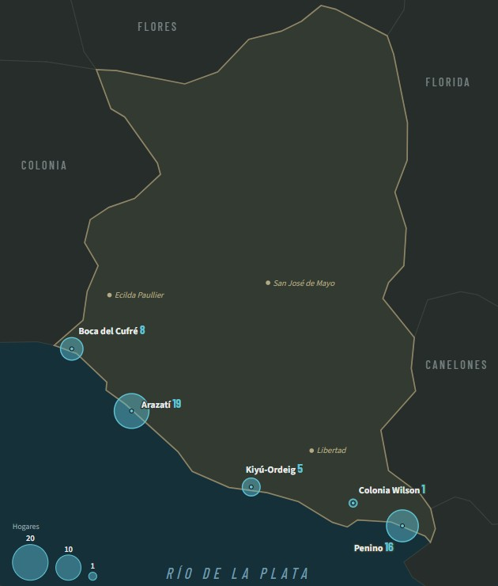
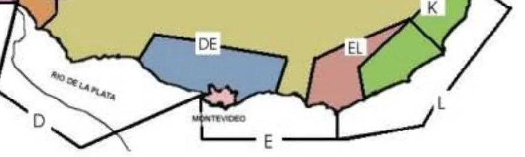

# Presentación y antecedentes

El presente informe fue elaborado por el Instituto Departamental de Estadísticas de la Intendencia de San José en base a los datos del Censo a Pescadores Artesanales del Departamento de San José -2026.

El mencionado Censo fue realizado por iniciativa de la Dirección de Desarrollo con el apoyo del Instituto Departamental de Estadísticas (IDE). El Instituto se encargó del entrenamiento del equipo de encuestadores, diseño del instrumento de recolección, de la prueba del formulario y del procesamiento, análisis y elaboración del informe final.

Para el diseño del censo, se tuvo en cuenta un trabajo desarrollado en forma parcial en 2007, antecedentes nacionales e internacionales y se mantuvieron entrevistas on line con integrantes del Núcleo Interdisciplinario para el Estudio de la Pesca en Uruguay (NIEPU) de la Universidad de la República, y pescadores con experiencia en la costa del Río de la Plata en el departamento de San José.

Aquellos ciudadanos que tengan dudas o requieran información adicional, pueden comunicarse con el IDE-San José a ide\@sanjose.gub.uy o al teléfono +598 43429000 int 1904.

\newpage

# Aspectos metodológicos

La estrategia de abordaje consistió en "barridas" por principales puntos de pesca del departamento apuntando principalmente a relevar los hogares de pescadores. y se realizó mediante identificación directa y, en un segundo paso, por la técnica de bola de nieve que permitió llegar a los pescadores a través de la referencia de sus pares anteriormente contactados.

Se localizaron 78 personas que trabajan en la pesca, pertenecientes a 53 hogares y 62 embarcaciones.

La encuesta se dividió en dos módulos: vivienda, hogares y personas por un lado y por otro, unidades de producción (embarcaciones). Las dimensiones principales fueron: ubicación y tenencia de la vivienda; calidad de la vivienda y servicios básicos; composición del hogar; datos básicos de las personas; educación y salud; arraigo; perfil laboral e ingresos de la pesca; organización, participación y capacitación; percepción de desafíos y problemas. En el módulo relativo a la unidad de producción se identifican las siguientes dimensiones: identificación técnica y formalización; propulsión y seguridad; artes de pesca; esfuerzo y captura, comercialización y precios y finalmente, tripulación.

El trabajo de campo, realizado por un equipo perteneciente a la Dirección de Desarrollo, se aplicó entre el 26 de junio y el 8 de setiembre de 2026.

La información se presenta en tablas y gráficos con su correspondiente lectura. En caso de surgir interés en nuevos cruces de las variables relevadas, el equipo técnico del IDE queda a disposición para su procesamiento. Al final se presenta un capítulo de conclusiones. Los datos fueron procesados con el programa R y el documento fue producido en el entorno Quarto.

\newpage

# Principales resultados

## Hogares y viviendas

En este capítulo se abordan en primer lugar la distribución territorial de los hogares, para luego adentrarnos en las condiciones habitacionales y la composición de los hogares de los pescadores.

```{r}
#| label: setup
#| echo: false
#| warning: false
#| message: false
#| results: hide

library(tidyverse)  
library(readxl)      
library(janitor)     
library(scales)      
library(knitr)       
library(kableExtra)  
library(patchwork)


# Rutas, los excel deben estar en la carpeta del proyecto. No cambiar estas rutas, corren así como están.
ruta_archivo  <- "base_pescadores.xlsx"
embarcaciones <- read_excel("embarcacion_censo_pescadores.xlsx")

hogares       <- read_excel(ruta_archivo, sheet = "_10_de_formulario_0") %>% clean_names()
personas_solo <- read_excel(ruta_archivo, sheet = "personas_pesca_1")    %>% clean_names()

#Limpieza base
hogares       <- hogares       %>% mutate(across(where(is.character), ~ na_if(str_trim(.x), "")))
personas_solo <- personas_solo %>% mutate(across(where(is.character), ~ na_if(str_trim(.x), "")))

hogares       <- hogares       %>% select(where(~ !all(is.na(.x))))
personas_solo <- personas_solo %>% select(where(~ !all(is.na(.x))))

# 2.3 Pasamos a número las columnas que son cantidades
hogares <- hogares %>%
  mutate(
    n_personas_hogar     = as.numeric(n_personas_hogar),
    n_nucleos_familiares = as.numeric(n_nucleos_familiares),
    n_personas_pescan    = as.numeric(n_personas_pescan)
  )

personas_solo <- personas_solo %>%
  mutate(
    edad                    = as.numeric(edad),
    anos_oficio_pesca       = as.numeric(anos_oficio_pesca),
    n_embarcaciones_propias = as.numeric(n_embarcaciones_propias))


datos <-personas_solo %>% left_join(hogares, by="id_hogar")

# 3. ESTILO DEL INFORME 

paleta_pesca   <- c("#1A5276", "#2E86AB", "#48A9A6", "#73AB84", "#A6C36F", "#F4A259", "#C1666B", "#7B506F")
fuente_caption <- "Fuente: Elaboración propia en base a Censo de pescadores artesanales, IDE-San José"

tema_informe <- theme_minimal(base_size = 12) +
  theme(
    plot.title = element_text(face = "bold", size = 11, hjust = 0.5),
    plot.subtitle = element_text(size = 9, hjust = 0.5, color = "gray40"),
    plot.caption = element_text(size = 8, color = "gray50", hjust = 1),
    panel.grid.minor = element_blank(),
    panel.grid.major.y = element_blank(),
    plot.background = element_rect(fill = "white", color = NA)
  )

# 4. FUNCIONES AUXILIARES

tabla_frecuencias <- function(df, var) {
  df %>%
    filter(!is.na(.data[[var]])) %>%      
    count(.data[[var]], name = "n") %>%   
    mutate(pct = round(100 * n / sum(n), 1)) %>%  
    arrange(desc(n))                      
}

# tabla_frecuencias_ordenada
tabla_frecuencias_ordenada <- function(df, var, niveles, etiquetas = niveles) {
  df %>%
    filter(!is.na(.data[[var]])) %>%
    mutate(!!var := factor(.data[[var]], levels = niveles, labels = etiquetas)) %>%
    count(.data[[var]], name = "n", .drop = FALSE) %>%
    mutate(pct = round(100 * n / sum(n), 1))
}


grafico_barras_estilo <- function(tabla, var, titulo, subtitulo = NULL) {
  ggplot(tabla, aes(x = reorder(.data[[var]], pct), y = pct, fill = .data[[var]])) +
    geom_col(width = 0.7, show.legend = FALSE) +                          
    geom_text(aes(label = paste0(pct, "%")), hjust = -0.15, size = 3.2) + 
    coord_flip(clip = "off") +                                            
    scale_fill_manual(values = rep(paleta_pesca, length.out = nrow(tabla))) +
    scale_y_continuous(expand = expansion(mult = c(0, 0.18))) +           
    labs(
      title = toupper(titulo), subtitle = subtitulo,
      caption = fuente_caption, x = NULL, y = NULL
    ) +
    tema_informe
}
```

La siguiente tabla indica la distribución de los hogares y la cantidad de personas por localidad que trabajan en la pesca artesanal[^1]. En total se relevaron 53 hogares de pescadores artesanales, en los cuales residen 159 personas de los que se identificaron a 78 que trabajan en la pesca artesanal. El promedio es de 3 personas por hogar. Hay que señalar que dos pares de hogares comparten vivienda. .

[^1]: Más adelante se profundiza sobre los "desmalladores", otro grupo personas ocupadas en la actividad productiva

La mayor concentración de hogares y personas se encuentran en Arazatí y Penino respectivamente que reúnen en ambas categorías alrededor de las dos terceras partes de las unidades relevadas. Luego se encuentran Boca del Cufré , Kiyú y Ordeig, otras y por últimos Colonia Wilson. Hay cuatro hogares que comparten viviendas

```{r}
#| echo: false
#| warning: false

recode_localidad <- function(x) {
  recode(x,
    "arazati"       = "Arazatí",
    "penino"        = "Penino",
    "kiyu_ordeig"   = "Kiyú-Ordeig",
    "boca_cufre"    = "Boca del Cufré",
    "coloniawilson" = "Colonia Wilson",
    "otra"          = "Otras"
  )
}

# 1. Hogares por localidad
hogares_por_localidad <- hogares %>%
  mutate(localidad = recode_localidad(localidad)) %>%
  count(localidad, name = "Hogares (n)")

# 2. Personas por localidad
personas_por_localidad <- datos %>%
  mutate(localidad = recode_localidad(localidad)) %>%
  count(localidad, name = "Personas (n)")

# 3. Juntamos las dos tablas por localidad y calculamos los porcentajes
tabla_localidad <- hogares_por_localidad %>%
  left_join(personas_por_localidad, by = "localidad") %>%
  mutate(
    "Hogares (%)"  = round(100 * `Hogares (n)` / sum(`Hogares (n)`), 1),
    "Personas (%)" = round(100 * `Personas (n)` / sum(`Personas (n)`), 1)
  ) %>%
  rename(Localidad = localidad) %>%
  arrange(desc(`Hogares (n)`)) %>%
  select(Localidad, `Hogares (n)`, `Hogares (%)`, `Personas (n)`, `Personas (%)`)

fila_total <- tibble(
  Localidad      = "Total",
  "Hogares (n)"  = sum(tabla_localidad$`Hogares (n)`),
  "Hogares (%)"  = 100,
  "Personas (n)" = sum(tabla_localidad$`Personas (n)`),
  "Personas (%)" = 100
)
tabla_localidad <- bind_rows(tabla_localidad, fila_total)

# 5. Mostramos la tabla con estilo, con la fila de Total en negrita
tabla_localidad %>%
  kbl(caption = "Hogares y personas dedicadas a la pesca por localidad") %>%
  kable_styling(latex_options = "HOLD_position", full_width = FALSE, position = "left") %>%
  row_spec(nrow(tabla_localidad), bold = TRUE, extra_css = "border-top: 1px solid #333;")

```

\newpage



\newpage

### Viviendas

En primer lugar se podrá visualizar la forma de tenencia de los terrenos donde están las viviendas de los hogares con personas que trabajan en la pesca.

```{r}
#| echo: false

tabla_frecuencias(hogares, "tenencia_terreno") %>%
  grafico_barras_estilo("tenencia_terreno", "Tenencia del terreno por hogares")


```

Como se observa, más del 41,5% de los hogares dicen ser propietarios del terreno, un 32% ocupantes, un 17% dicen que residen sobre un terreno prestado y un 9% son arrendatarios. De la categoría ocupantes, hay que señalar que el 75% ocupan predios públicos mientras que el resto dice estar ocupando predios privados. La mayor cantidad de ocupantes, las dos terceras partes, están en Arazatí y Boca del Cufré.

\newpage

El gráfico siguiente muestra las condiciones de materialidad de la vivienda de los 53 hogares de pescadores.

```{r}
#| echo: false

grafico_en_paneles <- function(tabla, colores, titulo, subtitulo = NULL) {

  tabla <- tabla %>%
    arrange(dimension, pct) %>%
    mutate(categoria_orden = factor(
      paste(categoria, dimension, sep = "___"),
      levels = paste(categoria, dimension, sep = "___")
    ))

  ggplot(tabla, aes(x = categoria_orden, y = pct, fill = dimension)) +
    geom_col(width = 0.7, show.legend = FALSE) +
    geom_text(aes(label = paste0(pct, "%")), hjust = -0.15, size = 3) +
    coord_flip(clip = "off") +
    facet_wrap(~dimension, scales = "free_y", ncol = 1) +   # un panel por dimension
    # le sacamos a las etiquetas del eje el sufijo "___panel" que agregamos arriba
    scale_x_discrete(labels = function(x) sub("___.*$", "", x)) +
    scale_fill_manual(values = colores) +
    scale_y_continuous(expand = expansion(mult = c(0, 0.18))) +
    labs(title = titulo, subtitle = subtitulo, caption = fuente_caption, x = NULL, y = NULL) +
    tema_informe
}

# Materialidad de la vivienda
tabla_materialidad <- bind_rows(
  tabla_frecuencias(
    hogares %>% mutate(material_paredes = recode(material_paredes,
      "bloque_ladrillo"   = "Bloque/ladrillo",
      "madera_costaneros" = "Madera/costaneros",
      "chapa"             = "Chapa",
      "desecho"           = "Desecho",
      "otro"              = "Otro"
    )),
    "material_paredes"
  ) %>% rename(categoria = material_paredes) %>% mutate(dimension = "Paredes", .before = 1),

  tabla_frecuencias(
    hogares %>% mutate(material_piso = recode(material_piso,
      "hormigon" = "Hormigón",
      "ceramica" = "Cerámica",
      "madera"   = "Madera",
      "tierra"   = "Tierra",
      "otro"     = "Otro"
    )),
    "material_piso"
  ) %>% rename(categoria = material_piso) %>% mutate(dimension = "Piso", .before = 1),

  tabla_frecuencias(
    hogares %>% mutate(material_techo = recode(material_techo,
      "chapa_liviano" = "Chapa liviana",
      "planchada"     = "Planchada",
      "desecho"       = "Desecho",
      "otro"          = "Otro"
    )),
    "material_techo"
  ) %>% rename(categoria = material_techo) %>% mutate(dimension = "Techo", .before = 1)
)

# Graficamos los 3 paneles juntos con la función grafico_en_paneles() de arriba
grafico_en_paneles(
  tabla_materialidad,
  colores   = paleta_pesca[c(1, 3, 6)],
  titulo    = "MATERIALIDAD DE LA VIVIENDA",
  subtitulo = "Material predominante de paredes, piso y techo"
)
```

Se observa que más del 62% tienen paredes de bloque o ladrillo mientras que el resto se describe como de materiales de menor calidad. En cuanto a los pisos, 53% tienen hormigón o cerámica y respecto a los techos, el 83% son de chapa, un 11% de planchada y un 6% de desecho u otro. Si se considera la materialidad de algunos de los tres componentes, se puede observar que casi un 40% tiene paredes con materiales precarios, un 12% pisos precarios y casi un 6% techos precarios.

\newpage

```{r}
#| echo: false

tabla_servicios <- bind_rows(
  tabla_frecuencias(
    hogares %>% mutate(alumbrado_electrico = recode(alumbrado_electrico,
      "ute"      = "UTE",
      "solar"    = "Solar",
      "no_tiene" = "No tiene"
    )),
    "alumbrado_electrico"
  ) %>% rename(categoria = alumbrado_electrico) %>% mutate(dimension = "Alumbrado eléctrico", .before = 1),

  tabla_frecuencias(
    hogares %>% mutate(origen_agua = recode(origen_agua,
      "ose"  = "OSE",
      "pozo" = "Pozo",
      "otro" = "Otro"
    )),
    "origen_agua"
  ) %>% rename(categoria = origen_agua) %>% mutate(dimension = "Origen del agua", .before = 1),

  tabla_frecuencias(
    hogares %>% mutate(evacuacion_bano = recode(evacuacion_bano,
      "pozo_negro" = "Pozo negro",
      "entubado"   = "Entubado (saneamiento)",
      "otro"       = "Otro"
    )),
    "evacuacion_bano"
  ) %>% rename(categoria = evacuacion_bano) %>% mutate(dimension = "Evacuación del baño", .before = 1)
)

grafico_en_paneles(
  tabla_servicios,
  colores   = paleta_pesca[c(2, 4, 7)],
  titulo    = "SERVICIOS BÁSICOS DEL HOGAR",
  subtitulo = "Alumbrado eléctrico, origen del agua y evacuación del baño"
)
```

En cuanto a servicios básicos, en el gráfico superior se observa que la gran mayoría cuenta con energía eléctrica de UTE, un 2% explota energía solar y otro 2% asegura no tener ninguna de estas fuentes energéticas. La evacuación de las aguas servidas en las tres cuartas partes de los casos se hace hacia pozo negro, casi una quinta parte a "otro" destino y el 6% a saneamiento. Con relación del agua de consumo y de uso familiar, 77% dice utilizar agua de OSE, una quinta parte "otra" fuente y un 4% se abastece desde "pozo". Entre quienes dicen que se abastecen de "otra" fuente, algunos entrevistados afirmaron que recogen agua de lluvia y otros que traen en bidones o le acercan agua familiares.

\newpage

### Composición de los hogares

Los hogares tienen un tamaño promedio de 3 personas, lo cual es 0,5 puntos porcentuales mayor que el tamaño promedio de los hogares uruguayos y los del departamento.

En 37 de los hogares (70%), la persona entrevistada convive con su cónyuge. En dos hogares, se informó la presencia de personas con discapacidad.

Se relevaron 14 menores de 18 años que no se encontraban escolarizados, los cuales se encuentran en un 26,4% del total de hogares, tal como se aprecia en la siguiente gráfica.

```{r}
#| echo: false

promedio_personas_hogar <- round(mean(hogares$n_personas_hogar, na.rm = TRUE), 1)
total_personas_pescan   <- sum(hogares$n_personas_pescan, na.rm = TRUE)
n_menor_no_escolarizado <- sum(hogares$menor_no_escolarizado == "si", na.rm = TRUE)
n_hogares_total         <- n_distinct(hogares$id_hogar)
conyuge<-sum(hogares$tiene_conyuge == "si")
discapacidad <-sum(hogares$hay_discapacidad=="si")
```

```{r}
#| echo: false

tabla_frecuencias(hogares, "menor_no_escolarizado") %>%
  grafico_barras_estilo("menor_no_escolarizado", "Porcentaje de hogares con menores no escolarizados")
```

\newpage

## Caracterización demográfica, educativa y de salud de las personas que trabajan en la pesca

En los siguientes gráficos observamos algunas características demográficas de las personas que declararon trabajar en la pesca artesanal.

```{r}
#| echo: false
# Sexo de las personas que pescan
tabla_frecuencias(personas_solo, "sexo") %>%
  grafico_barras_estilo("sexo", "Sexo de las personas que trabajan en la pesca")

```

El gráfico da cuenta que el 77% son varones y el 23% mujeres. De las mujeres, el 70% tienen 45 años o menos.

\newpage

```{r}
#| echo: false
# Tramos de edad (ajustar los cortes acá si se quiere otra apertura)
cortes_edad    <- c(-Inf, 24, 39, 54, 64, Inf)
etiquetas_edad <- c("Menos de 25", "25 a 39", "40 a 54", "55 a 64", "65 y más")

# cut() convierte la edad (número) en el tramo que le corresponde (texto)
personas_solo <- personas_solo %>%
  mutate(grupo_edad = cut(edad, breaks = cortes_edad, labels = etiquetas_edad, right = TRUE))

# Distribución de edad por tramo
tabla_edad <- personas_solo %>%
  filter(!is.na(grupo_edad)) %>%
  count(grupo_edad, name = "n") %>%
  mutate(pct = round(100 * n / sum(n), 1))


ggplot(tabla_edad, aes(x = grupo_edad, y = pct, fill = grupo_edad)) +
  geom_col(width = 0.65, show.legend = FALSE) +
  geom_text(aes(label = paste0(pct, "%")), vjust = -0.5, size = 3.8, fontface = "bold") +
  scale_fill_manual(values = rep(paleta_pesca, length.out = nrow(tabla_edad))) +
  scale_y_continuous(expand = expansion(mult = c(0, 0.15))) +
  labs(
    title = "DISTRIBUCIÓN DE EDAD DE LAS PERSONAS QUE TRABAJAN EN PESCA",
    subtitle = "Porcentaje de personas por tramo de edad",
    caption = fuente_caption, x = NULL, y = "%"
  ) +
  tema_informe
```

Según la distribución por edades, se observa que el intervalo modal está entre los 40 y los 54 años, grupo que representa el 40% de los pescadores. El 27% está entre 25 y 39 años, el 16% entre 55 y 64 años y el resto se distribuye en proporciones casi iguales en los extremos de la distribución. Resumiendo, las tres cuartas partes de los/las pescadores/as tienen menos de 55 años.

\newpage

```{r}
#| echo: false

tabla_frecuencias_ordenada(
  personas_solo, "nivel_educativo",
  niveles   = c("primaria", "secundaria_1", "secundaria_2", "terciaria"),
  etiquetas = c("Primaria", "Primer ciclo", "Segundo ciclo", "Terciaria")
) %>%
  grafico_barras_estilo("nivel_educativo", "Máximo nivel educativo alcanzado")
```

Por educación formal completada, se observa que 72% completó hasta primaria, casi un 15% Ciclo Básico, un 9% alcanzó a realizar Enseñanza Media Superior y un 4% Educación Terciaria.

\newpage

```{r}
#| echo: false

tabla_frecuencias(
  personas_solo %>% mutate(cobertura_salud = recode(cobertura_salud,
    "publica_asse" = "ASSE",
    "privada"      = "Privada"
  )),
  "cobertura_salud"
) %>%
  grafico_barras_estilo("cobertura_salud", "Cobertura de salud")
```

En cuanto a la cobertura de salud, se constató que el 84% se atiende en los servicios de ASSE y un 16% tiene cobertura privada.

\newpage

```{r}
#| echo: false

tabla_frecuencias(
  personas_solo %>% mutate(tiempo_residencia_zona = recode(tiempo_residencia_zona,
    "mas2a"        = "Más de 2 años",
    "6m_1a"        = "De 6 meses a 1 año",
    "no_vive_zona" = "No vive en la zona"
  )),
  "tiempo_residencia_zona"
) %>%
  grafico_barras_estilo("tiempo_residencia_zona", "Tiempo de residencia en la zona")
```

En el gráfico anterior se observa la distribución porcentual por tiempo de residencia en el lugar de trabajo. Cómo se ve, casi todos tienen un tiempo de permanencia en sus respectivas localidades superior a los dos años. Un 1,3% dijo que está en el lugar hace un año o menos y un porcentaje similar no vive en la zona donde trabaja.

\newpage

## Actividad pesquera

### Trayectoria y rol

En el siguiente gráfico se observa los años de trayectoria que tienen los pescadores.

```{r}
#| echo: false

# --- 1. Procesamiento de datos ---
trayectoria <- datos %>% 
  mutate(Tramos_antiguedad = case_when(
    anos_oficio_pesca < 10 ~ "Menos de 10 años",
    anos_oficio_pesca >= 10 & anos_oficio_pesca < 25 ~ "De 10 a 25 años",
    anos_oficio_pesca >= 25 ~ "25 años o más",
    TRUE ~ "Sin dato"
  )) %>%
  group_by(Tramos_antiguedad) %>% 
  summarise(Cantidad = n(), .groups = "drop") %>% 
  mutate(
    Porcentaje = round(Cantidad / sum(Cantidad) * 100, 1),
    Porcentaje_formateado = paste0(Porcentaje, "%"),
    Tramos_antiguedad = factor(Tramos_antiguedad,
      levels = c("Menos de 10 años", "De 10 a 25 años", "25 años o más", "Sin dato"))
  )

# --- 2. Definir tamaño del agujero (hsize) ---
hsize <- 2

# --- 4. Gráfico de rosca ---
ggplot(trayectoria, aes(x = hsize, y = Porcentaje, fill = Tramos_antiguedad)) +
  geom_col(color = "white", width = 1) +
  geom_text(aes(label = Porcentaje_formateado),
            size = 4,
            position = position_stack(vjust = 0.5),
            fontface = "bold",
            color = "white") +
  coord_polar(theta = "y") +
  scale_fill_manual(values = paleta_pesca) +
  xlim(c(0.2, hsize + 0.5)) +
  labs(
    title   = "DISTRIBUCIÓN POR TRAMOS DE ANTIGÜEDAD EN EL OFICIO",
    fill    = "Tramos de antigüedad",
    caption = fuente_caption
  ) +
  tema_informe +
  theme(
    axis.title = element_blank(),
    axis.ticks = element_blank(),
    axis.text  = element_blank(),
    panel.grid = element_blank(),
    legend.title = element_text(size = 10),
    legend.text  = element_text(size = 9)
  )

```

Como se ve, la mitad tiene una trayectoria media en el rubro: de 10 a 25 años, la cuarta parte más de 25 años y una quinta parte, menos de 10 años. De un 4% no se obtuvo datos.

\newpage

```{r}
#| echo: false
datos <- datos %>%
  mutate(
    rol_principal_pesca = trimws(rol_principal_pesca),
    # ¿Es multirrespuesta?
    multi_rol = grepl(",", rol_principal_pesca),
    # Rol jerarquizado: si tiene patrón, gana patrón; si no, el primero listado
    rol_jerarquizado = case_when(
      is.na(rol_principal_pesca) | rol_principal_pesca == "" ~ "Sin dato",
      grepl("patron_duenio", rol_principal_pesca) ~ "Patrón / dueño",
      grepl("marinero_tripulante", rol_principal_pesca) ~ "Marinero / tripulante",
      grepl("procesamiento", rol_principal_pesca) ~ "Procesamiento",
      grepl("venta_directa|comercializacion_publico", rol_principal_pesca) ~ "Comercialización",
      grepl("apoyo_tierra", rol_principal_pesca) ~ "Apoyo en tierra",
      grepl("construccion_artes", rol_principal_pesca) ~ "Construcción de artes",
      TRUE ~ "Otro"
    ),
    # Etiqueta legible
    Rol = recode(rol_jerarquizado,
      "Patrón / dueño"       = "Patrón / dueño",
      "Marinero / tripulante"= "Marinero / tripulante",
      "Procesamiento"        = "Procesamiento",
      "Comercialización"     = "Comercialización",
      "Apoyo en tierra"      = "Apoyo en tierra",
      "Construcción de artes"= "Construcción de artes",
      "Otro"                 = "Otro",
      "Sin dato"             = "Sin dato"
    )
  )

# Resumen
roles_resumen <- datos %>%
  count(Rol, name = "Cantidad") %>%
  mutate(
    Porcentaje = round(Cantidad / sum(Cantidad) * 100, 1),
    Porcentaje_formateado = paste0(Porcentaje, "%")
  ) %>%
  arrange(desc(Cantidad))

orden <- c("Patrón / dueño", "Marinero / tripulante", "Procesamiento",
           "Comercialización", "Apoyo en tierra", "Construcción de artes",
           "Otro", "Sin dato")
roles_resumen <- roles_resumen %>%
  mutate(Rol = factor(Rol, levels = rev(orden[orden %in% Rol])))

ggplot(roles_resumen, aes(x = Rol, y = Porcentaje, fill = Rol)) +
  geom_col(width = 0.65, show.legend = FALSE) +
  geom_text(aes(label = paste0(Porcentaje, "%")), 
            hjust = -0.15, size = 3.8, fontface = "bold") +
  scale_fill_manual(values = rep(paleta_pesca, length.out = nrow(roles_resumen))) +
  scale_y_continuous(expand = expansion(mult = c(0, 0.15))) +
  coord_flip() +
  labs(
    title = "DISTRIBUCIÓN POR ROL PRINCIPAL EN LA PESCA",
    subtitle = "Porcentaje de personas según rol jerarquizado",
    caption = fuente_caption, x = NULL, y = NULL
  ) +
  tema_informe


```

En cuanto al rol en la pesca (gráfico superior), se observa que el 77% son patrones, un 11,5% marineros, un 4% trabaja en el procesamiento del pescado y el resto se distribuye en otros roles o no sin información.

\newpage

### Embarcaciones y permisos

En los gráficos siguientes vemos la situación respecto a la propiedad de las embarcaciones y la formalización de las mismas.

```{r}
#| echo: false

library(patchwork)

# --- 1. NA -> "Sin dato" ---
datos <- datos %>%
  mutate(
    tiene_embarcacion_propia = ifelse(is.na(tiene_embarcacion_propia), "Sin dato", tiene_embarcacion_propia),
    tiene_libreta_prefectura = ifelse(is.na(tiene_libreta_prefectura), "Sin dato", tiene_libreta_prefectura)
  )

# --- 2. Tablas resumen ---
tabla_emb <- datos %>%
  count(tiene_embarcacion_propia, name = "Cantidad") %>%
  mutate(
    Porcentaje = round(Cantidad / sum(Cantidad) * 100, 1),
    Porcentaje_formateado = paste0(Porcentaje, "%")
  ) %>%
  mutate(tiene_embarcacion_propia = factor(
    tiene_embarcacion_propia, levels = c("si", "no", "Sin dato")
  )) %>%
  arrange(tiene_embarcacion_propia)

tabla_lib <- datos %>%
  count(tiene_libreta_prefectura, name = "Cantidad") %>%
  mutate(
    Porcentaje = round(Cantidad / sum(Cantidad) * 100, 1),
    Porcentaje_formateado = paste0(Porcentaje, "%")
  ) %>%
  mutate(tiene_libreta_prefectura = factor(
    tiene_libreta_prefectura, levels = c("si", "no", "Sin dato")
  )) %>%
  arrange(tiene_libreta_prefectura)

# --- 3. Rosca 1: embarcación ---
hsize <- 2

g_emb <- ggplot(tabla_emb, aes(x = hsize, y = Porcentaje, fill = tiene_embarcacion_propia)) +
  geom_col(color = "white", width = 1) +
  geom_text(aes(label = Porcentaje_formateado),
            size = 4, position = position_stack(vjust = 0.5),
            fontface = "bold", color = "white") +
  coord_polar(theta = "y") +
  scale_fill_manual(
    values = paleta_pesca,
    name   = "Respuesta",
    labels = c("si" = "Sí", "no" = "No", "Sin dato" = "Sin dato")
  ) +
  xlim(c(0.2, hsize + 0.5)) +
  labs(title = "EMBARCACIÓN PROPIA",
       subtitle = "Porcentaje de pescadores según tenencia") +
  tema_informe +
  theme(axis.title = element_blank(), axis.ticks = element_blank(),
        axis.text = element_blank(), panel.grid = element_blank(),
        legend.title = element_text(size = 10),
        legend.text = element_text(size = 9))

# --- 4. Rosca 2: libreta ---
g_lib <- ggplot(tabla_lib, aes(x = hsize, y = Porcentaje, fill = tiene_libreta_prefectura)) +
  geom_col(color = "white", width = 1) +
  geom_text(aes(label = Porcentaje_formateado),
            size = 4, position = position_stack(vjust = 0.5),
            fontface = "bold", color = "white") +
  coord_polar(theta = "y") +
  scale_fill_manual(
    values = paleta_pesca,
    name   = "Respuesta",
    labels = c("si" = "Sí", "no" = "No", "Sin dato" = "Sin dato")
  ) +
  xlim(c(0.2, hsize + 0.5)) +
  labs(title = "LIBRETA DE PREFECTURA",
       subtitle = "Porcentaje de pescadores según tenencia") +
  tema_informe +
  theme(axis.title = element_blank(), axis.ticks = element_blank(),
        axis.text = element_blank(), panel.grid = element_blank(),
        legend.title = element_text(size = 10),
        legend.text = element_text(size = 9))

# --- 5. Panel único con UNA sola leyenda y UN solo caption ---
g_emb + g_lib +
  plot_layout(guides = "collect") +
  plot_annotation(
    title   = "TENENCIA DE ACTIVOS Y HABILITACIONES",
    caption = fuente_caption,
    theme   = theme(
      plot.title   = element_text(face = "bold", size = 12, hjust = 0.5),
      plot.caption = element_text(size = 8, color = "gray50", hjust = 1)
    )
  ) &
  theme(legend.position = "bottom")
```

En total se relevaron 62 embarcaciones. De quienes tienen embarcación propia, la gran mayoría informó tener sólo una, excepto seis casos que afirman tener dos cada uno

Un 72% de las personas que trabajan en la pesca dijeron ser propietarios de sus embarcaciones, un 17% dijo no serlo, mientras que un 11,5% no informó al respecto.

En cuanto a la libreta de prefectura, un 65% de los pescadores dijo tenerla; casi una cuarta parte (23%), dijo estar embarcándose sin libreta y un 11,5% no aportó información al respecto.

Al ser consultados si contaban con permiso de pesca se constató que un 39% de estas embarcaciones, están trabajando sin la habilitación correspondiente.

\newpage

### Formalización laboral

En cuanto a la formalización laboral, la información se presenta en los gráficos que siguen.

```{r}
#| echo: false

# --- 1. Limpieza: NA, vacíos y variantes -> "si" / "no" / "Sin dato" ---
datos <- datos %>%
  mutate(
    aporta_bps = trimws(as.character(aporta_bps)),
    aporta_bps = case_when(
      is.na(aporta_bps) | aporta_bps == "" ~ "Sin dato",
      tolower(aporta_bps) %in% c("si", "sí", "s") ~ "si",
      tolower(aporta_bps) %in% c("no", "n")      ~ "no",
      TRUE ~ "Sin dato"
    )
  )

# --- 2. Tabla resumen ---
tabla_bps <- datos %>%
  count(aporta_bps, name = "Cantidad") %>%
  mutate(
    Porcentaje = round(Cantidad / sum(Cantidad) * 100, 1),
    Porcentaje_formateado = paste0(Porcentaje, "%")
  ) %>%
  mutate(aporta_bps = factor(
    aporta_bps, levels = c("si", "no", "Sin dato")
  )) %>%
  arrange(aporta_bps)

# --- 3. Rosca ---
hsize <- 2

ggplot(tabla_bps, aes(x = hsize, y = Porcentaje, fill = aporta_bps)) +
  geom_col(color = "white", width = 1) +
  geom_text(aes(label = Porcentaje_formateado),
            size = 4, position = position_stack(vjust = 0.5),
            fontface = "bold", color = "white") +
  coord_polar(theta = "y") +
  scale_fill_manual(
    values = paleta_pesca,
    name   = "Respuesta",
    labels = c("si" = "Sí", "no" = "No", "Sin dato" = "Sin dato")
  ) +
  xlim(c(0.2, hsize + 0.5)) +
  labs(
    title    = "APORTES A BPS",
    subtitle = "Porcentaje de pescadores según aporte",
    caption  = fuente_caption
  ) +
  tema_informe +
  theme(
    axis.title = element_blank(), axis.ticks = element_blank(),
    axis.text  = element_blank(), panel.grid = element_blank(),
    legend.title = element_text(size = 10),
    legend.text  = element_text(size = 9)
  )
```

Un 64% informó que no hace aportes al BPS, un 31% sí los hace y un 5% no aportó información al respecto.

Entre quienes aportan, la forma predominante es el monotributo (80%).

\newpage

```{r}
#| echo: false

library(dplyr)
library(ggplot2)

# --- 1. Limpieza: NA y vacíos -> "Sin dato" ---
datos <- datos %>%
  mutate(
    relacion_laboral = trimws(as.character(relacion_laboral)),
    relacion_laboral = case_when(
      is.na(relacion_laboral) | relacion_laboral == "" ~ "Sin dato",
      TRUE ~ relacion_laboral
    )
  )

# --- 2. Tabla resumen ---
tabla_rel <- datos %>%
  count(relacion_laboral, name = "Cantidad") %>%
  mutate(
    pct = round(Cantidad / sum(Cantidad) * 100, 1)
  ) %>%
  arrange(desc(pct))

# --- 3. Ordenar: categorías reales por frecuencia desc, "Sin dato" al final ---
tabla_rel <- tabla_rel %>%
  mutate(es_sin_dato = relacion_laboral == "Sin dato") %>%
  arrange(es_sin_dato, desc(pct)) %>%
  mutate(relacion_laboral = factor(relacion_laboral, levels = rev(relacion_laboral)))

# --- 4. Barras horizontales ---
ggplot(tabla_rel, aes(x = relacion_laboral, y = pct, fill = relacion_laboral)) +
  geom_col(width = 0.65, show.legend = FALSE) +
  geom_text(aes(label = paste0(pct, "%")),
            hjust = -0.15, size = 3.8, fontface = "bold") +
  scale_fill_manual(values = rep(paleta_pesca, length.out = nrow(tabla_rel))) +
  scale_y_continuous(expand = expansion(mult = c(0, 0.15))) +
  coord_flip() +
  labs(
    title    = "DISTRIBUCIÓN POR RELACIÓN LABORAL",
    subtitle = "Porcentaje de pescadores según relación laboral",
    caption  = fuente_caption,
    x = NULL, y = NULL
  ) +
  tema_informe
```

En cuanto a la relación laboral, se observa que un 56% trabajan por cuenta propia; un 5% son asalariados dependientes; un 3% dicen ser familiares no remunerados, mientras que un 36% no aportó información al respecto.

\newpage

### Fuente de ingresos

En primer lugar se presentan datos sobre la continuidad laboral de los pescadores.

```{r}
#| echo: false


# --- 1. Limpieza: NA, vacíos y variantes -> "si" / "no" / "Sin dato" ---
datos <- datos %>%
  mutate(
    trabaja_todo_ano = trimws(as.character(trabaja_todo_ano)),
    trabaja_todo_ano = case_when(
      is.na(trabaja_todo_ano) | trabaja_todo_ano == "" ~ "Sin dato",
      tolower(trabaja_todo_ano) %in% c("si", "sí", "s") ~ "si",
      tolower(trabaja_todo_ano) %in% c("no", "n")      ~ "no",
      TRUE ~ "Sin dato"
    )
  )

# --- 2. Tabla resumen ---
tabla_trabajo <- datos %>%
  count(trabaja_todo_ano, name = "Cantidad") %>%
  mutate(
    Porcentaje = round(Cantidad / sum(Cantidad) * 100, 1),
    Porcentaje_formateado = paste0(Porcentaje, "%")
  ) %>%
  mutate(trabaja_todo_ano = factor(
    trabaja_todo_ano, levels = c("si", "no", "Sin dato")
  )) %>%
  arrange(trabaja_todo_ano)

# --- 3. Rosca ---
hsize <- 2

ggplot(tabla_trabajo, aes(x = hsize, y = Porcentaje, fill = trabaja_todo_ano)) +
  geom_col(color = "white", width = 1) +
  geom_text(aes(label = Porcentaje_formateado),
            size = 4, position = position_stack(vjust = 0.5),
            fontface = "bold", color = "white") +
  coord_polar(theta = "y") +
  scale_fill_manual(
    values = paleta_pesca,
    name   = "Respuesta",
    labels = c("si" = "Sí", "no" = "No", "Sin dato" = "Sin dato")
  ) +
  xlim(c(0.2, hsize + 0.5)) +
  labs(
    title    = "TRABAJO DURANTE TODO EL AÑO",
    subtitle = "Porcentaje de pescadores según continuidad laboral",
    caption  = fuente_caption
  ) +
  tema_informe +
  theme(
    axis.title = element_blank(), axis.ticks = element_blank(),
    axis.text  = element_blank(), panel.grid = element_blank(),
    legend.title = element_text(size = 10),
    legend.text  = element_text(size = 9)
  )

```

En el gráfico anterior se ve que un 83% de los pescadores dicen que trabajan en la actividad durante todo el año, un 13% dice que no y 4% no informó.

De quienes no trabajan durante todo el año, todos se concentran en partes del segundo semestre hasta el mes de febrero.

\newpage

Respecto a la fuentes de ingresos se presentan los siguientes datos.

```{r}
#| echo: false

# ============================================================
# 1. LIMPIEZA
# ============================================================
datos <- datos %>%
  mutate(
    # otras_actividades_remuneradas: si/no
    otras_actividades_remuneradas = trimws(as.character(otras_actividades_remuneradas)),
    otras_actividades_remuneradas = case_when(
      is.na(otras_actividades_remuneradas) | otras_actividades_remuneradas == "" ~ "Sin dato",
      tolower(otras_actividades_remuneradas) %in% c("si", "sí", "s") ~ "si",
      tolower(otras_actividades_remuneradas) %in% c("no", "n")      ~ "no",
      TRUE ~ "Sin dato"
    ),
    # pesca_principal_ingreso: si/no
    pesca_principal_ingreso = trimws(as.character(pesca_principal_ingreso)),
    pesca_principal_ingreso = case_when(
      is.na(pesca_principal_ingreso) | pesca_principal_ingreso == "" ~ "Sin dato",
      tolower(pesca_principal_ingreso) %in% c("si", "sí", "s") ~ "si",
      tolower(pesca_principal_ingreso) %in% c("no", "n")      ~ "no",
      TRUE ~ "Sin dato"
    )
  )

# ============================================================
# 2. TABLAS RESUMEN
# ============================================================
tabla_pesca <- datos %>%
  count(pesca_principal_ingreso, name = "Cantidad") %>%
  mutate(
    Porcentaje = round(Cantidad / sum(Cantidad) * 100, 1),
    Porcentaje_formateado = paste0(Porcentaje, "%")
  ) %>%
  mutate(pesca_principal_ingreso = factor(
    pesca_principal_ingreso, levels = c("si", "no", "Sin dato")
  )) %>%
  arrange(pesca_principal_ingreso)

tabla_otras <- datos %>%
  count(otras_actividades_remuneradas, name = "Cantidad") %>%
  mutate(
    Porcentaje = round(Cantidad / sum(Cantidad) * 100, 1),
    Porcentaje_formateado = paste0(Porcentaje, "%")
  ) %>%
  mutate(otras_actividades_remuneradas = factor(
    otras_actividades_remuneradas, levels = c("si", "no", "Sin dato")
  )) %>%
  arrange(otras_actividades_remuneradas)

# ============================================================
# 3. ROSCA 1: pesca principal ingreso
# ============================================================
hsize <- 2

g_pesca <- ggplot(tabla_pesca, aes(x = hsize, y = Porcentaje, fill = pesca_principal_ingreso)) +
  geom_col(color = "white", width = 1) +
  geom_text(aes(label = Porcentaje_formateado),
            size = 4, position = position_stack(vjust = 0.5),
            fontface = "bold", color = "white") +
  coord_polar(theta = "y") +
  scale_fill_manual(
    values = paleta_pesca,
    name   = "Respuesta",
    labels = c("si" = "Sí", "no" = "No", "Sin dato" = "Sin dato")
  ) +
  xlim(c(0.2, hsize + 0.5)) +
  labs(title = "PESCA COMO PRINCIPAL INGRESO",
       subtitle = "Pescadores según ingreso principal (%)") +
  tema_informe +
  theme(axis.title = element_blank(), axis.ticks = element_blank(),
        axis.text = element_blank(), panel.grid = element_blank(),
        legend.title = element_text(size = 10),
        legend.text = element_text(size = 9))

# ============================================================
# 4. ROSCA 2: otras actividades remuneradas
# ============================================================
g_otras <- ggplot(tabla_otras, aes(x = hsize, y = Porcentaje, fill = otras_actividades_remuneradas)) +
  geom_col(color = "white", width = 1) +
  geom_text(aes(label = Porcentaje_formateado),
            size = 4, position = position_stack(vjust = 0.5),
            fontface = "bold", color = "white") +
  coord_polar(theta = "y") +
  scale_fill_manual(
    values = paleta_pesca,
    name   = "Respuesta",
    labels = c("si" = "Sí", "no" = "No", "Sin dato" = "Sin dato")
  ) +
  xlim(c(0.2, hsize + 0.5)) +
  labs(title = "OTRAS ACTIVIDADES",
       subtitle = "Pescadores según actividades extra (%)") +
  tema_informe +
  theme(axis.title = element_blank(), axis.ticks = element_blank(),
        axis.text = element_blank(), panel.grid = element_blank(),
        legend.title = element_text(size = 10),
        legend.text = element_text(size = 9))

# ============================================================
# 5. PANEL ÚNICO
# ============================================================
g_pesca + g_otras +
  plot_layout(guides = "collect") +
  plot_annotation(
    title   = "PESCA COMO INGRESO PRINCIPAL Y PLURIACTIVIDAD",
    caption = fuente_caption,
    theme   = theme(
      plot.title   = element_text(face = "bold", size = 12, hjust = 0.5),
      plot.caption = element_text(size = 8, color = "gray50", hjust = 1)
    )
  ) &
  theme(legend.position = "bottom")
```

El 88,5% de los que trabajan en la pesca aseguró que su principal fuente de ingreso es la pesca, un 6% dijo que su ingreso principal provenía de otra actividad y el resto no dio información.

A su vez, un 27% de las personas que trabajan en la pesca afirmaron que realizan otras actividades complementarias. Las cuales se concentran en albañilería y changas, seguidas por trabajos rurales y, en menor medida, ocupaciones diversas como limpieza, gastronomía, almacén y leña. La presencia de respuestas múltiples evidencia una marcada pluriactividad entre los pescadores.

\newpage

En el gráfico siguiente se observa, la distribución de los intervalos de ingreso (ganancia resultante una vez pagado todos los costos), según zafra y fuera de zafra de acuerdo a lo que marcan los pescadores.

```{r}
#| echo: false

# ============================================================
# 1. LIMPIEZA Y ORDEN DE NIVELES
# ============================================================
# Orden lógico de los intervalos
niveles_ganancia <- c("menos20k", "20k_40k", "40k_60k", "mas60k", "no_corresponde", "ns_nc")

# Etiquetas legibles para el eje
etiquetas_ganancia <- c(
  "menos20k"       = "Menos de $20.000",
  "20k_40k"        = "$20.000 – $40.000",
  "40k_60k"        = "$40.000 – $60.000",
  "mas60k"         = "Más de $60.000",
  "no_corresponde" = "No corresponde",
  "ns_nc"          = "NS/NC"
)

datos <- datos %>%
  mutate(
    ganancia_mensual_zafra = trimws(as.character(ganancia_mensual_zafra)),
    ganancia_mensual_zafra = ifelse(is.na(ganancia_mensual_zafra) | ganancia_mensual_zafra == "",
                                    "ns_nc", ganancia_mensual_zafra),
    ganancia_mensual_zafra = factor(ganancia_mensual_zafra, levels = niveles_ganancia),

    ganancia_mensual_fuera_zafra = trimws(as.character(ganancia_mensual_fuera_zafra)),
    ganancia_mensual_fuera_zafra = ifelse(is.na(ganancia_mensual_fuera_zafra) | ganancia_mensual_fuera_zafra == "",
                                          "ns_nc", ganancia_mensual_fuera_zafra),
    ganancia_mensual_fuera_zafra = factor(ganancia_mensual_fuera_zafra, levels = niveles_ganancia)
  )

# ============================================================
# 2. TABLAS RESUMEN
# ============================================================
tabla_zafra <- datos %>%
  count(ganancia_mensual_zafra, name = "Cantidad") %>%
  mutate(
    pct = round(Cantidad / sum(Cantidad) * 100, 1)
  )

tabla_fuera <- datos %>%
  count(ganancia_mensual_fuera_zafra, name = "Cantidad") %>%
  mutate(
    pct = round(Cantidad / sum(Cantidad) * 100, 1)
  )

# ============================================================
# 3. GRÁFICO ZAFRA
# ============================================================
g_zafra <- ggplot(tabla_zafra, aes(x = ganancia_mensual_zafra, y = pct, fill = ganancia_mensual_zafra)) +
  geom_col(width = 0.65, show.legend = FALSE) +
  geom_text(aes(label = paste0(pct, "%")),
            hjust = -0.15, size = 3.6, fontface = "bold") +
  scale_fill_manual(values = rep(paleta_pesca, length.out = length(niveles_ganancia))) +
  scale_x_discrete(labels = etiquetas_ganancia, drop = FALSE) +
  scale_y_continuous(expand = expansion(mult = c(0, 0.15))) +
  coord_flip() +
  labs(
    title    = "GANANCIA MENSUAL EN ZAFRA",
    subtitle = "Porcentaje de pescadores por intervalo",
    x = NULL, y = "%"
  ) +
  tema_informe

# ============================================================
# 4. GRÁFICO FUERA DE ZAFRA
# ============================================================
g_fuera <- ggplot(tabla_fuera, aes(x = ganancia_mensual_fuera_zafra, y = pct, fill = ganancia_mensual_fuera_zafra)) +
  geom_col(width = 0.65, show.legend = FALSE) +
  geom_text(aes(label = paste0(pct, "%")),
            hjust = -0.15, size = 3.6, fontface = "bold") +
  scale_fill_manual(values = rep(paleta_pesca, length.out = length(niveles_ganancia))) +
  scale_x_discrete(labels = etiquetas_ganancia, drop = FALSE) +
  scale_y_continuous(expand = expansion(mult = c(0, 0.15))) +
  coord_flip() +
  labs(
    title    = "GANANCIA MENSUAL FUERA DE ZAFRA",
    subtitle = "Porcentaje de pescadores por intervalo",
    x = NULL, y = NULL
  ) +
  tema_informe

# ============================================================
# 5. PANEL ÚNICO
# ============================================================
g_zafra + g_fuera +
  plot_annotation(
    title   = "GANANCIA ZAFRA VS. FUERA DE ZAFRA",
    caption = fuente_caption,
    theme   = theme(
      plot.title   = element_text(face = "bold", size = 12, hjust = 0.5),
      plot.caption = element_text(size = 8, color = "gray50", hjust = 1)
    )
  )


```

En zafra, la mayoría, el 56%, dijo tener una ganancia de entre 20.000 y 40.000 pesos. El resto se distribuyó así: una quinta parte entre 40.000 y 60.000, un 6% afirmó ganar más de 60.000 pesos y un 11,5% dijo ganar menos de 20.000 pesos; más de 6% no respondió a esta pregunta.

Fuera de zafra, más de las dos terceras parte, aseguró que ganaba menos de 20.000 pesos; un 17% entre 20.000 y 40.000 y un 4%, entre 40.000 y 60.000 pesos.

\newpage

```{r}
#| echo: false

# --- 1. Limpieza ---
datos_ingreso <- datos %>%
  mutate(
    ingreso_mensual_hogar = trimws(as.character(ingreso_mensual_hogar)),
    ingreso_mensual_hogar = case_when(
      is.na(ingreso_mensual_hogar) | ingreso_mensual_hogar == "" ~ "Sin dato",
      ingreso_mensual_hogar %in% c("menos25k")           ~ "menos25k",
      ingreso_mensual_hogar %in% c("25k_50k", "30k_50k") ~ "25k_50k",   # unifico
      ingreso_mensual_hogar %in% c("50k_80k", "50k_75k") ~ "50k_80k",   # unifico
      ingreso_mensual_hogar %in% c("75k_100k")           ~ "80k_100k",
      ingreso_mensual_hogar %in% c("ns_nc")              ~ "ns_nc",
      TRUE ~ "Sin dato"
    )
  )


# --- 3. Orden de niveles ---
niveles_ing <- c("Sin dato", "ns_nc", "80k_100k", "50k_80k", "25k_50k", "menos25k")

etiquetas_ing <- c(
  "menos25k"  = "Menos de $25.000",
  "25k_50k"   = "$25.000 – $50.000",
  "50k_80k"   = "$50.000 – $80.000",
  "80k_100k"  = "$80.000 – $100.000",
  "ns_nc"     = "NS/NC",
  "Sin dato"  = "Sin dato"
)

# --- 4. Tabla resumen (un registro por hogar) ---
tabla_ing <- datos_ingreso %>%
  distinct(id_hogar, .keep_all = TRUE) %>%
  count(ingreso_mensual_hogar, name = "Cantidad") %>%
  mutate(
    pct = round(Cantidad / sum(Cantidad) * 100, 1),
    ingreso_mensual_hogar = factor(ingreso_mensual_hogar, levels = niveles_ing)
  )

# --- 5. Barras horizontales ---
ggplot(tabla_ing, aes(x = ingreso_mensual_hogar, y = pct, fill = ingreso_mensual_hogar)) +
  geom_col(width = 0.65, show.legend = FALSE) +
  geom_text(aes(label = paste0(pct, "%")),
            hjust = -0.15, size = 3.8, fontface = "bold") +
  scale_fill_manual(values = rep(paleta_pesca, length.out = length(niveles_ing))) +
  scale_x_discrete(labels = etiquetas_ing, drop = FALSE) +
  scale_y_continuous(expand = expansion(mult = c(0, 0.15))) +
  coord_flip() +
  labs(
    title    = "INGRESO MENSUAL DEL HOGAR",
    subtitle = "Porcentaje de hogares por intervalo",
    caption  = fuente_caption,
    x = NULL, y = NULL
  ) +
  tema_informe

```

En cuanto al ingreso del hogar, el 70% informó que el mismo estaba entre 25.000 y 50.000 pesos, un 21% dijo que tenían un ingreso menor a 25.000 pesos, casi un 4% supera los \$50.000 y un 6% no aportó información al respecto.

\newpage

### Capacitación, organización y percepción del sector

Se preguntó a los pescadores, qué interés tenían en recibir alguna capacitación y otros aspectos referidos a organización, participación de instancias colectivas y percepción de problemas del sector.

```{r}
#| echo: false


# --- 1. Limpieza: NA, vacíos y variantes -> "si" / "no" / "Sin dato" ---
datos <- datos %>%
  mutate(
    interes_capacitacion = trimws(as.character(interes_capacitacion)),
    interes_capacitacion = case_when(
      is.na(interes_capacitacion) | interes_capacitacion == "" ~ "Sin dato",
      tolower(interes_capacitacion) %in% c("si", "sí", "s") ~ "si",
      tolower(interes_capacitacion) %in% c("no", "n")      ~ "no",
      TRUE ~ "Sin dato"
    )
  )

# --- 2. Tabla resumen ---
tabla_cap <- datos %>%
  count(interes_capacitacion, name = "Cantidad") %>%
  mutate(
    Porcentaje = round(Cantidad / sum(Cantidad) * 100, 1),
    Porcentaje_formateado = paste0(Porcentaje, "%")
  ) %>%
  mutate(interes_capacitacion = factor(
    interes_capacitacion, levels = c("si", "no", "Sin dato")
  )) %>%
  arrange(interes_capacitacion)

# --- 3. Rosca ---
hsize <- 2

ggplot(tabla_cap, aes(x = hsize, y = Porcentaje, fill = interes_capacitacion)) +
  geom_col(color = "white", width = 1) +
  geom_text(aes(label = Porcentaje_formateado),
            size = 4, position = position_stack(vjust = 0.5),
            fontface = "bold", color = "white") +
  coord_polar(theta = "y") +
  scale_fill_manual(
    values = paleta_pesca,
    name   = "Respuesta",
    labels = c("si" = "Sí", "no" = "No", "Sin dato" = "Sin dato")
  ) +
  xlim(c(0.2, hsize + 0.5)) +
  labs(
    title    = "INTERÉS EN CAPACITACIÓN",
    subtitle = "Porcentaje de pescadores según interés",
    caption  = fuente_caption
  ) +
  tema_informe +
  theme(
    axis.title = element_blank(), axis.ticks = element_blank(),
    axis.text  = element_blank(), panel.grid = element_blank(),
    legend.title = element_text(size = 10),
    legend.text  = element_text(size = 9)
  )


```

Un 60% respondió tener interés en recibir capacitaciones, un 36% dijo no estar interesado y un 4% no informó al respecto.

\newpage

A los interesados en recibir capacitaciones, se les indicó que podían elegir hasta tres de un menú de opciones ya establecido.

```{r}
#| echo: false

n_personas_cap <- datos %>%
  filter(interes_capacitacion == "si",
         !is.na(temas_capacitacion), trimws(temas_capacitacion) != "") %>%
  nrow()

# --- 1. Limpieza 
tabla_cap_temas <- datos %>%
  filter(interes_capacitacion == "si") %>% 
  mutate(
    temas_capacitacion = trimws(as.character(temas_capacitacion))
  ) %>%
  separate_rows(temas_capacitacion, sep = ",") %>%
  mutate(temas_capacitacion = trimws(temas_capacitacion)) %>%
  filter(temas_capacitacion != "") %>%
  count(temas_capacitacion, name = "Cantidad") %>%
  mutate(
    pct = round(Cantidad / n_personas_cap * 100, 1),
    Porcentaje_formateado = paste0(pct, "%")
  )

# --- 2. Etiquetas 
etiquetas_temas <- c(
  "formalizacion_cap"     = "Formalización",
  "comercializacion"      = "Comercialización",
  "seguridad_nautica"     = "Seguridad náutica",
  "manipulacion_pescado"  = "Manipulación de pescado",
  "primeros_auxilios"     = "Primeros auxilios",
  "manejo_artes"          = "Manejo de artes",
  "buceo"                 = "Buceo",
  "gestion_ambiental"     = "Gestión ambiental",
  "administracion"        = "Administración",
  "otro"                  = "Otro",
  "Sin dato"              = "Sin dato"
)

# --- 3. Ordenar: por frecuencia 

tabla_cap_temas <- tabla_cap_temas %>%
  mutate(
    es_residual = temas_capacitacion %in% c("Sin dato", "otro"),
    etiqueta = recode(temas_capacitacion, !!!etiquetas_temas)
  ) %>%
  arrange(es_residual, desc(pct)) %>%
  mutate(etiqueta = factor(etiqueta, levels = rev(etiqueta)))

# --- 4. Gráfico
ggplot(tabla_cap_temas, aes(x = etiqueta, y = pct, fill = etiqueta)) +
  geom_col(width = 0.65, show.legend = FALSE) +
  geom_text(aes(label = Porcentaje_formateado),
            hjust = -0.15, size = 3.6, fontface = "bold") +
  scale_fill_manual(values = rep(paleta_pesca, length.out = nrow(tabla_cap_temas))) +
  scale_y_continuous(expand = expansion(mult = c(0, 0.15))) +
  coord_flip() +
  labs(
    title    = "TEMAS DE CAPACITACIÓN DE INTERÉS",
    subtitle = paste0("Porcentaje de pescadores que mencionó cada tema (respuesta múltiple, n = ", n_personas_cap, ")"),
    caption  = fuente_caption,
    x = NULL, y = NULL
  ) +
  tema_informe
```

El tema más mencionado fue comercialización, elegido por el 36% de los pescadores; en segundo lugar formalización, mencionado por el 32%; en tercer lugar, 28%, el interés se volcó por seguridad naútica y en cuarto lugar, manipulación del pescado, mencionado por el 23% de los pescadores. También otros temas como manejo de artes de pesca y primeros auxilios fueron mencionados por casi una quinta parte de los entrevistas como temas de interés para capacitarse. Con porcentajes menores de menciones aparecen buceo, administración y gestión ambiental. En "Otro" se encuentran tres menciones más a "Administración", una a "Meteorología" y otra a "Mecánica".

\newpage

En cuanto a la participación en asociaciones o organizaciones sociales por parte de los pescadores, solamente se encuentran dos casos que declaran participar de sindicatos, mostrando un bajo nivel asociativo del sector.

```{r}
#| echo: false

library(patchwork)

# ============================================================
# 1. LIMPIEZA
# ============================================================
datos <- datos %>%
  mutate(
    conoce_consejos_pesca = trimws(as.character(conoce_consejos_pesca)),
    conoce_consejos_pesca = case_when(
      is.na(conoce_consejos_pesca) | conoce_consejos_pesca == "" ~ "Sin dato",
      tolower(conoce_consejos_pesca) %in% c("si", "sí", "s") ~ "si",
      tolower(conoce_consejos_pesca) %in% c("no", "n")      ~ "no",
      TRUE ~ "Sin dato"
    ),

    conoce_mesa_desarrollo_rural = trimws(as.character(conoce_mesa_desarrollo_rural)),
    conoce_mesa_desarrollo_rural = case_when(
      is.na(conoce_mesa_desarrollo_rural) | conoce_mesa_desarrollo_rural == "" ~ "Sin dato",
      tolower(conoce_mesa_desarrollo_rural) %in% c("si", "sí", "s") ~ "si",
      tolower(conoce_mesa_desarrollo_rural) %in% c("no", "n")      ~ "no",
      TRUE ~ "Sin dato"
    )
  )

# ============================================================
# 2. TABLAS RESUMEN
# ============================================================
tabla_consejos <- datos %>%
  count(conoce_consejos_pesca, name = "Cantidad") %>%
  mutate(
    Porcentaje = round(Cantidad / sum(Cantidad) * 100, 1),
    Porcentaje_formateado = paste0(Porcentaje, "%")
  ) %>%
  mutate(conoce_consejos_pesca = factor(conoce_consejos_pesca,
                                        levels = c("si", "no", "Sin dato"))) %>%
  arrange(conoce_consejos_pesca)

tabla_mesa <- datos %>%
  count(conoce_mesa_desarrollo_rural, name = "Cantidad") %>%
  mutate(
    Porcentaje = round(Cantidad / sum(Cantidad) * 100, 1),
    Porcentaje_formateado = paste0(Porcentaje, "%")
  ) %>%
  mutate(conoce_mesa_desarrollo_rural = factor(conoce_mesa_desarrollo_rural,
                                               levels = c("si", "no", "Sin dato"))) %>%
  arrange(conoce_mesa_desarrollo_rural)

# ============================================================
# 3. ROSCA 1: consejos de pesca
# ============================================================
hsize <- 2

g_consejos <- ggplot(tabla_consejos, aes(x = hsize, y = Porcentaje, fill = conoce_consejos_pesca)) +
  geom_col(color = "white", width = 1) +
  geom_text(aes(label = Porcentaje_formateado),
            size = 4, position = position_stack(vjust = 0.5),
            fontface = "bold", color = "white") +
  coord_polar(theta = "y") +
  scale_fill_manual(
    values = paleta_pesca,
    name   = "Respuesta",
    labels = c("si" = "Sí", "no" = "No", "Sin dato" = "Sin dato")
  ) +
  xlim(c(0.2, hsize + 0.5)) +
  labs(title = "CONSEJOS DE PESCA",
       subtitle = "Pescadores con conocimiento (%)") +
  tema_informe +
  theme(axis.title = element_blank(), axis.ticks = element_blank(),
        axis.text = element_blank(), panel.grid = element_blank(),
        legend.title = element_text(size = 10),
        legend.text = element_text(size = 9))

# ============================================================
# 4. ROSCA 2: mesa de desarrollo rural
# ============================================================
g_mesa <- ggplot(tabla_mesa, aes(x = hsize, y = Porcentaje, fill = conoce_mesa_desarrollo_rural)) +
  geom_col(color = "white", width = 1) +
  geom_text(aes(label = Porcentaje_formateado),
            size = 4, position = position_stack(vjust = 0.5),
            fontface = "bold", color = "white") +
  coord_polar(theta = "y") +
  scale_fill_manual(
    values = paleta_pesca,
    name   = "Respuesta",
    labels = c("si" = "Sí", "no" = "No", "Sin dato" = "Sin dato")
  ) +
  xlim(c(0.2, hsize + 0.5)) +
  labs(title = "MESA DE DESARROLLO RURAL",
       subtitle = "Pescadores con conocimiento (%)") +
  tema_informe +
  theme(axis.title = element_blank(), axis.ticks = element_blank(),
        axis.text = element_blank(), panel.grid = element_blank(),
        legend.title = element_text(size = 10),
        legend.text = element_text(size = 9))

# ============================================================
# 5. PANEL ÚNICO
# ============================================================
g_consejos + g_mesa +
  plot_layout(guides = "collect") +
  plot_annotation(
    title   = "CONOCIMIENTO DE ESPACIOS DE PARTICIPACIÓN",
    caption = fuente_caption,
    theme   = theme(
      plot.title   = element_text(face = "bold", size = 12, hjust = 0.5),
      plot.caption = element_text(size = 8, color = "gray50", hjust = 1)
    )
  ) &
  theme(legend.position = "bottom")


```

Se preguntó en particular qué conocimiento tenían sobre dos ámbitos de participación: Consejos de Pesca y Mesa de Desarrollo Rural. Como vemos la gran mayoría desconoce ambos espacios: el 70% y el 73% respectivamente. Un 28% conoce los Consejos de Pesca y un 23% la Mesa de Desarrollo Rural. Adentrándonos en detalles sobre estos últimos, sólo la quinta parte de los que conocen no encuentra útil la participación en estos espacios.

\newpage

Se pidió a los pescadores que señalaran cuáles son problemas que enfrenta el sector. Para ello se les entregó una tarjeta que contenía un listado de posibles dificultades y se les solicitó que seleccionaran hasta tres.

```{r}
#| echo: false


# ============================================================
# 1. LIMPIEZA + SEPARAR MENCIONES
# ============================================================
datos_prob <- datos %>%
  mutate(
    principales_problemas_sector = trimws(as.character(principales_problemas_sector)),
    principales_problemas_sector = ifelse(
      is.na(principales_problemas_sector) | principales_problemas_sector == "",
      "Sin dato", principales_problemas_sector
    )
  )

# Total de personas que respondieron (denominador para el % sobre personas)
n_personas <- datos_prob %>%
  filter(principales_problemas_sector != "Sin dato") %>%
  nrow()

# Separar y contar menciones
tabla_prob <- datos_prob %>%
  separate_rows(principales_problemas_sector, sep = ",") %>%
  mutate(principales_problemas_sector = trimws(principales_problemas_sector)) %>%
  filter(principales_problemas_sector != "") %>%
  count(principales_problemas_sector, name = "Cantidad") %>%
  mutate(
    # % sobre personas (recomendado)
    pct = round(Cantidad / n_personas * 100, 1),
    Porcentaje_formateado = paste0(pct, "%")
  )

# ============================================================
# 2. ETIQUETAS LEGIBLES
# ============================================================
etiquetas_prob <- c(
  "infraestructura"        = "Infraestructura",
  "precios_bajos"          = "Precios bajos",
  "contaminacion"          = "Contaminación",
  "clima"                  = "Clima",
  "formalizacion"          = "Formalización",
  "habitacional"           = "Habitacional",
  "prefectura"             = "Prefectura",
  "dinara"                 = "DINARA",
  "lobos_marinos"          = "Lobos marinos",
  "turismo"                = "Turismo",
  "condicion_embarcacion"  = "Condición de la embarcación",
  "sociales"               = "Sociales"
)

# ============================================================
# 3. ORDENAR: por frecuencia desc
# ============================================================
tabla_prob <- tabla_prob %>%
  mutate(etiqueta = recode(principales_problemas_sector, !!!etiquetas_prob)) %>%
  arrange(desc(pct)) %>%
  mutate(etiqueta = factor(etiqueta, levels = rev(etiqueta))) %>% 
  filter(principales_problemas_sector != "Sin dato")

# ============================================================
# 4. BARRAS HORIZONTALES
# ============================================================
ggplot(tabla_prob, aes(x = etiqueta, y = pct, fill = etiqueta)) +
  geom_col(width = 0.65, show.legend = FALSE) +
  geom_text(aes(label = Porcentaje_formateado),
            hjust = -0.15, size = 3.6, fontface = "bold") +
  scale_fill_manual(values = rep(paleta_pesca, length.out = nrow(tabla_prob))) +
  scale_y_continuous(expand = expansion(mult = c(0, 0.15))) +
  coord_flip() +
  labs(
    title    = "PRINCIPALES PROBLEMAS DEL SECTOR",
    subtitle = paste0("Porcentaje de pescadores que mencionó cada problema (respuesta múltiple, n = ", n_personas, ")"),
    caption  = fuente_caption,
    x = NULL, y = "%"
  ) +
  tema_informe
```

Como se observa en el gráfico anterior, el 62% de los pescadores mencionó precios bajos, un 43% marcó infraestructura, un 40% contaminación. Porcentajes menores pero también significativos mencionaron como problemas aspectos relativos al clima, la formalización, dificultades de vivienda y problemas con prefectura. Menos del 10% de los pescadores, también mencionaron "condición de la embarcación", la presencia de "lobos marinos" y conflictos con la actividad turística.

\newpage

En la pregunta siguiente se solicitó a cada pescador, que de los tres problemas identificados, seleccionara aquel que considerara prioritario por lo que este gráfico suma 100.

```{r}
#| echo: false

# ============================================================
# 1. LIMPIEZA
# ============================================================
datos <- datos %>%
  mutate(
    problema_mas_relevante = trimws(as.character(problema_mas_relevante)),
    problema_mas_relevante = ifelse(
      is.na(problema_mas_relevante) | problema_mas_relevante == "",
      "Sin dato", problema_mas_relevante
    )
  )

# ============================================================
# 2. ETIQUETAS LEGIBLES
# ============================================================
etiquetas_prob <- c(
  "precios_bajos"     = "Precios bajos",
  "clima"             = "Clima",
  "contaminacion"     = "Contaminación",
  "formalizacion"     = "Formalización",
  "infraestructura"   = "Infraestructura",
  "prefectura"        = "Prefectura",
  "habitacional"      = "Habitacional",
  "dinara"            = "DINARA",
  "lobos_marinos"     = "Lobos marinos",
  "turismo"           = "Turismo",
  "Sin dato"          = "Sin dato"
)

# ============================================================
# 3. TABLA RESUMEN
# ============================================================
tabla_prob_rel <- datos %>% 
  filter(problema_mas_relevante != "Sin dato") %>% 
  count(problema_mas_relevante, name = "Cantidad") %>%
  mutate(
    pct = round(Cantidad / sum(Cantidad) * 100, 1),
    Porcentaje_formateado = paste0(pct, "%"),
    etiqueta = recode(problema_mas_relevante, !!!etiquetas_prob)
  )

# ============================================================
# 4. ORDENAR: reales por frecuencia desc, "Sin dato" al final
# ============================================================
tabla_prob_rel <- tabla_prob_rel %>%
  mutate(es_sin_dato = etiqueta == "Sin dato") %>%
  arrange(es_sin_dato, desc(pct)) %>%
  mutate(etiqueta = factor(etiqueta, levels = rev(etiqueta)))

# ============================================================
# 5. BARRAS HORIZONTALES
# ============================================================
ggplot(tabla_prob_rel, aes(x = etiqueta, y = pct, fill = etiqueta)) +
  geom_col(width = 0.65, show.legend = FALSE) +
  geom_text(aes(label = Porcentaje_formateado),
            hjust = -0.15, size = 3.8, fontface = "bold") +
  scale_fill_manual(values = rep(paleta_pesca, length.out = nrow(tabla_prob_rel))) +
  scale_y_continuous(expand = expansion(mult = c(0, 0.15))) +
  coord_flip() +
  labs(
    title    = "PROBLEMA MÁS RELEVANTE DEL SECTOR",
    subtitle = "Porcentaje de pescadores según el problema señalado como principal",
    caption  = fuente_caption,
    x = NULL, y = NULL
  ) +
  tema_informe

# ============================================================
# 1. Limpieza rápida de ambas variables
# ============================================================
# (Asumo que la columna de localidad se llama 'localidad')
datos_cruce <- datos %>%
  mutate(
    # Normalizar localidad
    Localidad = trimws(tolower(as.character(localidad))),
    Localidad = paste0(toupper(substr(Localidad, 1, 1)), substr(Localidad, 2, nchar(Localidad))), # Primera mayúscula
    
    # Normalizar problema (por si había guiones bajos)
    Problema = recode(problema_mas_relevante,
                      "precios_bajos"   = "Precios bajos",
                      "clima"           = "Clima",
                      "contaminacion"   = "Contaminación",
                      "formalizacion"   = "Formalización",
                      "infraestructura" = "Infraestructura",
                      "prefectura"      = "Prefectura",
                      "habitacional"    = "Habitacional",
                      "dinara"          = "DINARA",
                      "lobos_marinos"   = "Lobos marinos",
                      "turismo"         = "Turismo"
    )
  ) %>%
  filter(!is.na(Localidad), Localidad != "", !is.na(Problema), Problema != "")

# ============================================================
# 2. Tabla cruzada (conteo absoluto y porcentaje por localidad)
# ============================================================
tabla_cruce <- datos_cruce %>%
  count(Localidad, Problema) %>%
  group_by(Localidad) %>%
  mutate(
    pct_localidad = round(n / sum(n) * 100, 1),
    etiqueta = paste0(pct_localidad, "%")
  ) %>%
  ungroup()


```

La cuarta parte, sostuvo que el problema principal es el relativo a los bajos precios, un 15% jerarquizó el tema de la formalización y un porcentaje igual problemas de infraestructura. Un 13% seleccionó como problema principal el derivado de la contaminación y luego aparecen en ese orden temas tales como clima, vivienda y prefectura con 7,5%; Dinara con 6% de los pescadores que la mencionan como fuente de problema y lobos marinos y turismo con 2% cada uno.

Según localidad los problemas principales más mencionados fueron:

- Arazatí: Es la única localidad donde la Formalización aparece como la principal preocupación (25%), seguida por el Clima (10,7%) y los Precios bajos (10,7%).

- Kiyú-Ordeig: Casi la mitad de los pescadores (44,4%) señaló los Precios bajos como su principal preocupación.

- Peñino: Este puerto presenta una mirada más vinculada a lo estructural y lo institucional. La Infraestructura (19%), seguida por las demandas hacia DINARA (14,3%) y los Precios bajos (14,3%), demuestran que el foco está puesto en las condiciones materiales para operar y en la regulación estatal.

- Boca del Cufré: La principal queja son los Precios bajos (21,4%), pero llama la atención que un 14,3% señale a la Prefectura como el problema más relevante. Esto indica un conflicto específico con la autoridad portuaria o los controles en esa zona.

- Otras localidades: En "Otra" (agrupación de respuestas sueltas), prima la Contaminación (40%). En Colonia Wilson, el único registro válido apunta a los Lobos marinos, un conflicto muy localizado con la fauna.

\newpage

Para cada uno de los problemas jerarquizados se preguntó a los pescadores que solución darían. A continuación se presenta un análisis descriptivo de lo recabado.

*Intermediación y comercialización.*

Los pescadores identifican a los intermediarios como el principal eslabón que captura el valor de su trabajo, y proponen tanto eliminarlos como buscar canales alternativos: "Sacar los intermediarios"; "Buscar mejores mercados para mejorar precios"; "Intervención del Estado, hay un monopolio: (mencionan empresa) Oligopolio. Asimetría porque tienen muchas barcas."

*Precio y rentabilidad.*

Directamente vinculado al punto anterior, aparece el reclamo por mejores precios y estabilidad "Que sepa, hace años se paga lo mismo"; "Estabilidad en el precio";"Costos suben"

*Formalización y trámites.*

Una demanda recurrente es simplificar los procedimientos y mejorar el acceso a la información, sin perder de vista la necesidad de regularizar la actividad: "Simplificar para permiso, menos vueltas";"Más rápido los trámites, y más información";"Abrir ventanilla"

*Infraestructura.*

Las propuestas se orientan a obras concretas que mejoren las condiciones de trabajo: muelles, caminería, accesos y servicios básicos: "Construir un muelle"; "Agua para consumo y muelle";"Mejora de entrada, hormigón"

*Control ambiental.*

Frente a la contaminación, las soluciones apuntan a mayor fiscalización y a responsabilizar a todos los actores, no solo a los pescadores: "Control agroquímicos de los campos o prohibición"; "Tachos, para los restos de los pescados"; "Que la gente de las cámaras de frío no tiren el pescado, no son los pescadores que tiran al arroyo".

*Control y fiscalización.*

Algunas respuestas se centran en mejorar y equiparar el control de la actividad: "Que se pueda hacer registros cerca y control parejo para todas las embarcaciones"; "Mejorar el control".

*Vivienda e ingreso.*

Aparecen demandas vinculadas a las condiciones de vida: "Alguna vivienda, para dejar de pagar alquiler";"Apoyo de materiales";"Teniendo dinero para comprar."

*Gestión con DINARA.*

Se mencionan facilidades para la formalización y la necesidad de permisos accesibles: "Que den más facilidades para la formalización"; "Falta de facilidades para la formalización".

*Convivencia con turismo y fauna.*

Respuestas puntuales pero significativas por su contenido simbólico: "Respetar el espacio de trabajo"(turismo); "No hay, es el hábitat de ellos también" (lobos marinos)

**Tres ejes ordenan el conjunto de las propuestas:**

1.  Eje económico-comercial (intermediación, precio): el problema más sentido y el que más soluciones concentra. El reclamo apunta a romper la asimetría de poder en la cadena de comercialización.

2.  Eje institucional-regulatorio (formalización, DINARA, prefectura): convive una doble demanda: simplificar los trámites y mejorar el control de la actividad, lo que sugiere que el problema no es la regulación en sí, sino cómo se implementa.

3.  Eje territorial-ambiental (infraestructura, contaminación, turismo): las soluciones son concretas y localizadas, y expresan una preocupación por las condiciones materiales del trabajo y por el cuidado del ambiente del que depende la actividad.

\newpage

Finalmente se pregunta a los pescadores qué es lo que más valoran de su profesión. Se presenta un análisis al respecto.

*Eje 1 --- Autonomía e independencia*

Es, sin duda, el valor más mencionado. Aparece bajo distintas formulaciones que remiten a la misma idea: la posibilidad de organizar el propio trabajo, no tener jefe, decidir cuándo y cómo salir a pescar.Lo expresan así: "Ser independiente"; "Trabajar para mí mismo, libertad"; "Trabajo independiente"; "Ser libre de tu vida" La independencia aquí no es solo una condición laboral: es un valor identitario, lo que define al oficio frente a otras ocupaciones.

*Eje 2 --- Libertad y tranquilidad*

Estrechamente ligado al anterior, pero con un matiz más emocional y existencial. Aparecen dos palabras que se repiten una y otra vez: libertad y tranquilidad. De esta manera: "Libertad"; "Tranquilidad"; "Paz y tranquilidad"; "Tranquilidad y libertad".Es llamativo el peso de estos términos, casi como un estribillo que atraviesa las respuestas. Sugiere que el oficio ofrece algo que va más allá del ingreso: un modo de vida asociado al ritmo propio, al contacto con el entorno y a la ausencia de presiones externas.

*Eje 3 --- Gusto por la actividad y vínculo con la naturaleza*

Muchos pescadores valoran simplemente hacer lo que les gusta, con un vínculo explícito con el entorno natural: "Me gusta pescar"; "Es lo que me gusta y puedo vivir"; "La naturaleza";"El entorno con la naturaleza." Este eje combina vocación (hacer lo que a uno le gusta) y pertenencia territorial (el río, el mar, el entorno como parte del trabajo).

*Eje 4 --- Ser patrón y sostener el ingreso*

Un grupo importante menciona el valor de ser patrón (tener embarcación propia) y de poder vivir de la pesca: "Ser patrón";"El ser patrón"; "Poder vivir de la pesca"; "El ingreso"; "Que hay trabajo y comida todos los días".Acá la valoración es material y de estatus: no se trata solo de libertad, sino de autonomía económica y de ser dueño de los medios de producción.

*Eje 5 --- El oficio como forma de vida*

Algunas respuestas sintetizan todo lo anterior y expresan que la pesca no es solo un trabajo, sino una forma de vida: "Es la forma de vida"; "Que es la forma de vivir";"El arte como tal". Es la formulación más densa simbólicamente: el oficio como identidad, no como ocupación transitoria.

*Menciones negativas o ambivalentes*

Hay dos respuestas que rompen el tono positivo general y merecen señalarse aparte: "No, que es sacrificado";"Sacrificio". Estas voces introducen el costo físico y personal del oficio, y son importantes para no romantizar el análisis: la libertad y la tranquilidad conviven con un trabajo duro, incierto y expuesto a condiciones adversas.

*Lectura transversal*

Tres ideas ordenan el conjunto:

- Autonomía como núcleo identitario: ser independiente, ser patrón, trabajar para uno mismo. Es lo que distingue a la pesca de un empleo asalariado.

- Bienestar subjetivo: libertad, tranquilidad, paz. No es solo una libertad formal, es una experiencia cotidiana de vivir sin presiones externas.

- Vocación y pertenencia: gusto por la actividad y vínculo con el entorno natural y el territorio.

Por último, se recaban algunas observaciones generales, donde vale la pena destacar las menciones a la merma percibida sobre la cantidad de pescado en los últimos 5 años, el mal estado de la bajadas en varios puntos y lo díficil que resulta mantener el monotributo fuera de zafra.

\newpage

## Embarcaciones

En este apartado, se incorpora el relevamiento sobre las embarcaciones utilizadas para la pesca artesanal del departamento de San José.

Según los hogares relevados, se informó sobre la existencia de 62 embarcaciones, obteniendo información sobre 60 de las mismas (hay dos casos no relevados por no respuesta).

A continuación vemos los puertos bases de las embarcaciones relevadas.

```{r}
#| echo: false

# Puerto base
embarcaciones <- embarcaciones %>%
  mutate(puerto_base = recode(puerto_base,
                              "arazati"     = "Arazatí",
                              "penino"      = "Penino",
                              "boca_cufre"  = "Boca del Cufré",
                              "kiyu_ordeig" = "Kiyú-Ordeig",
                              "otro"        = "Otro"
  ))

tabla_puerto <- tabla_frecuencias(embarcaciones, "puerto_base")

grafico_barras_estilo(tabla_puerto, "puerto_base",
                      "PUERTO BASE DE LA EMBARCACIÓN",
                      "Distribución de embarcaciones según puerto base")
```

En el gráfico superior se observa que el puerto base que tiene más embarcaciones es Arazatí con el 32% de las mismas y, en segundo lugar, Penino, con el 30%. Es decir que estos dos puertos base, concentran el 62% de las embarcaciones que operan en la pesca artesanal de la costa platense de San José. Después vemos que el 20% trabajan desde Boca del Cufré, un 12% desde Kiyú-Ordeig y un 7% restante desde otros. Sobre estos últimos, uno dice salir desde Autódromo, próximo a Penino, dos dicen tener como referencia puertos base de Colonia y uno Montevideo.

\newpage

### Características de la embarcación

Al pasar a describir la embarcación, el 100% informó operar con motor "fuera de borda". De las 60 embarcaciones, un 13% cuenta con motores de 100 o más hp; un 25 tienen motores de entre 50 y 90 hp; un 35% tiene motores de 40hp y el resto de 5 hp a 30 hp. El 90% de las embarcaciones tienen motores de las marcas Yamaha o Mercury, en ese orden de magnitud. Además, la tercera parte de las embarcaciones también cuenta con remos.

En relación al material del casco, como se observa en la siguiente gráfica, un 77% informó que son de "fibra y madera", un 17% sólo de "fibra" y un 7% dijo que el casco es sólo de madera. Se les pidió también que informaran sobre el estado en que se encontraba la embarcación.

```{r}
#| echo: false

embarcaciones <- embarcaciones %>%
  mutate(material_casco = recode(material_casco,
                                 "fibra,madera" = "Fibra y madera",
                                 "fibra"        = "Fibra",
                                 "madera"       = "Madera"
  ))

tabla_material_casco <- tabla_frecuencias(embarcaciones, "material_casco")

grafico_barras_estilo(tabla_material_casco, "material_casco",
                      "MATERIAL DEL CASCO",
                      "Distribución de embarcaciones según material del casco")
```

\newpage

También se relevo sobre la percepción sobre el estado de las embarcaciones.

```{r}
#| echo: false

niveles_estado <- c("nueva_buen_estado", "antigua_mantenimiento", "antigua_mal_estado")
etiquetas_estado <- c("Nueva / buen estado", "Antigua, con mantenimiento", "Antigua, mal estado")

tabla_estado <- tabla_frecuencias_ordenada(embarcaciones, "estado_embarcacion",
                                           niveles_estado, etiquetas_estado)

grafico_barras_estilo(tabla_estado, "estado_embarcacion",
                      "ESTADO DE LA EMBARCACIÓN",
                      "Distribución de embarcaciones según su estado")
```

Se informó que un 53% de las embarcaciones son nueva o están en buen estado; un 43% si bien son antiguas, se encuentran en buen estado de mantenimiento y un 3%, además de antiguas, se están en mal estado.

En la tabla inferior se ve la distribución de las embarcaciones según régimen de tenencia.

```{r}
#| echo: false
#| warning: false

embarcaciones <- embarcaciones %>%
  mutate(tenencia_embarcacion = recode(tenencia_embarcacion,
                                       "propia"     = "Propia",
                                       "compartida" = "Compartida",
                                       "alquilada"  = "Alquilada"
  ))

tabla_tenencia <- embarcaciones %>%
  count(tenencia_embarcacion, name = "Cantidad") %>%
  mutate(`Porcentaje (%)` = round(Cantidad / sum(Cantidad) * 100, 1))

fila_total <- tibble(
  tenencia_embarcacion = "Total",
  Cantidad = sum(tabla_tenencia$Cantidad),
  `Porcentaje (%)` = 100
)

tabla_tenencia <- bind_rows(tabla_tenencia, fila_total)

tabla_tenencia %>%
  rename(Tenencia = tenencia_embarcacion) %>%
  kbl(align = "lcc",  caption = "Tenencia de la embarcación") %>%
  kable_styling(latex_options = "HOLD_position", full_width = FALSE, position = "center") %>%
  row_spec(nrow(tabla_tenencia), bold = TRUE, background = "#f0f0f0")

```

Se observa que el 95%, o sea 57 embarcaciones son propias; dos de propiedad compartida y una es alquilada.

\newpage

Se consulto sobre el equipamiento de seguridad a bordo de las embarcaciones.

```{r}
#| echo: false

# 1. LIMPIEZA 

datos_equip <- embarcaciones %>%
  mutate(
    equipamiento_seguridad = trimws(as.character(equipamiento_seguridad)),
    equipamiento_seguridad = ifelse(
      is.na(equipamiento_seguridad) | equipamiento_seguridad == "",
      "Sin dato", equipamiento_seguridad
    )
  )

# Total de embarcaciones que respondieron 
n_embarcaciones <- datos_equip %>%
  filter(equipamiento_seguridad != "Sin dato") %>%
  nrow()

# Separar y contar menciones
tabla_equip <- datos_equip %>%
  separate_rows(equipamiento_seguridad, sep = ",") %>%
  mutate(equipamiento_seguridad = trimws(equipamiento_seguridad)) %>%
  filter(equipamiento_seguridad != "") %>%
  count(equipamiento_seguridad, name = "Cantidad") %>%
  mutate(
    pct = round(Cantidad / n_embarcaciones * 100, 1),
    Porcentaje_formateado = paste0(pct, "%")
  )

# 2. ETIQUETAS LEGIBLES

etiquetas_equip <- c(
  "chalecos"     = "Chalecos salvavidas",
  "radio"        = "Radio",
  "luces"        = "Luces",
  "bengalas"     = "Bengalas",
  "nav_nocturna" = "Navegación nocturna",
  "motor"        = "Motor auxiliar"
)

# 3. ORDENAR: por frecuencia 
tabla_equip <- tabla_equip %>%
  mutate(etiqueta = recode(equipamiento_seguridad, !!!etiquetas_equip)) %>%
  arrange(desc(pct)) %>%
  mutate(etiqueta = factor(etiqueta, levels = rev(etiqueta))) %>%
  filter(equipamiento_seguridad != "Sin dato")

# 4. BARRAS HORIZONTALES
ggplot(tabla_equip, aes(x = etiqueta, y = pct, fill = etiqueta)) +
  geom_col(width = 0.65, show.legend = FALSE) +
  geom_text(aes(label = Porcentaje_formateado),
            hjust = -0.15, size = 3.6, fontface = "bold") +
  scale_fill_manual(values = rep(paleta_pesca, length.out = nrow(tabla_equip))) +
  scale_y_continuous(expand = expansion(mult = c(0, 0.15))) +
  coord_flip() +
  labs(
    title    = "EQUIPAMIENTO DE SEGURIDAD",
    subtitle = paste0("Porcentaje de embarcaciones que cuenta con cada equipo (respuesta múltiple, n = ", n_embarcaciones, ")"),
    caption  = fuente_caption,
    x = NULL, y = NULL
  ) +
  tema_informe
```

Según la información aportada, el 97% de las embarcaciones cuenta con chalecos salvavidas; el 80% tiene luces de navegación; un 72% tiene sistema de navegación; igual porcentaje tiene radio y un 62% cuenta con bengalas a bordo. Por último, un 10% de las embarcaciones cuenta con motor auxiliar.

\newpage

### Formalización y permisos

Se relevo sobre la situación de formalización y permisos de las embarcaciones.

```{r}
#| echo: false

niveles_permiso <- c("si", "en_tramite", "vencido", "nunca")
etiquetas_permiso <- c("Sí", "En trámite", "Vencido", "Nunca tuvo")

tabla_permiso <- tabla_frecuencias_ordenada(embarcaciones, "permiso_dinara",
                                            niveles_permiso, etiquetas_permiso)

grafico_barras_estilo(tabla_permiso, "permiso_dinara",
                      "PERMISO DE DINARA",
                      "¿Cuenta con permiso de DINARA?")

```

En el gráfico superior, se ve que un 62% de las embarcaciones cuentan con el permiso de pescado de Dinara, mientras que un 38% no lo tiene aunque aquí se observan distintas situaciones: aquellas que nunca tuvieron el permiso que representan el 27% de las embarcaciones; quienes lo tienen vencido, el 8% y las embarcaciones que están con el permiso en trámite, 3%.

A aquellos que nunca tuvieron permiso (16) se les consultó si tienen interés en formalizarse y el total de manifestó tenerlo.

En cuanto a las dificultades que encuentran para formalizarse, tabla inferior, un 45% reclamó simplificar los trámites, un 30% dijo que estaban a la espera que Dinara habilitara el registro y una quinta parte demanda asesoramiento e información.

```{r}
#| echo: false
#| warning: false

temas_necesidad <- c(
  "Información"                                                                    = "Información y asesoramiento",
  "No sabe, necesitan información"                                                 = "Información y asesoramiento",
  "Contacten y asesoramiento"                                                      = "Información y asesoramiento",
  
  "Otorgar los permisos"                                                           = "Permisos y cupos",
  "Permisos para poder registrarse"                                                = "Permisos y cupos",
  "Que abran los cupos"                                                            = "Permisos y cupos",
  "Dinara le retiro el permiso"                                                    = "Permisos y cupos",
  "Que le den el permiso , no se lo dan despues de seis meses de vencidoMontevideo" = "Permisos y cupos",
  "Renobaracion"                                                                   = "Permisos y cupos",
  
  "Tramites burocraticos dinara, no hay cupo"                                      = "Trámites y simplificación",
  "Iniciarlo"                                                                      = "Trámites y simplificación",
  "Iniciar"                                                                        = "Trámites y simplificación",
  "Los papeles"                                                                    = "Trámites y simplificación",
  "Hacer el tramite"                                                               = "Trámites y simplificación",
  "Simlificar"                                                                     = "Trámites y simplificación",
  "Dar mas facilidades para formalizarse"                                          = "Trámites y simplificación",
  "Facilidades para formlizarse"                                                   = "Trámites y simplificación",
  "Abrir ventanilla"                                                               = "Trámites y simplificación",
  
  "Qe hagan llamados para inscripsion"                                             = "Convocatoria / difusión"
)

tabla_necesidad <- embarcaciones %>%
  filter(!is.na(necesidad_formalizarse)) %>%
  mutate(necesidad_formalizarse = trimws(necesidad_formalizarse)) %>%
  mutate(tema = recode(necesidad_formalizarse, !!!temas_necesidad)) %>%
  count(tema, name = "Cantidad") %>%
  mutate(`Porcentaje (%)` = round(Cantidad / sum(Cantidad) * 100, 1)) %>%
  arrange(desc(Cantidad))

fila_total <- tibble(
  tema = "Total",
  Cantidad = sum(tabla_necesidad$Cantidad),
  `Porcentaje (%)` = 100
)

tabla_necesidad <- bind_rows(tabla_necesidad, fila_total)

tabla_necesidad %>%
  rename(Tema = tema) %>%
  kbl(align = "lcc", caption = "Necesidades mencionadas para formalizarse") %>%
  kable_styling(latex_options = "HOLD_position", full_width = FALSE, position = "center") %>%
  row_spec(nrow(tabla_necesidad), bold = TRUE, background = "#f0f0f0")
```

\newpage

En el gráfico inferior, se ve la distribución de las embarcaciones que cuentan con permiso de Dinara y que tienen acceso a combustible con descuento.

```{r}
#| echo: false


datos_permiso_si <- embarcaciones %>%
  filter(permiso_dinara == "si") %>%
  mutate(combustible_descuento = recode(combustible_descuento,
                                        "si" = "Sí",
                                        "no" = "No"
  ))

tabla_combustible <- tabla_frecuencias(datos_permiso_si, "combustible_descuento")

grafico_barras_estilo(tabla_combustible, "combustible_descuento",
                      "ACCESO A COMBUSTIBLE CON DESCUENTO",
                      "Entre quienes cuentan con permiso de DINARA")
```

El 35% no acceden al beneficio y la razón queda expuesta en la página siguiente en números absolutos y porcentajes.

\newpage

```{r}
#| echo: false
#| warning: false

temas_motivo <- c(
  "No ha tramitado"                                              = "Trámite / documentación pendiente",
  "No ha hecho tramite"                                          = "Trámite / documentación pendiente",
  "Falta tramite"                                                = "Trámite / documentación pendiente",
  "Falta regularizar"                                            = "Trámite / documentación pendiente",
  "No tiene permiso total"                                       = "Trámite / documentación pendiente",
  "Documentacion"                                                = "Trámite / documentación pendiente",
  "Ducumentacion"                                                = "Trámite / documentación pendiente",
  
  "Se tiene que afiluar a BPS"                                   = "Situación con BPS",
  "Problema con BPS"                                             = "Situación con BPS",
  "No aporta BPS"                                                = "Situación con BPS",
  
  "Por falta de dinero para incoorparar el motor o dar de alta"  = "Motivo económico / motor",
  "Por motor"                                                    = "Motivo económico / motor",
  
  "No le interesa"                                               = "Desinterés"
)


tabla_motivo <- embarcaciones %>%
  filter(!is.na(motivo_no_descuento)) %>%
  mutate(motivo_no_descuento = trimws(motivo_no_descuento)) %>%
  mutate(tema = recode(motivo_no_descuento, !!!temas_motivo)) %>%
  count(tema, name = "Cantidad") %>%
  mutate(`Porcentaje (%)` = round(Cantidad / sum(Cantidad) * 100, 1)) %>%
  arrange(desc(Cantidad))

fila_total <- tibble(
  tema = "Total",
  Cantidad = sum(tabla_motivo$Cantidad),
  `Porcentaje (%)` = 100
)

tabla_motivo <- bind_rows(tabla_motivo, fila_total)

tabla_motivo %>%
  rename(Tema = tema) %>%
  kbl(align = "lcc", caption = "Motivo por el que no accede al descuento de combustible") %>%
  kable_styling(latex_options = "HOLD_position", full_width = FALSE, position = "center") %>%
  row_spec(nrow(tabla_motivo), bold = TRUE, background = "#f0f0f0")
```

Siete no acceden a combustible con descuento porque tienen trámites pendientes que representan más del 50%; tres por situación relativa con el Banco de Previsión Social (BPS), dos por motivos económicos relativo a la unidad de propulsión y uno por desinterés.

\newpage

Se preguntó también si regularmente reportaban a Dinara y Prefectura los partes de pesca y despachos.

```{r}
#| echo: false

datos_permiso_si <- embarcaciones %>%
  filter(permiso_dinara == "si") %>%
  mutate(reporta_dinara_prefectura = recode(reporta_dinara_prefectura,
                                            "si" = "Sí",
                                            "no" = "No"
  ))

tabla_reporta <- tabla_frecuencias(datos_permiso_si, "reporta_dinara_prefectura")

grafico_barras_estilo(tabla_reporta, "reporta_dinara_prefectura",
                      "REPORTE A DINARA Y PREFECTURA",
                      "Entre quienes cuentan con permiso de DINARA")
```

Entre quienes cuentan con permiso de Dinara, el 95% informaron que reportaban cuando correspondía, mientras que el resto respondió negativamente.

\newpage

### Actividad pesquera: zona y artes

La Dinara distribuye las zonas de pesca del Río de la Plata con una codificación señalada con las letras D y E. Al departamento de San José y parte de Colonia, le corresponde la letra D y a Montevideo y Canelones la letra E.



Como se observa en la siguiente tabla, el 38% de los pescadores tienen habilitada la zona D, el 18% las zonas D y E y un 5% la zona E. Casi la cuarta parte no brindó información al respecto.

```{r}
#| echo: false
#| warning: false

embarcaciones <- embarcaciones %>%
  mutate(zona_habilitada = case_when(
    zona_habilitada == "zona_d"        ~ "Zona D",
    zona_habilitada == "zona_e"        ~ "Zona E",
    zona_habilitada == "zona_d,zona_e" ~ "Zona D y E",
    TRUE ~ "Sin dato"
  ))

tabla_zona <- embarcaciones %>%
  count(zona_habilitada, name = "Cantidad") %>%
  mutate(`Porcentaje (%)` = round(Cantidad / sum(Cantidad) * 100, 1))

fila_total <- tibble(
  zona_habilitada = "Total",
  Cantidad = sum(tabla_zona$Cantidad),
  `Porcentaje (%)` = 100
)

tabla_zona <- bind_rows(tabla_zona, fila_total)

tabla_zona %>%
  rename(Zona = zona_habilitada) %>%
  kbl(align = "lcc", caption = "Zona habilitada de pesca") %>%
  kable_styling(latex_options = "HOLD_position", full_width = FALSE, position = "center") %>%
  row_spec(nrow(tabla_zona), bold = TRUE, background = "#f0f0f0")
```

\newpage

#### Artes

Se preguntó sobre el uso de artes de pesca. Los pescadores informaron que el 100% de las embarcaciones usa trasmallo; nueve de ellos (15%) usan además palangre y tres (5%), utilizan línea de mano. Ninguno informó usar otro tipo de artes. Entre quienes usan palangre la cantidad de anzuelos utilizados va desde aquellos que solo cuentan decenas, la mayoría, hasta dos embarcaciones que utilizan mil o más.

En el gráfico siguiente se informa sobre el largo total de las redes utilizadas.

```{r}
#| echo: false

embarcaciones <- embarcaciones %>%
  mutate(red_largo_tramo = case_when(
    is.na(red_largo_m)  ~ "Sin dato",
    red_largo_m <= 100   ~ "Hasta 100 m",
    red_largo_m <= 400   ~ "101-400 m",
    red_largo_m == 500   ~ "500 m",
    red_largo_m <= 800   ~ "501-800 m",
    TRUE                 ~ "Más de 800 m"
  ))

niveles_red <- c("Sin dato", "Hasta 100 m", "101-400 m", "500 m", "501-800 m", "Más de 800 m")

tabla_red_largo <- tabla_frecuencias_ordenada(embarcaciones, "red_largo_tramo", niveles_red)

grafico_barras_estilo(tabla_red_largo, "red_largo_tramo",
                      "LARGO TOTAL DE REDES UTILIZADAS")
```

La mitad de las embarcaciones usan un total de 500 metros de redes; un 15% usan de 501 a 800 metros; un 8% usan más de 800 metros de redes; es decir, casi las tres cuartas partes usan 500 metros o más de redes. Después se observa un 5% que usan entre 101 metros y 400 y un 20% que usan 100 metros o menos.

\newpage

La distribución respecto a la luz de malla que usaban en sus redes fue la siguiente:

```{r}
#| echo: false

embarcaciones <- embarcaciones %>%
  mutate(luz_malla_tramo = case_when(
    is.na(red_luz_malla_cm) ~ "Sin dato",
    red_luz_malla_cm < 8    ~ "Menos de 8 cm",
    red_luz_malla_cm <= 14  ~ "8 a 14 cm",
    TRUE                    ~ "Más de 14 cm"
  ))

niveles_luz <- c("Sin dato", "Menos de 8 cm", "8 a 14 cm", "Más de 14 cm")

tabla_luz_malla <- tabla_frecuencias_ordenada(embarcaciones, "luz_malla_tramo", niveles_luz)

grafico_barras_estilo(tabla_luz_malla, "luz_malla_tramo",
                      "LUZ DE MALLA DE LA RED")


```

Casi la mitad (un 47%) dio usar redes con luz de malla de entre 8 y 14 centímetros; un 28% luz de malla inferior a 8 cm; un 22% más de 14 cm y un 3% no aportó información.

\newpage

### Producción, comercialización y descarte

En primer lugar se realiza una comparación sobre la producción en zafra y fuera de zafra.

```{r}
#| echo: false

library(patchwork)

# ============================================================
# 1. Convertir a numérico y calcular resumen
# ============================================================
dias <- embarcaciones %>%
  mutate(
    dias_pesca_zafra        = as.numeric(dias_pesca_zafra),
    dias_pesca_fuera_zafra  = as.numeric(dias_pesca_fuera_zafra)
  )

resumen <- dias %>%
  summarise(
    n           = n(),
    zafra_media = round(mean(dias_pesca_zafra, na.rm = TRUE), 1),
    zafra_med   = median(dias_pesca_zafra, na.rm = TRUE),
    zafra_min   = min(dias_pesca_zafra, na.rm = TRUE),
    zafra_max   = max(dias_pesca_zafra, na.rm = TRUE),
    fuera_media = round(mean(dias_pesca_fuera_zafra, na.rm = TRUE), 1),
    fuera_med   = median(dias_pesca_fuera_zafra, na.rm = TRUE),
    fuera_min   = min(dias_pesca_fuera_zafra, na.rm = TRUE),
    fuera_max   = max(dias_pesca_fuera_zafra, na.rm = TRUE)
  )

# ============================================================
# 2. Histograma ZAFRA
# ============================================================
g_zafra <- ggplot(dias, aes(x = dias_pesca_zafra)) +
  geom_histogram(binwidth = 2, fill = paleta_pesca[2], color = "white") +
  geom_vline(aes(xintercept = mean(dias_pesca_zafra, na.rm = TRUE)),
             linetype = "dashed", color = "gray30") +
  scale_x_continuous(breaks = seq(0, 30, 5)) +
  labs(
    title    = "DÍAS DE PESCA EN ZAFRA",
    subtitle = "Línea punteada: media",
    x = "Días por mes", y = "Cantidad de pescadores"
  ) +
  tema_informe

# ============================================================
# 3. Histograma FUERA DE ZAFRA
# ============================================================
g_fuera <- ggplot(dias, aes(x = dias_pesca_fuera_zafra)) +
  geom_histogram(binwidth = 2, fill = paleta_pesca[4], color = "white") +
  geom_vline(aes(xintercept = mean(dias_pesca_fuera_zafra, na.rm = TRUE)),
             linetype = "dashed", color = "gray30") +
  scale_x_continuous(breaks = seq(0, 30, 5)) +
  labs(
    title    = "DÍAS DE PESCA FUERA DE ZAFRA",
    subtitle = "Línea punteada: media",
    x = "Días por mes", y = "Cantidad de pescadores"
  ) +
  tema_informe

# ============================================================
# 4. Panel
# ============================================================
g_zafra + g_fuera +
  plot_annotation(
    title   = "DÍAS DE PESCA POR MES: ZAFRA VS. FUERA DE ZAFRA",
    caption = fuente_caption,
    theme   = theme(
      plot.title   = element_text(face = "bold", size = 12, hjust = 0.5),
      plot.caption = element_text(size = 8, color = "gray50", hjust = 1)
    )
  )

```

La cantidad de días dedicados a la pesca muestra una marcada estacionalidad. Durante la zafra, los pescadores trabajan en promedio 19 días al mes (mediana 20), lo que refleja una dedicación casi exclusiva a la actividad. Fuera de zafra, el promedio cae a 9 días al mes (mediana 10), es decir, menos de la mitad. Esta diferencia es consistente con la pluriactividad observada en otras variables: fuera de la zafra, los pescadores combinan la pesca con otras actividades remuneradas (changas, albañilería, trabajo rural) para sostener sus ingresos. La estacionalidad, entonces, no solo afecta los ingresos mensuales —como se vio en la comparación de ganancias— sino también la intensidad del trabajo, configurando un ciclo anual de alta y baja dedicación.

\newpage

```{r}
#| echo: false

# 1. Limpieza y unificación
embarcaciones <- embarcaciones %>%
  mutate(
    zona_pesca_zafra = case_when(
      trimws(zona_pesca_zafra) %in% c("puerto_base", "esta_localidad") ~ "Puerto base",
      trimws(zona_pesca_zafra) == "otro_puerto"                        ~ "Otro puerto",
      trimws(zona_pesca_zafra) == "otro_depto"                         ~ "Otro departamento",
      trimws(zona_pesca_zafra) == "no_pesca"                           ~ "No pesca",
      TRUE ~ "Sin dato"
    ),
    zona_pesca_fuera_zafra = case_when(
      trimws(zona_pesca_fuera_zafra) %in% c("puerto_base", "esta_localidad") ~ "Puerto base",
      trimws(zona_pesca_fuera_zafra) == "otro_puerto"                        ~ "Otro puerto",
      trimws(zona_pesca_fuera_zafra) == "otro_depto"                         ~ "Otro departamento",
      trimws(zona_pesca_fuera_zafra) == "no_pesca"                           ~ "No pesca",
      TRUE ~ "Sin dato"
    )
  )

# 2. Niveles y tablas
niveles_zona <- c("Puerto base", "Otro puerto", "Otro departamento", "No pesca", "Sin dato")

tabla_zafra <- embarcaciones %>% 
  count(zona_pesca_zafra) %>% 
  mutate(pct = round(n/sum(n)*100, 1), lab = paste0(pct,"%")) %>% 
  mutate(zona_pesca_zafra = factor(zona_pesca_zafra, levels = niveles_zona))

tabla_fuera <- embarcaciones %>% 
  count(zona_pesca_fuera_zafra) %>% 
  mutate(pct = round(n/sum(n)*100, 1), lab = paste0(pct,"%")) %>% 
  mutate(zona_pesca_fuera_zafra = factor(zona_pesca_fuera_zafra, levels = niveles_zona))

# 3. Gráficos (¡OJO! Quitamos scale_fill_manual de aquí)
hsize <- 2

g_zafra <- ggplot(tabla_zafra, aes(x = hsize, y = pct, fill = zona_pesca_zafra)) +
  geom_col(color = "white", width = 1) +
  geom_text(aes(label = lab), size = 3.5, position = position_stack(vjust = 0.5), fontface = "bold", color = "white") +
  coord_polar(theta = "y") +
  xlim(c(0.2, hsize + 0.5)) +
  labs(title = "ZAFRA", subtitle = "Distribución porcentual") +
  tema_informe +
  theme(axis.title = element_blank(), axis.ticks = element_blank(), 
        axis.text = element_blank(), panel.grid = element_blank())

g_fuera <- ggplot(tabla_fuera, aes(x = hsize, y = pct, fill = zona_pesca_fuera_zafra)) +
  geom_col(color = "white", width = 1) +
  geom_text(aes(label = lab), size = 3.5, position = position_stack(vjust = 0.5), fontface = "bold", color = "white") +
  coord_polar(theta = "y") +
  xlim(c(0.2, hsize + 0.5)) +
  labs(title = "FUERA DE ZAFRA", subtitle = "Distribución porcentual") +
  tema_informe +
  theme(axis.title = element_blank(), axis.ticks = element_blank(), 
        axis.text = element_blank(), panel.grid = element_blank())

# 4. Panel final: acá aplicamos la escala y el tema con el operador "&"
g_zafra + g_fuera +
  plot_layout(guides = "collect") +
  plot_annotation(
    title   = "ZONA DE PESCA SEGÚN TEMPORADA",
    caption = fuente_caption,
    theme   = theme(
      plot.title   = element_text(face = "bold", size = 12, hjust = 0.5),
      plot.caption = element_text(size = 8, color = "gray50", hjust = 1)
    )
  ) & 
  scale_fill_manual(values = paleta_pesca, name = "Zona de pesca", drop = FALSE) & 
  theme(legend.position = "right")
```

Se observa una marcada diferencia en el radio de operación de la flota según la temporada. Durante la zafra, la actividad es altamente localizada: el 90% de los pescadores opera exclusivamente en su puerto base o localidad, y los traslados a otros puertos u otros departamentos son marginales (5% en cada caso). Sin embargo, fuera de zafra, la dependencia del puerto base se reduce al 73,3%. Esta caída se explica por un fuerte aumento de la movilidad: un 15% de los pescadores se desplaza a operar en otros departamentos (el triple que en zafra) y un 6,7% migra hacia otros puertos.En otro depto se menciona Colonia.

\newpage

```{r}
#| echo: false

# ============================================================
# 1. Calcular total de personas (denominador)
# ============================================================
n_personas_zafra <- embarcaciones %>%
  filter(!is.na(meses_zafra), trimws(meses_zafra) != "") %>%
  nrow()

# ============================================================
# 2. Separar los meses y contar
# ============================================================
tabla_meses <- embarcaciones %>%
  mutate(
    meses_zafra = trimws(tolower(as.character(meses_zafra)))
  ) %>%
  filter(!is.na(meses_zafra), meses_zafra != "") %>%
  separate_rows(meses_zafra, sep = ",") %>%
  mutate(meses_zafra = trimws(meses_zafra)) %>%
  count(meses_zafra, name = "Cantidad") %>%
  mutate(
    pct = round(Cantidad / n_personas_zafra * 100, 1),
    Porcentaje_formateado = paste0(pct, "%")
  )

# ============================================================
# 3. Ordenar los meses cronológicamente
# ============================================================
meses_orden <- c("enero", "febrero", "marzo", "abril", "mayo", "junio", 
                 "julio", "agosto", "setiembre", "octubre", "noviembre", "diciembre")

tabla_meses <- tabla_meses %>%
  mutate(
    # Primera letra en mayúscula
    Mes = paste0(toupper(substr(meses_zafra, 1, 1)), substr(meses_zafra, 2, nchar(meses_zafra))),
    # Factor con orden cronológico
    Mes = factor(Mes, levels = paste0(toupper(substr(meses_orden, 1, 1)), substr(meses_orden, 2, nchar(meses_orden))))
  ) %>%
  arrange(Mes)

# ============================================================
# 4. Gráfico de columnas verticales
# ============================================================
ggplot(tabla_meses, aes(x = Mes, y = pct, fill = Mes)) +
  geom_col(width = 0.7, show.legend = FALSE) +
  geom_text(aes(label = Porcentaje_formateado), 
            vjust = -0.5, size = 3.5, fontface = "bold") +
  scale_fill_manual(values = rep(paleta_pesca, length.out = nrow(tabla_meses))) +
  scale_y_continuous(expand = expansion(mult = c(0, 0.15))) +
  labs(
    title    = "MESES DE ZAFRA",
    subtitle = paste0("Porcentaje de pescadores que mencionó cada mes (n = ", n_personas_zafra, ")"),
    caption  = fuente_caption,
    x = NULL, y = "%"
  ) +
  tema_informe +
  theme(
    axis.text.x = element_text(angle = 45, hjust = 1) # Rotar etiquetas para que entren
  )

```

La zafra de pesca en la zona no responde a un único bloque estacional, sino que se distribuye en dos picos claros a lo largo del año. El primero y más fuerte se da en el verano (diciembre a marzo), mientras que el segundo se concentra en el invierno (julio y agosto). Los meses de otoño (abril y mayo) son los de menor actividad. Esta bimodalidad explica por qué los pescadores señalaban trabajar 'todo el año': al alternar entre la zafra de verano y la de invierno, logran mantener una actividad relativamente constante, aunque con cambios en las especies objetivo y en los volúmenes de captura.

\newpage

```{r}
#| echo: false
#| warning: false


# ============================================================
# 1. Limpieza y conversión a numérico
# ============================================================
datos_captura <- embarcaciones %>%
  mutate(
    zafra = as.numeric(gsub("[^0-9.]", "", as.character(captura_media_zafra_kg))),
    fuera = as.numeric(gsub("[^0-9.]", "", as.character(captura_media_fuera_zafra_kg)))
  )

# ============================================================
# 2. Calcular medidas resumen para el informe
# ============================================================
resumen_captura <- datos_captura %>%
  summarise(
    zafra_media   = round(mean(zafra, na.rm = TRUE), 0),
    zafra_mediana = median(zafra, na.rm = TRUE),
    fuera_media   = round(mean(fuera, na.rm = TRUE), 0),
    fuera_mediana = median(fuera, na.rm = TRUE)
  )

# ============================================================
# 3. Preparar los datos para el gráfico (formato largo)
# ============================================================
# Pasamos los datos a formato "largo" para graficar fácil con ggplot
datos_long <- datos_captura %>%
  select(zafra, fuera) %>%
  pivot_longer(cols = everything(), names_to = "temporada", values_to = "kg") %>%
  filter(!is.na(kg)) %>%
  mutate(
    temporada = recode(temporada, 
                       "zafra" = "Zafra", 
                       "fuera" = "Fuera de zafra")
  )

# ============================================================
# 5. Boxplot comparativo (Escala Logarítmica - RECOMENDADO)
# ============================================================
ggplot(datos_long, aes(x = temporada, y = kg, fill = temporada)) +
  geom_boxplot(width = 0.5, show.legend = FALSE, outlier.shape = NA) +
  geom_jitter(width = 0.1, alpha = 0.4, size = 2, color = "gray30", show.legend = FALSE) +
  scale_fill_manual(values = paleta_pesca[c(2, 4)]) +
  scale_y_log10(labels = scales::comma) + # <--- ACÁ APLICAMOS LA ESCALA LOG
  labs(
    title    = "CAPTURA MEDIA POR EMBARCACIÓN (KG)",
    subtitle = "Comparación en escala logarítmica (Zafra vs. Fuera de Zafra)",
    caption  = fuente_caption,
    x = NULL, y = "Kilogramos (escala log)"
  ) +
  tema_informe
```

El volumen de captura muestra una estacionalidad extrema. Mientras que en fuera de zafra la mediana de captura es de 1000 kg por embarcación, en zafra esta cifra sube abruptamente a 6000kg. Esta marcada suba en el volumen extraído explica por qué los pescadores deben buscar otras fuentes de ingreso o trabajar muchos menos días en los meses de veda. Asimismo, la altísima dispersión (con casos que superan los 20.000 kg y otros de apenas unos cientos) refleja una gran heterogeneidad en la capacidad de pesca de la flota, probablemente asociada al tamaño de las embarcaciones y a las artes de pesca utilizadas.

\newpage

A continuación se presentan datos sobre las especies más pescadas y el destino de los descartes.

```{r}
#| echo: false


# ============================================================
# 1. Limpieza + Separar las especies
# ============================================================
# Primero calculamos el total de personas que respondieron (denominador)
n_personas_especies <- embarcaciones %>%
  filter(!is.na(especies_principales), trimws(especies_principales) != "") %>%
  nrow()

# Ahora separamos por coma y contamos
tabla_especies <- embarcaciones %>%
  mutate(
    especies_principales = trimws(as.character(especies_principales))
  ) %>%
  filter(!is.na(especies_principales), especies_principales != "") %>%
  # El truco para respuestas múltiples:
  separate_rows(especies_principales, sep = ",") %>%
  mutate(especies_principales = trimws(especies_principales)) %>%
  count(especies_principales, name = "Cantidad") %>%
  mutate(
    # Calculamos el % sobre el total de PERSONAS, no de menciones
    pct = round(Cantidad / n_personas_especies * 100, 1),
    Porcentaje_formateado = paste0(pct, "%")
  ) %>%
  arrange(desc(pct))

# ============================================================
# 2. Etiquetas legibles (primera letra mayúscula)
# ============================================================
tabla_especies <- tabla_especies %>%
  mutate(
    Especie = paste0(toupper(substr(especies_principales, 1, 1)), 
                     substr(especies_principales, 2, nchar(especies_principales)))
  ) %>%
  # Ordenamos el factor para que la barra más alta quede arriba (por el coord_flip)
  mutate(Especie = factor(Especie, levels = rev(Especie)))

# ============================================================
# 3. Gráfico de barras horizontales
# ============================================================
ggplot(tabla_especies, aes(x = Especie, y = pct, fill = Especie)) +
  geom_col(width = 0.65, show.legend = FALSE) +
  geom_text(aes(label = Porcentaje_formateado), 
            hjust = -0.15, size = 3.6, fontface = "bold") +
  scale_fill_manual(values = rep(paleta_pesca, length.out = nrow(tabla_especies))) +
  scale_y_continuous(expand = expansion(mult = c(0, 0.15))) +
  coord_flip() +
  labs(
    title    = "ESPECIES PRINCIPALES CAPTURADAS",
    subtitle = paste0("Porcentaje de pescadores que mencionó cada especie (n = ", n_personas_especies, ")"),
    caption  = fuente_caption,
    x = NULL, y = "%"
  ) +
  tema_informe
```

La corvina, el sábalo y el bagre se posicionan como las especies principales de la pesca artesanal en la zona, siendo mencionadas por la gran mayoría de los pescadores. En un segundo plano aparecen especies como la boga, viejas y el pejerrey, que dan cuenta de la diversidad de la captura. Esta variedad refleja una estrategia de pesca multiespecífica, característica del sector artesanal. Se registran cinco casos que mencionan pescar especies no comercializables.

\newpage

```{r}
#| echo: false

# ============================================================
# 1. Calcular el total de personas (denominador)
# ============================================================
n_personas_descarte <- embarcaciones %>%
  filter(!is.na(destino_descarte), trimws(destino_descarte) != "") %>%
  nrow()

# ============================================================
# 2. Limpieza + Separar las respuestas múltiples
# ============================================================
tabla_descarte <- embarcaciones %>%
  mutate(
    destino_descarte = trimws(as.character(destino_descarte))
  ) %>%
  filter(!is.na(destino_descarte), destino_descarte != "") %>%
  separate_rows(destino_descarte, sep = ",") %>%
  mutate(destino_descarte = trimws(destino_descarte)) %>%
  count(destino_descarte, name = "Cantidad") %>%
  mutate(
    # Porcentaje sobre el total de personas
    pct = round(Cantidad / n_personas_descarte * 100, 1),
    Porcentaje_formateado = paste0(pct, "%")
  ) %>%
  arrange(desc(pct))

# ============================================================
# 3. Etiquetas legibles
# ============================================================
etiquetas_descarte <- c(
  "devuelve"           = "Devuelve al agua",
  "carnada"            = "Usa como carnada",
  "consumo_familiar"   = "Consumo familiar",
  "procesa"            = "Procesa",
  "otro"               = "Otro"
)

tabla_descarte <- tabla_descarte %>%
  mutate(
    Destino = recode(destino_descarte, !!!etiquetas_descarte),
    # Ordenar las barras de mayor a menor (rev para coord_flip)
    Destino = factor(Destino, levels = rev(Destino))
  )

# ============================================================
# 4. Gráfico de barras horizontales
# ============================================================
ggplot(tabla_descarte, aes(x = Destino, y = pct, fill = Destino)) +
  geom_col(width = 0.65, show.legend = FALSE) +
  geom_text(aes(label = Porcentaje_formateado), 
            hjust = -0.15, size = 3.8, fontface = "bold") +
  scale_fill_manual(values = rep(paleta_pesca, length.out = nrow(tabla_descarte))) +
  scale_y_continuous(expand = expansion(mult = c(0, 0.15))) +
  coord_flip() +
  labs(
    title    = "DESTINO DEL DESCARTE DE PESCA",
    subtitle = paste0("Porcentaje de pescadores según qué hace con el descarte (n = ", n_personas_descarte, ")"),
    caption  = fuente_caption,
    x = NULL, y = "%"
  ) +
  tema_informe
```

El principal destino del descarte es la devolución al agua, una práctica extendida entre casi todos los pescadores. En segundo lugar, y de forma mucho más marginal, el descarte se reutiliza como carnada o se destina al consumo familiar. La escasa presencia del procesamiento o la venta de este excedente sugiere una oportunidad de mejora en la cadena de valor: gran parte del volumen capturado y descartado podría tener un aprovechamiento comercial o productivo que hoy se está perdiendo

\newpage

También se relevo información sobre la comercialización del producto.

```{r}
#| echo: false

# ============================================================
# 1. Calcular el total de personas (denominador)
# ============================================================
n_personas_destino <- embarcaciones %>%
  filter(!is.na(destino_venta), trimws(destino_venta) != "") %>%
  nrow()

# ============================================================
# 2. Limpieza + Separar las respuestas múltiples
# ============================================================
tabla_destino <- embarcaciones %>%
  mutate(
    destino_venta = trimws(as.character(destino_venta))
  ) %>%
  filter(!is.na(destino_venta), destino_venta != "") %>%
  separate_rows(destino_venta, sep = ",") %>%
  mutate(destino_venta = trimws(destino_venta)) %>%
  count(destino_venta, name = "Cantidad") %>%
  mutate(
    # Porcentaje sobre el total de personas
    pct = round(Cantidad / n_personas_destino * 100, 1),
    Porcentaje_formateado = paste0(pct, "%")
  ) %>%
  arrange(desc(pct))

# ============================================================
# 3. Etiquetas legibles
# ============================================================
etiquetas_destino <- c(
  "intermediario"   = "Intermediario",
  "publico_directo" = "Público directo"
)

tabla_destino <- tabla_destino %>%
  mutate(
    Destino = recode(destino_venta, !!!etiquetas_destino),
    # Ordenar las barras de mayor a menor
    Destino = factor(Destino, levels = rev(Destino))
  )

# ============================================================
# 4. Gráfico de barras horizontales
# ============================================================
ggplot(tabla_destino, aes(x = Destino, y = pct, fill = Destino)) +
  geom_col(width = 0.65, show.legend = FALSE) +
  geom_text(aes(label = Porcentaje_formateado), 
            hjust = -0.15, size = 3.8, fontface = "bold") +
  scale_fill_manual(values = rep(paleta_pesca, length.out = nrow(tabla_destino))) +
  scale_y_continuous(expand = expansion(mult = c(0, 0.15))) +
  coord_flip() +
  labs(
    title    = "DESTINO DE LA VENTA",
    subtitle = paste0("Porcentaje de pescadores según a quién le venden (n = ", n_personas_destino, ")"),
    caption  = fuente_caption,
    x = NULL, y = "%"
  ) +
  tema_informe
```

La comercialización está dominada casi en su totalidad por la figura del intermediario. Prácticamente el 100% de los pescadores le vende a un intermediario, y solo un pequeño porcentaje logra colocar parte de su producción de forma directa al público. Esta estructura de comercialización explica los reclamos por los 'precios bajos' y el 'monopolio/oligopolio' mencionados en la sección anterior: el intermediario captura el excedente del trabajo de los pescadores, quienes tienen una capacidad de negociación muy limitada al no contar con canales alternativos de venta

\newpage

```{r}
#| echo: false


# ============================================================
# 1. Calcular el total de personas (denominador)
# ============================================================
n_personas_venta <- embarcaciones %>%
  filter(!is.na(forma_venta), trimws(forma_venta) != "") %>%
  nrow()

# ============================================================
# 2. Limpieza + Separar las respuestas múltiples
# ============================================================
tabla_venta <- embarcaciones %>%
  mutate(
    forma_venta = trimws(as.character(forma_venta))
  ) %>%
  filter(!is.na(forma_venta), forma_venta != "") %>%
  separate_rows(forma_venta, sep = ",") %>%
  mutate(forma_venta = trimws(forma_venta)) %>%
  count(forma_venta, name = "Cantidad") %>%
  mutate(
    # Porcentaje sobre el total de personas
    pct = round(Cantidad / n_personas_venta * 100, 1),
    Porcentaje_formateado = paste0(pct, "%")
  ) %>%
  arrange(desc(pct))

# ============================================================
# 3. Etiquetas legibles
# ============================================================
etiquetas_venta <- c(
  "entero"             = "Entero",
  "filete"             = "Filete",
  "evisc_sin_cabeza"   = "Eviscerado sin cabeza",
  "postas"             = "Postas"
)

tabla_venta <- tabla_venta %>%
  mutate(
    Formato = recode(forma_venta, !!!etiquetas_venta),
    # Ordenar las barras de mayor a menor (rev para coord_flip)
    Formato = factor(Formato, levels = rev(Formato))
  )

# ============================================================
# 4. Gráfico de barras horizontales
# ============================================================
ggplot(tabla_venta, aes(x = Formato, y = pct, fill = Formato)) +
  geom_col(width = 0.65, show.legend = FALSE) +
  geom_text(aes(label = Porcentaje_formateado), 
            hjust = -0.15, size = 3.8, fontface = "bold") +
  scale_fill_manual(values = rep(paleta_pesca, length.out = nrow(tabla_venta))) +
  scale_y_continuous(expand = expansion(mult = c(0, 0.15))) +
  coord_flip() +
  labs(
    title    = "FORMATO DE VENTA DEL PESCADO",
    subtitle = paste0("Porcentaje de pescadores según formato de comercialización (n = ", n_personas_venta, ")"),
    caption  = fuente_caption,
    x = NULL, y = "%"
  ) +
  tema_informe
```

La comercialización del pescado se realiza mayoritariamente en su formato entero, lo que indica un bajo nivel de procesamiento o valor agregado en origen. Un grupo menor, aunque significativo, comercializa también en filete, eviscerado sin cabeza o en postas. Esto último representa una oportunidad para fortalecer la cadena productiva local: avanzar en la formalización de plantas de procesamiento o mesas de fileteo permitiría a los pescadores capturar un mayor margen de rentabilidad sobre su captura.

\newpage

Para terminar este apartado se preguntó sobre los precios de venta y se estimo el ingreso bruto mensual por barca.

```{r}
#| echo: false

# ============================================================
# 1. Limpieza y cálculo de medidas resumen
# ============================================================
# Convertimos a numérico (por si hay espacios o comas) y quitamos vacíos
datos_precio <- embarcaciones %>%
  mutate(precio_kg = as.numeric(gsub(",", ".", as.character(precio_kg)))) %>%
  filter(!is.na(precio_kg))

# Calculamos las medidas para el texto del informe
resumen_precio <- datos_precio %>%
  summarise(
    n           = n(),
    media       = round(mean(precio_kg), 1),
    mediana     = median(precio_kg),
    min         = min(precio_kg),
    max         = max(precio_kg)
  )


# ============================================================
# 2. Histograma de distribución
# ============================================================
ggplot(datos_precio, aes(x = precio_kg)) +
  geom_histogram(binwidth = 5, fill = paleta_pesca[2], color = "white", boundary = 0) +
  # Línea de la media
  geom_vline(aes(xintercept = mean(precio_kg)), 
             linetype = "dashed", color = "gray30", linewidth = 1) +
  # Línea de la mediana (por si difieren mucho por valores atípicos)
  geom_vline(aes(xintercept = median(precio_kg)), 
             linetype = "dotted", color = "gray50", linewidth = 1) +
  scale_x_continuous(breaks = seq(15, 55, 5)) +
  scale_y_continuous(expand = expansion(mult = c(0, 0.1))) +
  labs(
    title    = "DISTRIBUCIÓN DEL PRECIO POR KG DE PESCADO",
    subtitle = "Línea punteada: media | Línea de puntos: mediana",
    caption  = fuente_caption,
    x = "Precio por kg ($)", y = "Cantidad de pescadores"
  ) +
  tema_informe  

```

El precio de venta del pescado por kilogramo presenta una alta concentración en torno a los 30 pesos, siendo este el valor más frecuente (la mediana). Sin embargo, se observa una importante dispersión que va desde los 20 pesos hasta los 50 pesos por kg. Esta variabilidad de precios para un mismo producto refleja la falta de un precio de referencia estable y la vulnerabilidad de los pescadores frente a los intermediarios (como se desprende de las entrevistas). La moda en 30 pesos indica que, a pesar de los reclamos por 'precios bajos', la mayoría de las transacciones se realizan en un rango acotado que muchas veces puede no cubrir los costos de salida.

\newpage

```{r}
#| echo: false
#| warning: false


# ============================================================
# 1. Crear la variable de Ingreso Bruto Mensual
# ============================================================
datos_ingreso <- embarcaciones %>%
  mutate(
    # Aseguramos que sean numéricos
    precio_num = as.numeric(gsub(",", ".", as.character(precio_kg))),
    captura_zafra = as.numeric(gsub(",", ".", as.character(captura_media_zafra_kg))),
    captura_fuera = as.numeric(gsub(",", ".", as.character(captura_media_fuera_zafra_kg))),
    
    # Creamos el ingreso bruto mensual
    ingreso_zafra = precio_num * captura_zafra,
    ingreso_fuera = precio_num * captura_fuera
  )

# ============================================================
# 2. Pasar a formato largo para el gráfico
# ============================================================
datos_long <- datos_ingreso %>%
  select(ingreso_zafra, ingreso_fuera) %>%
  pivot_longer(cols = everything(), names_to = "temporada", values_to = "ingreso") %>%
  filter(!is.na(ingreso), ingreso > 0) %>% # Quitamos NAs y ceros (porque log(0) no existe)
  mutate(
    temporada = recode(temporada, 
                       "ingreso_zafra" = "Zafra", 
                       "ingreso_fuera" = "Fuera de zafra")
  )

# ============================================================
# 3. Boxplot Comparativo (Escala Logarítmica)
# ============================================================
ggplot(datos_long, aes(x = temporada, y = ingreso, fill = temporada)) +
  geom_boxplot(width = 0.5, show.legend = FALSE, outlier.shape = NA) +
  # Agregamos los puntos para ver la dispersión real
  geom_jitter(width = 0.1, alpha = 0.4, size = 2, color = "gray30") +
  scale_fill_manual(values = paleta_pesca[c(2, 4)]) +
  # Escala logarítmica con formato de pesos para leer mejor
  scale_y_log10(labels = scales::dollar_format(prefix = "$", big.mark = ".")) + 
  labs(
    title    = "INGRESO BRUTO MENSUAL ESTIMADO POR EMBARCACIÓN",
    subtitle = "Cálculo: Precio por kg × Captura media mensual (escala logarítmica)",
    caption  = fuente_caption,
    x = NULL, y = "Pesos ($)"
  ) +
  tema_informe


# ============================================================
# 1. Creamos los ingresos 
# ============================================================
datos_ingreso <- embarcaciones %>%
  mutate(
    precio_num = as.numeric(gsub(",", ".", as.character(precio_kg))),
    captura_zafra = as.numeric(gsub(",", ".", as.character(captura_media_zafra_kg))),
    captura_fuera = as.numeric(gsub(",", ".", as.character(captura_media_fuera_zafra_kg))),
    ingreso_zafra = precio_num * captura_zafra,
    ingreso_fuera = precio_num * captura_fuera
  )

# ============================================================
# 2. Función para calcular las medidas resumen
# ============================================================
calc_resumen <- function(x) {
  data.frame(
    n       = sum(!is.na(x)),
    Media   = round(mean(x, na.rm = TRUE), 0),
    Mediana = round(median(x, na.rm = TRUE), 0),
    Min     = min(x, na.rm = TRUE),
    P25     = round(quantile(x, 0.25, na.rm = TRUE), 0),
    P75     = round(quantile(x, 0.75, na.rm = TRUE), 0),
    Max     = max(x, na.rm = TRUE)
  )
}

# ============================================================
# 3. Aplicar a Ingresos Brutos
# ============================================================
resumen_ingresos <- bind_rows(
  Zafra = calc_resumen(datos_ingreso$ingreso_zafra),
  Fuera_de_Zafra = calc_resumen(datos_ingreso$ingreso_fuera),
  .id = "Temporada"
)


# ============================================================
# 4. Aplicar a Precio y Captura (por separado)
# ============================================================
resumen_componentes <- bind_rows(
  Precio_kg      = calc_resumen(datos_ingreso$precio_num),
  Captura_Zafra  = calc_resumen(datos_ingreso$captura_zafra),
  Captura_Fuera  = calc_resumen(datos_ingreso$captura_fuera),
  .id = "Variable"
)


```

La estimación del ingreso bruto mensual por embarcación (calculado como el producto entre el precio y la captura mensual) muestra una brecha estacional extrema. Durante la zafra, la mediana del ingreso se ubica en 180.000 pesos, lo que significa que la mitad de los pescadores factura por encima de ese monto y la otra mitad por debajo. El 75% de la flota factura hasta 274.750 pesos, aunque existen casos excepcionales que superan el millón de pesos.

Fuera de la zafra, la realidad cambia drásticamente: la mediana cae a 30.000 pesos, lo que representa una caída del 83% en los ingresos brutos respecto a la temporada alta. El límite superior del 75% de los pescadores apenas alcanza los 70.000 pesos, y el piso de ingresos desciende hasta los 2.530 pesos mensuales.

\newpage

```{r}
#| echo: false
#| warning: false

# ============================================================
# 1. Crear la variable de ingreso bruto (si no la tenés creada)
# ============================================================
datos_puerto <- embarcaciones %>%
  mutate(
    precio_num = as.numeric(gsub(",", ".", as.character(precio_kg))),
    captura_zafra = as.numeric(gsub(",", ".", as.character(captura_media_zafra_kg))),
    ingreso_zafra = precio_num * captura_zafra,
    # Asumimos que la columna se llama puerto_base. 
    # Si tiene otro nombre (ej. 'localidad'), cambialo acá:
    Puerto = as.factor(trimws(puerto_base)) 
  )

# ============================================================
# 2. Calcular las medidas por Puerto
# ============================================================
resumen_puerto <- datos_puerto %>%
  filter(!is.na(ingreso_zafra), !is.na(Puerto), Puerto != "") %>%
  group_by(Puerto) %>%
  summarise(
    n       = n(),
    Media   = round(mean(ingreso_zafra), 0),
    Mediana = round(median(ingreso_zafra), 0),
    Min     = min(ingreso_zafra),
    Max     = max(ingreso_zafra),
    .groups = "drop"
  ) %>%
  arrange(desc(Mediana)) # Ordenar de mayor a menor mediana

# ============================================================
# 3. Gráfico Boxplot por Puerto
# ============================================================
# Primero filtramos datos válidos para el gráfico
datos_grafico <- datos_puerto %>%
  filter(!is.na(ingreso_zafra), ingreso_zafra > 0, !is.na(Puerto), Puerto != "")

# Reordenamos el factor Puerto para que el gráfico salga ordenado por mediana
datos_grafico$Puerto <- factor(datos_grafico$Puerto, 
                               levels = resumen_puerto$Puerto)

ggplot(datos_grafico, aes(x = Puerto, y = ingreso_zafra, fill = Puerto)) +
  geom_boxplot(width = 0.5, show.legend = FALSE, outlier.shape = NA) +
  geom_jitter(width = 0.1, alpha = 0.4, size = 2, color = "gray30") +
  scale_fill_manual(values = rep(paleta_pesca, length.out = length(unique(datos_grafico$Puerto)))) +
  # Escala logarítmica con formato de moneda
  scale_y_log10(labels = scales::dollar_format(prefix = "$", big.mark = ".")) +
  labs(
    title    = "INGRESO BRUTO MENSUAL EN ZAFRA POR PUERTO BASE",
    subtitle = "Distribución del ingreso estimado (Precio × Captura) en escala logarítmica",
    caption  = fuente_caption,
    x = NULL, y = "Ingreso bruto mensual ($)"
  ) +
  tema_informe

```

El análisis del ingreso bruto estimado (precio × captura) revela una fuerte heterogeneidad territorial entre los puertos de la zona. El Puerto de Peñino se destaca muy por encima del resto: sus embarcaciones registran una mediana de 348.750 pesos mensuales en zafra y un promedio de 421.833 pesos, con picos que alcanzan el millón de pesos. Esto sugiere la presencia de una flota de mayor porte o con acceso a caladeros de mayor volumen (coincide que el equipo de encuestadores se encontró con una zafra de pesca en Penino).

En un segundo escalón se ubican Kiyú-Ordeig (mediana de 207.500 pesos) y Boca del Cufré (mediana de 180.000 pesos), mostrando niveles de facturación sólidos pero considerablemente menores. Por su parte, Arazatí presenta los ingresos más bajos de la muestra, con una mediana de 120.000 pesos y un promedio de 148.784 pesos, lo que refleja una flota más pequeña o con menores volúmenes de captura.

\newpage

```{r}
#| echo: false
library(dplyr)
library(ggplot2)

# ============================================================
# 1. Limpieza y tabla resumen
# ============================================================
tabla_precio_anio <- embarcaciones %>%
  mutate(
    cambio_precio_anio = trimws(as.character(cambio_precio_anio)),
    # Normalizamos por si hay tildes o mayúsculas
    cambio_precio_anio = case_when(
      tolower(cambio_precio_anio) %in% c("subio", "subió") ~ "Subió",
      tolower(cambio_precio_anio) %in% c("bajo", "bajó")   ~ "Bajó",
      tolower(cambio_precio_anio) == "estable"             ~ "Estable",
      is.na(cambio_precio_anio) | cambio_precio_anio == "" ~ "Sin dato",
      TRUE ~ "Sin dato"
    ),
    # Orden lógico: Subió, Estable, Bajó
    cambio_precio_anio = factor(cambio_precio_anio, levels = c("Subió", "Estable", "Bajó", "Sin dato"))
  ) %>%
  filter(!is.na(cambio_precio_anio)) %>%
  count(cambio_precio_anio, name = "Cantidad") %>%
  mutate(
    Porcentaje = round(Cantidad / sum(Cantidad) * 100, 1),
    Porcentaje_formateado = paste0(Porcentaje, "%")
  ) %>%
  arrange(cambio_precio_anio)

# ============================================================
# 2. Gráfico de Rosca
# ============================================================
hsize <- 2

ggplot(tabla_precio_anio, aes(x = hsize, y = Porcentaje, fill = cambio_precio_anio)) +
  geom_col(color = "white", width = 1) +
  geom_text(aes(label = Porcentaje_formateado),
            size = 4, position = position_stack(vjust = 0.5),
            fontface = "bold", color = "white") +
  coord_polar(theta = "y") +
  scale_fill_manual(
    values = paleta_pesca,
    name   = "Percepción"
  ) +
  xlim(c(0.2, hsize + 0.5)) +
  labs(
    title    = "PERCEPCIÓN DEL PRECIO EN EL ÚLTIMO AÑO",
    subtitle = "¿Cómo evolucionó el precio del pescado?",
    caption  = fuente_caption
  ) +
  tema_informe +
  theme(
    axis.title = element_blank(), axis.ticks = element_blank(),
    axis.text  = element_blank(), panel.grid = element_blank(),
    legend.title = element_text(size = 10),
    legend.text  = element_text(size = 9)
  )
```

Al consultar sobre la evolución del precio del pescado en el último año, la mayoría de los pescadores percibe que el precio se mantuvo estable, mientras que un grupo menor señala que subió o bajó. Esta percepción de 'estabilidad' es sumamente significativa si se la cruza con los datos de inflación y aumento de costos: si el precio del pescado se mantuvo estático (o subió por debajo de la inflación) mientras los costos operativos (combustible, insumos, carnada) se incrementaron, el resultado es una pérdida real de poder adquisitivo para el sector. Esto dialoga directamente con la frase de un pescador en la sección cualitativa: 'Que seba, hace años se paga lo mismo'

\newpage

```{r}
#| echo: false


# ============================================================
# 1. Limpieza y tabla resumen
# ============================================================
tabla_mejor_ganancia <- embarcaciones %>%
  mutate(
    especie_mejor_ganancia = trimws(as.character(especie_mejor_ganancia)),
    # Poner primera letra en mayúscula
    Especie = paste0(toupper(substr(especie_mejor_ganancia, 1, 1)), 
                     substr(especie_mejor_ganancia, 2, nchar(especie_mejor_ganancia)))
  ) %>%
  filter(!is.na(Especie), Especie != "") %>%
  count(Especie, name = "Cantidad") %>%
  mutate(
    pct = round(Cantidad / sum(Cantidad) * 100, 1),
    Porcentaje_formateado = paste0(pct, "%")
  ) %>%
  arrange(desc(pct)) %>%
  # Ordenar para que la barra más alta quede arriba en coord_flip
  mutate(Especie = factor(Especie, levels = rev(Especie)))

# ============================================================
# 2. Gráfico de barras horizontales
# ============================================================
ggplot(tabla_mejor_ganancia, aes(x = Especie, y = pct, fill = Especie)) +
  geom_col(width = 0.65, show.legend = FALSE) +
  geom_text(aes(label = Porcentaje_formateado), 
            hjust = -0.15, size = 3.8, fontface = "bold") +
  scale_fill_manual(values = rep(paleta_pesca, length.out = nrow(tabla_mejor_ganancia))) +
  scale_y_continuous(expand = expansion(mult = c(0, 0.15))) +
  coord_flip() +
  labs(
    title    = "ESPECIE CON MEJOR GANANCIA",
    subtitle = "Porcentaje de pescadores según la especie más rentable",
    caption  = fuente_caption,
    x = NULL, y = "%"
  ) +
  tema_informe
```

Al consultar cuál es la especie que les reporta la mejor ganancia, las respuestas se concentran casi exclusivamente en dos especies: el sábalo y la corvina. El sábalo lidera las preferencias, lo que es coherente con su alta presencia en las capturas y su demanda en el mercado. La corvina, por su parte, ocupa un sólido segundo lugar. Esta concentración en dos especies dominantes no solo refleja la biología del ecosistema, sino también las estrategias comerciales de los pescadores: dependen de muy pocas especies para sostener su rentabilidad, lo que los hace altamente vulnerables a las fluctuaciones de precios, a la sobreexplotación de esos recursos o a los cambios en la disponibilidad estacional.

\newpage

### Tripulación

Finalmente, se pregunto sobre la tripulación a bordo de las embarcaciones y los desmalladores.

```{r}
#| echo: false

library(dplyr)
library(ggplot2)

# ============================================================
# 1. Limpieza y tabla resumen
# ============================================================
tabla_personas <- embarcaciones %>%
  mutate(
    personas_a_bordo = as.numeric(personas_a_bordo)
  ) %>%
  filter(!is.na(personas_a_bordo)) %>%
  count(personas_a_bordo, name = "Cantidad") %>%
  mutate(
    pct = round(Cantidad / sum(Cantidad) * 100, 1),
    # Creamos una etiqueta clara para el gráfico
    etiqueta = paste0(personas_a_bordo, ifelse(personas_a_bordo == 1, " persona", " personas"))
  )

# ============================================================
# 2. Gráfico de barras verticales
# ============================================================
ggplot(tabla_personas, aes(x = factor(personas_a_bordo), y = pct, fill = factor(personas_a_bordo))) +
  geom_col(width = 0.6, show.legend = FALSE) +
  geom_text(aes(label = paste0(pct, "%")), 
            vjust = -0.5, size = 4, fontface = "bold", color = "gray20") +
  scale_fill_manual(values = rep(paleta_pesca, length.out = nrow(tabla_personas))) +
  scale_y_continuous(expand = expansion(mult = c(0, 0.15))) +
  scale_x_discrete(labels = tabla_personas$etiqueta) + # Usa las etiquetas "1 persona", etc.
  labs(
    title    = "PERSONAS A BORDO POR EMBARCACIÓN",
    subtitle = "Porcentaje de embarcaciones según cantidad de tripulantes",
    caption  = fuente_caption,
    x = NULL, y = "%"
  ) +
  tema_informe +
  theme(
    panel.grid.major.x = element_blank() # Quita las líneas verticales para que quede más limpio
  )
```

La tripulación de la flota artesanal se caracteriza por ser reducida y de tipo familiar o de dupla. Más de la mitad de las embarcaciones (un 56,7%) opera habitualmente con 2 personas a bordo, mientras que un 38,3% lo hace con 3 personas. Las salidas individuales (1 persona) son prácticamente inexistentes, representando solo un 5% de los casos. Esta estructura de tripulación (predominio de dúos y tríos) es coherente con la organización del trabajo artesanal: una persona se aboca a la conducción de la embarcación y las artes de pesca, mientras que la otra (u otras dos) colabora con la maniobra, la selección de la captura y el desmallado. En total se registran 140 personas a bordo.

```{r}
#| echo: false

# ============================================================
# 1. Limpieza y tabla resumen
# ============================================================
tabla_desmalladores <- embarcaciones %>%
  mutate(
    contrata_desmalladores = tolower(trimws(as.character(contrata_desmalladores))),
    # Normalizar respuestas
    Respuesta = case_when(
      contrata_desmalladores %in% c("si", "sí", "s") ~ "Sí",
      contrata_desmalladores %in% c("no", "n")       ~ "No",
      is.na(contrata_desmalladores) | contrata_desmalladores == "" ~ "Sin dato",
      TRUE ~ "Sin dato"
    ),
    Respuesta = factor(Respuesta, levels = c("Sí", "No", "Sin dato"))
  ) %>%
  count(Respuesta, name = "Cantidad") %>%
  mutate(
    Porcentaje = round(Cantidad / sum(Cantidad) * 100, 1),
    Porcentaje_formateado = paste0(Porcentaje, "%")
  ) %>%
  arrange(Respuesta)


# ============================================================
# 3. OPCIÓN B: Barra apilada 100% (Muy clara para variables desbalanceadas)
# ============================================================
g_barra <- ggplot(tabla_desmalladores, aes(x = "", y = Porcentaje, fill = Respuesta)) +
  geom_col(color = "white", width = 0.5) +
  geom_text(aes(label = Porcentaje_formateado),
            size = 4, position = position_stack(vjust = 0.5),
            fontface = "bold", color = "white") +
  coord_flip() + # Horizontal
  scale_fill_manual(values = paleta_pesca) +
  labs(
    title    = "CONTRATACIÓN DE DESMALLADORES",
    subtitle = "Porcentaje de embarcaciones según contratación de personal",
    x = NULL, y = "%",
    fill     = "Respuesta",
    caption  = fuente_caption
  ) +
  tema_informe +
  theme(
    axis.title = element_blank(), axis.ticks = element_blank(),
    axis.text.y = element_blank(), panel.grid = element_blank()
  )

# Mostrar Barra
g_barra

```

Al consultar si la embarcación contrata desmalladores (personal encargado de limpiar y preparar el pescado a bordo o en tierra), la mayoría de los pescadores (cerca del 60%) respondió que no contrata este servicio. Esto refleja que el desmallado y la preparación del pescado suelen ser tareas asumidas por los propios tripulantes de la embarcación o por el núcleo familiar, antes que una actividad tercerizada. La contratación de desmalladores queda restringida a un poco más de un tercio de la flota, probablemente aquellas embarcaciones de mayor porte o con volúmenes de captura más altos

```{r}
#| echo: false


# ============================================================
# 1. Limpieza y agrupación en categorías
# ============================================================
datos_desmalladores <- embarcaciones %>%
  mutate(
    zafra = as.numeric(gsub(",", ".", as.character(desmalladores_zafra))),
    fuera = as.numeric(gsub(",", ".", as.character(desmalladores_fuera_zafra))),
    # Si está vacío (NA), asumimos 0
    zafra = ifelse(is.na(zafra), 0, zafra),
    fuera = ifelse(is.na(fuera), 0, fuera),
    
    # Creamos categorías para el gráfico
    cat_zafra = case_when(
      zafra == 0 ~ "0 (No contrata)",
      zafra >= 1 & zafra <= 4 ~ "1 a 4 personas",
      zafra >= 5 & zafra <= 9 ~ "5 a 9 personas",
      zafra >= 10 ~ "10 o más"
    ),
    cat_fuera = case_when(
      fuera == 0 ~ "0 (No contrata)",
      fuera >= 1 & fuera <= 4 ~ "1 a 4 personas",
      fuera >= 5 & fuera <= 9 ~ "5 a 9 personas",
      fuera >= 10 ~ "10 o más"
    )
  )

# ============================================================
# 2. Pasar a formato largo y calcular porcentajes
# ============================================================
tabla_barras <- datos_desmalladores %>%
  select(cat_zafra, cat_fuera) %>%
  pivot_longer(cols = everything(), names_to = "temporada", values_to = "cantidad") %>%
  mutate(
    temporada = recode(temporada, 
                       "cat_zafra" = "Zafra", 
                       "cat_fuera" = "Fuera de zafra"),
    # Forzar el orden de las categorías
    cantidad = factor(cantidad, levels = c("0 (No contrata)", "1 a 4 personas", "5 a 9 personas", "10 o más"))
  ) %>%
  count(temporada, cantidad, name = "n") %>%
  group_by(temporada) %>%
  mutate(
    pct = round(n / sum(n) * 100, 1),
    # Solo mostrar el % en el gráfico si es mayor a 5% para no superponer texto
    label = ifelse(pct > 5, paste0(pct, "%"), "")
  ) %>%
  ungroup()

# ============================================================
# 3. Gráfico de Barras Apiladas
# ============================================================
ggplot(tabla_barras, aes(x = temporada, y = pct, fill = cantidad)) +
  geom_col(width = 0.6, color = "white") +
  geom_text(aes(label = label),
            position = position_stack(vjust = 0.5),
            size = 4, fontface = "bold", color = "white") +
  scale_fill_manual(
    values = c(
      "0 (No contrata)" = paleta_pesca[5], # Color más claro/suave para el 0
      "1 a 4 personas"  = paleta_pesca[2],
      "5 a 9 personas"  = paleta_pesca[3],
      "10 o más"        = paleta_pesca[1]  # Color más oscuro/fuerte para el máximo
    ),
    name = "Desmalladores\ncontratados"
  ) +
  labs(
    title    = "CONTRATACIÓN DE DESMALLADORES SEGÚN TEMPORADA",
    subtitle = "Distribución porcentual de las embarcaciones",
    caption  = fuente_caption,
    x = NULL, y = "%"
  ) +
  tema_informe +
  theme(
    panel.grid.major.x = element_blank(),
    legend.position = "right"
  )
```

La contratación de desmalladores presenta una fuerte estacionalidad ligada a los volúmenes de captura. Durante la zafra, las embarcaciones que tercerizan esta tarea contratan en promedio a 4 personas, llegando en algunos casos a requerir hasta 20 trabajadores para el procesamiento inicial del pescado. Sin embargo, fuera de la zafra, la mediana de contratación cae a cero: la mayoría de las embarcaciones prescinde de este personal, y quienes lo mantienen lo reducen a 1 o 2 personas. Esto no solo confirma la caída de la actividad, sino que evidencia la precarización del empleo en el sector: el trabajo de desmallado es un empleo zafral por excelencia, que desaparece cuando baja la pesca

El volumen total de puestos de desmalladores contratados por la flota cae drásticamente al finalizar la zafra. Mientras que en temporada de zafra los pescadores suman un total de 113 contrataciones, fuera de zafra ese número se desploma a apenas 28 personas.

Esto significa que, en los meses de baja actividad, desaparecen 85 puestos de trabajo vinculados directamente a la manipulación y preparación del pescado, lo que representa una caída del 75% en el empleo de este rubro.

A nivel de cada embarcación, la diferencia también es notoria: el promedio de desmalladores por barca pasa de 1,9 personas en zafra a solo 0,5 fuera de zafra. Esto confirma que el desmallado es una tarea estrictamente zafral y que la gran mayoría de los tripulantes que se dedican a esta función quedan sin trabajo en los meses de veda.

# Conclusiones

#### 

1\) Más del 60% de los hogares y las personas que trabajan en la pesca artesanal en el departamento ubican su lugar de residencia en la zona de Arazatí y en el barrio Penino de Ciudad del Plata.

2\) La mitad de los pescadores artesanales tienen una condición de tenencia precaria de los terrenos donde residen, ubicándose la mayor parte de estos en predios fiscales en calidad de ocupantes y otro grupo en terrenos prestados.

3\) En cuanto a la materialidad de las viviendas, casi un 40% de los hogares ocupan unidades con algún grado de precariedad.

4\) Con relación a los servicios, se observa que aproximadamente una cuarta parte de los pescadores artesanales no tiene acceso a agua segura lo que se refleja en los reclamos registrados en formato cualitativo. Con respecto a la evacuación de aguas servidas, más de las tres cuartas parte vierte en pozo negro y casi una quinta parte de forma totalmente precaria.

5\) El sector tiene una significativa particpación en la actividad productiva de mujeres, que representan más de la quinta parte de los pescadores artesanales del departamento de San José. En relación con las edades, dos tercios de pescadores/as tienen entre 25 y 55 años, siendo el intervalo de mayor concentración entre 40 y 54 años.

6\) Con respecto a nivel educativo, la actividad concentra trabajadores cuya trayectoria en gran parte no supera los niveles iniciales de educación formal: casi las tres cuarta parte de los pescadores dice haber alcanzado Primaria. Si se le suma el primer ciclo de Educación Secundaria se completa el 88% de la población de estudio.

7\) Se trata de un sector con una informalidad significativa en distintas dimensiones. En previsión social, el 64% no realiza aportes al BPS. En la actividad propiamente dicha, el 23% de las embarcaciones opera sin el permiso correspondiente de Prefectura y el 38% sin permiso de pesca de Dinara.

8\) Considerando toda la flota, unas seis de cada diez embarcaciones no acceden al descuento de combustible previsto para el sector: el 38% por no contar con permiso de Dinara y otro 22% que, aun teniéndolo, no logra acceder por las razones detalladas en el punto 15. Esto les impide aprovechar un beneficio importante para reducir costos operativos

9\) Al momento de identificar los principales problemas del sector, cuatro aspectos aparecen como los más destacados: los bajos precios que reciben por el producto, la formalización, dificultades de infraestructura como ausencia y precariedad de muelle y la contaminación que incide en los volúmenes de pesca.

10\) Lo anterior es consistente con algunos de los interés manifestados en materia de capacitación: comercialización y formalización. También se recogió un significativo interés en capacitaciones relativas a la seguridad náutica y manipulación del producto *(Por más consideraciones al respecto, léase los hallazgos de carácter cualitativo en la página 29).*

11\) La flota artesanal relevada está compuesta por 60 embarcaciones. La mayoría (77%) combina fibra y madera en su casco, y en su totalidad operan con motor fuera de borda de baja o media potencia (en su mayoría Yamaha o Mercury). En cuanto a su estado, el 53% son nuevas o están en buen estado y un 43% son antiguas pero con buen mantenimiento. Respecto a la tenencia, el 95% son propias, lo que confirma el carácter de trabajadores autónomos o cuentapropistas del sector.

12\) En cuanto a la seguridad de la flota, la gran mayoría cuenta con equipamiento básico obligatorio: el 97% tiene chalecos salvavidas, el 80% luces de navegación y el 72% radio y navegación nocturna. Sin embargo, solo el 10% cuenta con motor auxiliar, lo que evidencia una vulnerabilidad ante fallas mecánicas en alta mar.

13\) La operativa se concentra en los puertos base de Arazatí (32%), Penino (30%) y Boca del Cufré (20%). En zafra, el 90% de los pescadores opera exclusivamente en su puerto base o localidad, mostrando un fuerte arraigo. Sin embargo, fuera de zafra, la dependencia cae al 73% y un 15% migra hacia otros departamentos (como Colonia) en busca de mejores capturas, configurando una movilidad territorial forzada por la estacionalidad.

14\) En materia de formalización y permisos, se constata una significativa brecha. Si bien el 62% de las embarcaciones cuenta con permiso de pesca de DINARA, un 38% opera en la informalidad: un 27% nunca tuvo el permiso, un 8% lo tiene vencido y un 3% lo está tramitando. Un dato alentador es que la totalidad (100%) de quienes nunca tuvieron permiso manifestó su interés en regularizarse, reclamando principalmente la simplificación de trámites, la apertura de cupos y mayor asesoramiento.

15\) El acceso a beneficios operativos, como el descuento en el combustible, sigue siendo esquivo para una parte del sector. El 35% de quienes tienen permiso de DINARA no pueden acceder a este beneficio. Las razones principales son trabas burocráticas (trámites o documentación pendiente, 53,8%) y conflictos con la situación previsional (BPS, 23,1%). Esto evidencia que la informalidad y la carga administrativa no solo afectan la legalidad de la actividad, sino que impactan directamente en los costos de producción, marcando la necesidad de acompañamiento técnico para la regularización.

16\) La zafra no es un bloque único, sino que presenta una marcada bimodalidad a lo largo del año, con picos muy fuertes en verano (diciembre y enero, con más del 84% de las menciones) y un segundo bloque en invierno (julio y agosto, con más del 52%). Esto explica por qué el 83% de los pescadores afirma trabajar todo el año, alternando las especies objetivo según la temporada.

17\) El esfuerzo y volumen de pesca se desploma fuera de temporada. En zafra, la mediana de captura es de 6.000 kg mensuales por embarcación, mientras que fuera de zafra cae abruptamente a 1.000 kg (una merma del 80%). Esto es consistente con la reducción de los días de trabajo (de 20 días en zafra a 10 fuera de ella).

18\) La actividad es estrictamente multiespecífica, pero altamente dependiente de pocas especies comerciales: el sábalo (80%), el bagre (50%) y la corvina (50%) son las principales capturas. Sin embargo, al preguntar por la rentabilidad, el sábalo (50%) y la corvina (43%) concentran casi toda la preferencia. Esta dependencia de solo dos especies expone al sector a una gran vulnerabilidad frente a cambios biológicos o de mercado.

19\) En cuanto a la comercialización, existe una asimetría estructural muy marcada: el 100% de los pescadores le vende a un intermediario y solo un marginal 17% logra colocar algo de su producción directo al público. La venta se hace mayoritariamente en formato entero (100%), con bajo nivel de valor agregado (filete en un 22% y eviscerado en un 8%). Esta falta de canales alternativos explica la insatisfacción con los precios.

20\) El destino principal del descarte es la devolución al agua (82%). Muy marginalmente se usa como carnada (5%) o para consumo familiar (3%). Esto indica que gran parte del volumen descartado no tiene aprovechamiento comercial y podría trabajarse mediante la formalización de plantas de procesamiento o mesas de fileteo para capturar un mayor margen.

21\) La tripulación es reducida y de tipo familiar o de dupla: el 57% opera con 2 personas y el 38% con 3 personas. La contratación de desmalladores es una tarea tercerizada que genera empleo zafral: en temporada alta se contratan 113 personas en total, pero fuera de zafra la cifra cae a 28. Esto significa que desaparecen 85 puestos de trabajo (una caída del 75%), evidenciando la precariedad estructural del empleo en el sector.
