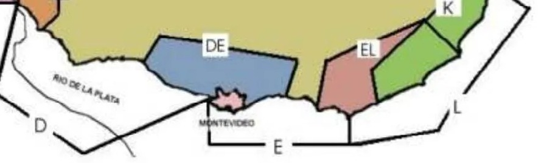

# Presentación y antecedentes

El presente informe fue elaborado por el Instituto Departamental de Estadísticas de la Intendencia de San José en base a los datos del Censo a Pescadores Artesanales del Departamento de San José -2026.

El mencionado Censo fue realizado por iniciativa de la Dirección de Desarrollo con el apoyo del Instituto Departamental de Estadísticas. El Instituto se encargó del entrenamiento del equipo de encuestadores, diseño del instrumento de recolección, de la prueba del formulario y del procesamiento, análisis y elaboración del informe final.

Para el diseño del censo, se tuvo en cuenta un trabajo desarrollado en forma parcial en 2007, antecedentes nacionales e internacionales y se mantuvieron entrevistas on line con integrantes del equipo técnico de la Dirección Nacional de Recursos Acuáticos (Dinara), y pescadores con experiencia de trabaja en la costa del Río de la Plata en el departamento de San José.

Aquellos ciudadanos que tengan dudas o requieran información adicional, pueden comunicarse con el IDE-San José a ide\@sanjose.gub.uy o al teléfono +598 43429000 int 1904.

\newpage

# Aspectos metodológicos

La selección de los entrevistados fue no probabilistica y se realizó mediante identificación directa y, en un segundo paso, por la técnica de bola de nieve que permitió llegar a los pescadores a través de la referencia de sus pares anteriormente contactados.

Se localizaron 78 personas personas que trabajan en la pesca, pertenecientes a 53 hogares.

La encuesta se dividió en dos módulos: vivienda, hogares y personas por un lado y por otro, unidades de producción (embarcaciones). Las dimensiones principales fueron: ubicación y tenencia de la vivienda; calidad de la vivienda y servicios básicos; composición del hogar; datos básicos de las personas; educación y salud; arraigo; perfil laboral e ingresos de la pesca; organización, participación y capacitación; percepción de desafíos y problemas. En el módulo relativo a la unidad de producción se identifican las siguientes dimensiones: identificación técnica y formalización; propulsión y seguridad; artes de pesca; esfuerzo y captura y comercialización y precios.

El trabajo de campo, realizado por un equipo de pertenecientes a la Dirección de Desarrollo, se aplicó entre el 26 de junio y el 8 de setiembre de 2026.

La información se presenta en tablas y gráficos con su correspondiente lectura. Al final se presenta un capítulo de conclusiones. Los datos fueron procesados con el programa R y el documento fue producido en el entorno Quarto.

\newpage

# Principales resultados

```{r}
#| label: setup
#| echo: false
#| warning: false
#| message: false
#| results: hide

library(tidyverse)  
library(readxl)      
library(janitor)     
library(scales)      
library(knitr)       
library(kableExtra)  
library(patchwork)


# Rutas, los excel deben estar en la carpeta del proyecto. No cambiar estas rutas, corren así como están.
ruta_archivo  <- "base_pescadores.xlsx"
embarcaciones <- read_excel("embarcacion_censo_pescadores.xlsx")

hogares       <- read_excel(ruta_archivo, sheet = "_10_de_formulario_0") %>% clean_names()
personas_solo <- read_excel(ruta_archivo, sheet = "personas_pesca_1")    %>% clean_names()

#Limpieza base
hogares       <- hogares       %>% mutate(across(where(is.character), ~ na_if(str_trim(.x), "")))
personas_solo <- personas_solo %>% mutate(across(where(is.character), ~ na_if(str_trim(.x), "")))

hogares       <- hogares       %>% select(where(~ !all(is.na(.x))))
personas_solo <- personas_solo %>% select(where(~ !all(is.na(.x))))

# 2.3 Pasamos a número las columnas que son cantidades
hogares <- hogares %>%
  mutate(
    n_personas_hogar     = as.numeric(n_personas_hogar),
    n_nucleos_familiares = as.numeric(n_nucleos_familiares),
    n_personas_pescan    = as.numeric(n_personas_pescan)
  )

personas_solo <- personas_solo %>%
  mutate(
    edad                    = as.numeric(edad),
    anos_oficio_pesca       = as.numeric(anos_oficio_pesca),
    n_embarcaciones_propias = as.numeric(n_embarcaciones_propias))


datos <-personas_solo %>% left_join(hogares, by="id_hogar")

# 3. ESTILO DEL INFORME 

paleta_pesca   <- c("#1A5276", "#2E86AB", "#48A9A6", "#73AB84", "#A6C36F", "#F4A259", "#C1666B", "#7B506F")
fuente_caption <- "Fuente: Elaboración propia en base a Censo de pescadores artesanales, IDE-San José"

tema_informe <- theme_minimal(base_size = 12) +
  theme(
    plot.title = element_text(face = "bold", size = 13, hjust = 0.5),
    plot.subtitle = element_text(size = 10, hjust = 0.5, color = "gray40"),
    plot.caption = element_text(size = 8, color = "gray50", hjust = 1),
    panel.grid.minor = element_blank(),
    panel.grid.major.y = element_blank(),
    plot.background = element_rect(fill = "white", color = NA)
  )

# 4. FUNCIONES AUXILIARES

tabla_frecuencias <- function(df, var) {
  df %>%
    filter(!is.na(.data[[var]])) %>%      
    count(.data[[var]], name = "n") %>%   
    mutate(pct = round(100 * n / sum(n), 1)) %>%  
    arrange(desc(n))                      
}

# tabla_frecuencias_ordenada
tabla_frecuencias_ordenada <- function(df, var, niveles, etiquetas = niveles) {
  df %>%
    filter(!is.na(.data[[var]])) %>%
    mutate(!!var := factor(.data[[var]], levels = niveles, labels = etiquetas)) %>%
    count(.data[[var]], name = "n", .drop = FALSE) %>%
    mutate(pct = round(100 * n / sum(n), 1))
}


grafico_barras_estilo <- function(tabla, var, titulo, subtitulo = NULL) {
  ggplot(tabla, aes(x = reorder(.data[[var]], pct), y = pct, fill = .data[[var]])) +
    geom_col(width = 0.7, show.legend = FALSE) +                          
    geom_text(aes(label = paste0(pct, "%")), hjust = -0.15, size = 3.2) + 
    coord_flip(clip = "off") +                                            
    scale_fill_manual(values = rep(paleta_pesca, length.out = nrow(tabla))) +
    scale_y_continuous(expand = expansion(mult = c(0, 0.18))) +           
    labs(
      title = toupper(titulo), subtitle = subtitulo,
      caption = fuente_caption, x = NULL, y = NULL
    ) +
    tema_informe
}
```

En la tabla inferior se puede observar la distribución de los hogares y de la cantidad de personas por localidad que trabajan en la pesca artesanal[^1]. En total se relevaron 53 hogares de pescadores artesanales, en los cuales residen 159 personas de los que se identificaron a 78 que trabajan en la pesca artesanal. El promedio es de 3 personas por hogar. Hay que señalar que dos pares de hogares comparten vivienda.

[^1]: Más adelante se profundiza sobre los "desmalladores", otro grupo personas ocupadas en la actividad productiva

La mayor concentración de hogares y personas se encuentran en Arazatí y Penino respectivamente que reúnen en ambas categorías alrededor de las dos terceras partes de las unidades relevadas. Luego se encuentran Boca del Cufré , Kiyú y Ordeig, otras y por últimos Colonia Wilson. Hay cuatro hogares que comparten viviendas

```{r}
#| echo: false
#| warning: false

recode_localidad <- function(x) {
  recode(x,
    "arazati"       = "Arazatí",
    "penino"        = "Penino",
    "kiyu_ordeig"   = "Kiyú-Ordeig",
    "boca_cufre"    = "Boca del Cufré",
    "coloniawilson" = "Colonia Wilson",
    "otra"          = "Otras"
  )
}

# 1. Hogares por localidad
hogares_por_localidad <- hogares %>%
  mutate(localidad = recode_localidad(localidad)) %>%
  count(localidad, name = "Hogares (n)")

# 2. Personas por localidad
personas_por_localidad <- datos %>%
  mutate(localidad = recode_localidad(localidad)) %>%
  count(localidad, name = "Personas (n)")

# 3. Juntamos las dos tablas por localidad y calculamos los porcentajes
tabla_localidad <- hogares_por_localidad %>%
  left_join(personas_por_localidad, by = "localidad") %>%
  mutate(
    "Hogares (%)"  = round(100 * `Hogares (n)` / sum(`Hogares (n)`), 1),
    "Personas (%)" = round(100 * `Personas (n)` / sum(`Personas (n)`), 1)
  ) %>%
  rename(Localidad = localidad) %>%
  arrange(desc(`Hogares (n)`)) %>%
  select(Localidad, `Hogares (n)`, `Hogares (%)`, `Personas (n)`, `Personas (%)`)

fila_total <- tibble(
  Localidad      = "Total",
  "Hogares (n)"  = sum(tabla_localidad$`Hogares (n)`),
  "Hogares (%)"  = 100,
  "Personas (n)" = sum(tabla_localidad$`Personas (n)`),
  "Personas (%)" = 100
)
tabla_localidad <- bind_rows(tabla_localidad, fila_total)

# 5. Mostramos la tabla con estilo, con la fila de Total en negrita
tabla_localidad %>%
  kbl(caption = "Hogares y personas dedicadas a la pesca por localidad") %>%
  kable_styling(full_width = FALSE, position = "left") %>%
  row_spec(nrow(tabla_localidad), bold = TRUE, extra_css = "border-top: 1px solid #333;")

```

\newpage

## Caracterización demográfica, educación y salud

En los siguientes gráficos observamos algunas características demográficas de las personas de declararon trabajar como pescadores artesanales.

```{r}
#| echo: false
# Sexo de las personas que pescan
tabla_frecuencias(personas_solo, "sexo") %>%
  grafico_barras_estilo("sexo", "Sexo de las personas que pescan")

```

```{r}
#| echo: false
# Tramos de edad (ajustar los cortes acá si se quiere otra apertura)
cortes_edad    <- c(-Inf, 24, 39, 54, 64, Inf)
etiquetas_edad <- c("Menos de 25", "25 a 39", "40 a 54", "55 a 64", "65 y más")

# cut() convierte la edad (número) en el tramo que le corresponde (texto)
personas_solo <- personas_solo %>%
  mutate(grupo_edad = cut(edad, breaks = cortes_edad, labels = etiquetas_edad, right = TRUE))

# Distribución de edad por tramo
tabla_edad <- personas_solo %>%
  filter(!is.na(grupo_edad)) %>%
  count(grupo_edad, name = "n") %>%
  mutate(pct = round(100 * n / sum(n), 1))


ggplot(tabla_edad, aes(x = grupo_edad, y = pct, fill = grupo_edad)) +
  geom_col(width = 0.65, show.legend = FALSE) +
  geom_text(aes(label = paste0(pct, "%")), vjust = -0.5, size = 3.8, fontface = "bold") +
  scale_fill_manual(values = rep(paleta_pesca, length.out = nrow(tabla_edad))) +
  scale_y_continuous(expand = expansion(mult = c(0, 0.15))) +
  labs(
    title = "DISTRIBUCIÓN DE EDAD DE LOS PESCADORES",
    subtitle = "Porcentaje de personas por tramo de edad",
    caption = fuente_caption, x = NULL, y = "%"
  ) +
  tema_informe
```

```{r}
#| echo: false

tabla_frecuencias_ordenada(
  personas_solo, "nivel_educativo",
  niveles   = c("primaria", "secundaria_1", "secundaria_2", "terciaria"),
  etiquetas = c("Primaria", "Primer ciclo", "Segundo ciclo", "Terciaria")
) %>%
  grafico_barras_estilo("nivel_educativo", "Máximo nivel educativo alcanzado")
```

```{r}
#| echo: false

tabla_frecuencias(
  personas_solo %>% mutate(cobertura_salud = recode(cobertura_salud,
    "publica_asse" = "ASSE",
    "privada"      = "Privada"
  )),
  "cobertura_salud"
) %>%
  grafico_barras_estilo("cobertura_salud", "Cobertura de salud")
```

El 77% son varones y el 23% mujeres. De las mujeres, el 70% tienen 45 años o menos. Según la distribución por edades, se observa que el intervalo modal está entre los 40 y los 54 años, grupo que representa el 40% de los pescadores. El 27% está entre 25 y 39 años, el 16% entre 55 y 64 años y el resto se distribuye en proporciones casi iguales en los extremos de la distribución. Resumiendo, las tres cuartas partes de los/las pescadores/as tienen menos de 55 años.

Por educación formal completada, se observa que 87 % asistió hasta Ciclo Básico de Educación Secundaria y de éstos, el 84% solamente hizo Primaria. Un 13% alcanzó a realizar Enseñanza Media Superior o educación terciaria. En cuanto a la cobertura de salud, se constató que el 84% se atiende en los servicios de ASSE y un 16% tiene cobertura privada.

```{r}
#| echo: false

tabla_frecuencias(
  personas_solo %>% mutate(tiempo_residencia_zona = recode(tiempo_residencia_zona,
    "mas2a"        = "Más de 2 años",
    "6m_1a"        = "De 6 meses a 1 año",
    "no_vive_zona" = "No vive en la zona"
  )),
  "tiempo_residencia_zona"
) %>%
  grafico_barras_estilo("tiempo_residencia_zona", "Tiempo de residencia en la zona")
```

\newpage

En el gráfico anterior se observa la la distribución porcentual por tiempo de residencia en el lugar de trabajo. Cómo se ve, casi todos tienen un tiempo de permanencia en sus respectivas localidades superior a los dos años. Un 1,3% dijo que está en el lugar hace un año o menos y un porcentaje similar no vive en la zona donde trabaja.

## Hogar y vivienda

En este capítulo se abordan las condiciones habitacionales y la composición de los hogares de los pescadores.

### Vivienda

En el siguiente gráfico se observa la forma de tenencia de los terrenos por hogares de los pescadores.

```{r}
#| echo: false

tabla_frecuencias(hogares, "tenencia_terreno") %>%
  grafico_barras_estilo("tenencia_terreno", "Tenencia del terreno por hogares")


```

Como se observa, más del 41,5% de los hogares dicen ser propietarios del terreno, un 32% ocupantes, un 17% dicen que residen sobre un terreno prestado y un 9% son arrendatarios. De la categoría ocpuantes, hay que señalar que el 75% ocupan predios públicos mientras que el resto dice estar ocupando predios privados. La mayor cantidad de ocuantes, las dos terceras partes, están en Arazatí y Boca del Cufré.

El gráfico siguiente muestra las condiciones de materialidad de la vivienda de los 53 hogares de pescadores.

```{r}
#| echo: false

grafico_en_paneles <- function(tabla, colores, titulo, subtitulo = NULL) {

  tabla <- tabla %>%
    arrange(dimension, pct) %>%
    mutate(categoria_orden = factor(
      paste(categoria, dimension, sep = "___"),
      levels = paste(categoria, dimension, sep = "___")
    ))

  ggplot(tabla, aes(x = categoria_orden, y = pct, fill = dimension)) +
    geom_col(width = 0.7, show.legend = FALSE) +
    geom_text(aes(label = paste0(pct, "%")), hjust = -0.15, size = 3) +
    coord_flip(clip = "off") +
    facet_wrap(~dimension, scales = "free_y", ncol = 1) +   # un panel por dimension
    # le sacamos a las etiquetas del eje el sufijo "___panel" que agregamos arriba
    scale_x_discrete(labels = function(x) sub("___.*$", "", x)) +
    scale_fill_manual(values = colores) +
    scale_y_continuous(expand = expansion(mult = c(0, 0.18))) +
    labs(title = titulo, subtitle = subtitulo, caption = fuente_caption, x = NULL, y = NULL) +
    tema_informe
}

# Materialidad de la vivienda
tabla_materialidad <- bind_rows(
  tabla_frecuencias(
    hogares %>% mutate(material_paredes = recode(material_paredes,
      "bloque_ladrillo"   = "Bloque/ladrillo",
      "madera_costaneros" = "Madera/costaneros",
      "chapa"             = "Chapa",
      "desecho"           = "Desecho",
      "otro"              = "Otro"
    )),
    "material_paredes"
  ) %>% rename(categoria = material_paredes) %>% mutate(dimension = "Paredes", .before = 1),

  tabla_frecuencias(
    hogares %>% mutate(material_piso = recode(material_piso,
      "hormigon" = "Hormigón",
      "ceramica" = "Cerámica",
      "madera"   = "Madera",
      "tierra"   = "Tierra",
      "otro"     = "Otro"
    )),
    "material_piso"
  ) %>% rename(categoria = material_piso) %>% mutate(dimension = "Piso", .before = 1),

  tabla_frecuencias(
    hogares %>% mutate(material_techo = recode(material_techo,
      "chapa_liviano" = "Chapa liviana",
      "planchada"     = "Planchada",
      "desecho"       = "Desecho",
      "otro"          = "Otro"
    )),
    "material_techo"
  ) %>% rename(categoria = material_techo) %>% mutate(dimension = "Techo", .before = 1)
)

# Graficamos los 3 paneles juntos con la función grafico_en_paneles() de arriba
grafico_en_paneles(
  tabla_materialidad,
  colores   = paleta_pesca[c(1, 3, 6)],
  titulo    = "MATERIALIDAD DE LA VIVIENDA",
  subtitulo = "Material predominante de paredes, piso y techo"
)
```

En el gráfico superior, se observa que más del 62% tienen paredes de bloque o ladrillo mientras que el resto se describe como de materiales de menor calidad. En cuanto a los pisos, 86% tienen hormigón o cerámica y respecto a los techos, el 83% son de chapa, un 11% de planchada y un 6% de desecho u otro. Si se considera la materialidad de algunos de los tres componentes, se puede observar que más de un 30% tiene al menos paredes en precarias.

```{r}
#| echo: false

tabla_servicios <- bind_rows(
  tabla_frecuencias(
    hogares %>% mutate(alumbrado_electrico = recode(alumbrado_electrico,
      "ute"      = "UTE",
      "solar"    = "Solar",
      "no_tiene" = "No tiene"
    )),
    "alumbrado_electrico"
  ) %>% rename(categoria = alumbrado_electrico) %>% mutate(dimension = "Alumbrado eléctrico", .before = 1),

  tabla_frecuencias(
    hogares %>% mutate(origen_agua = recode(origen_agua,
      "ose"  = "OSE",
      "pozo" = "Pozo",
      "otro" = "Otro"
    )),
    "origen_agua"
  ) %>% rename(categoria = origen_agua) %>% mutate(dimension = "Origen del agua", .before = 1),

  tabla_frecuencias(
    hogares %>% mutate(evacuacion_bano = recode(evacuacion_bano,
      "pozo_negro" = "Pozo negro",
      "entubado"   = "Entubado (saneamiento)",
      "otro"       = "Otro"
    )),
    "evacuacion_bano"
  ) %>% rename(categoria = evacuacion_bano) %>% mutate(dimension = "Evacuación del baño", .before = 1)
)

grafico_en_paneles(
  tabla_servicios,
  colores   = paleta_pesca[c(2, 4, 7)],
  titulo    = "SERVICIOS BÁSICOS DEL HOGAR",
  subtitulo = "Alumbrado eléctrico, origen del agua y evacuación del baño"
)
```

En cuanto a servicios básicos, gráfico superior, la gran mayoría cuenta con energía eléctrica de UTE, un 2% explota energía solar y otro 2% asegura no tener ninguna de estas fuentes energéticas. La evacuación de las aguas servidas en las tres cuarta parte de los casos se hace hacia pozo negro, casi una quinta parte a "otro" destino y el 6% a saneamiento. Con relación del agua de consumo y de uso familiar, 77% dice utilizar agua de OSE, una quinta parte "otra" fuente y un 4% se abastece desde "pozo". Entre quienes dicen que se abastecen de "otra" fuente, algunos entrevistados afirmaron que recogen agua de lluvia y otros que traen en bidones o le acercan agua familiares.

### Composición del hogar

Los hogares tienen un tamaño promedio de 3 personas, lo cual es 0,5% mayor que el tamaño promedio de los hogares uruguayos y los del departamento.

```{r}
#| echo: false

promedio_personas_hogar <- round(mean(hogares$n_personas_hogar, na.rm = TRUE), 1)
total_personas_pescan   <- sum(hogares$n_personas_pescan, na.rm = TRUE)
n_menor_no_escolarizado <- sum(hogares$menor_no_escolarizado == "si", na.rm = TRUE)
n_hogares_total         <- n_distinct(hogares$id_hogar)
conyuge<-sum(hogares$tiene_conyuge == "si")
discapacidad <-sum(hogares$hay_discapacidad=="si")
```

```{r}
#| echo: false

tabla_frecuencias(hogares, "menor_no_escolarizado") %>%
  grafico_barras_estilo("menor_no_escolarizado", "Porcentaje de hogares con menores no escolarizados")
```

\newpage

En 37 de los hogares (70%), la persona entrevistada convive con su cónyuge. En dos, se informó la presencia de personas con discapacidad. Y a su vez se relevaron 14 menores de 18 años que no se encontraban escolarizados (ver gráfico arriba).

## Actividad pesquera

### Trayectoria y rol

En el siguiente gráfico se observa los años de trayectoria que tienen los pescadores.

```{r}
#| echo: false

# --- 1. Procesamiento de datos ---
trayectoria <- datos %>% 
  mutate(Tramos_antiguedad = case_when(
    anos_oficio_pesca < 10 ~ "Menos de 10 años",
    anos_oficio_pesca >= 10 & anos_oficio_pesca < 25 ~ "De 10 a 25 años",
    anos_oficio_pesca >= 25 ~ "25 años o más",
    TRUE ~ "Sin dato"
  )) %>%
  group_by(Tramos_antiguedad) %>% 
  summarise(Cantidad = n(), .groups = "drop") %>% 
  mutate(
    Porcentaje = round(Cantidad / sum(Cantidad) * 100, 1),
    Porcentaje_formateado = paste0(Porcentaje, "%")
  )

# --- 2. Definir tamaño del agujero (hsize) ---
hsize <- 2

# --- 3. Paleta y tema (los que ya tenías) ---
paleta_pesca   <- c("#1A5276", "#2E86AB", "#48A9A6", "#73AB84",
                    "#A6C36F", "#F4A259", "#C1666B", "#7B506F")

fuente_caption <- "Fuente: Elaboración propia en base a Censo de pescadores artesanales, IDE-San José"

tema_informe <- theme_minimal(base_size = 12) +
  theme(
    plot.title    = element_text(face = "bold", size = 13, hjust = 0.5),
    plot.subtitle = element_text(size = 10, hjust = 0.5, color = "gray40"),
    plot.caption  = element_text(size = 8, color = "gray50", hjust = 1),
    panel.grid.minor = element_blank(),
    panel.grid.major.y = element_blank(),
    plot.background = element_rect(fill = "white", color = NA)
  )

# --- 4. Gráfico de rosca ---
ggplot(trayectoria, aes(x = hsize, y = Porcentaje, fill = Tramos_antiguedad)) +
  geom_col(color = "white", width = 1) +
  geom_text(aes(label = Porcentaje_formateado),
            size = 4,
            position = position_stack(vjust = 0.5),
            fontface = "bold",
            color = "white") +
  coord_polar(theta = "y") +
  scale_fill_manual(values = paleta_pesca) +
  xlim(c(0.2, hsize + 0.5)) +
  labs(
    title   = "Distribución por tramos de antigüedad en el oficio",
    fill    = "Tramos de antigüedad",
    caption = fuente_caption
  ) +
  tema_informe +
  theme(
    axis.title = element_blank(),
    axis.ticks = element_blank(),
    axis.text  = element_blank(),
    panel.grid = element_blank(),
    legend.title = element_text(size = 10),
    legend.text  = element_text(size = 9)
  )

```

Como se ve, la mitad tiene una extensa trayectoria en el rubro: al menos 25 años. Más de una cuarta parte tiene de 10 a 25 años y una quinta parte, menos de 10 años. De un 4% no se obtuvo datos.Como se ve, se trata en su gran mayoría de una población plenamente incorporada e involucrada a este sector de producción.

```{r}
#| echo: false
datos <- datos %>%
  mutate(
    rol_principal_pesca = trimws(rol_principal_pesca),
    # ¿Es multirrespuesta?
    multi_rol = grepl(",", rol_principal_pesca),
    # Rol jerarquizado: si tiene patrón, gana patrón; si no, el primero listado
    rol_jerarquizado = case_when(
      is.na(rol_principal_pesca) | rol_principal_pesca == "" ~ "Sin dato",
      grepl("patron_duenio", rol_principal_pesca) ~ "Patrón / dueño",
      grepl("marinero_tripulante", rol_principal_pesca) ~ "Marinero / tripulante",
      grepl("procesamiento", rol_principal_pesca) ~ "Procesamiento",
      grepl("venta_directa|comercializacion_publico", rol_principal_pesca) ~ "Comercialización",
      grepl("apoyo_tierra", rol_principal_pesca) ~ "Apoyo en tierra",
      grepl("construccion_artes", rol_principal_pesca) ~ "Construcción de artes",
      TRUE ~ "Otro"
    ),
    # Etiqueta legible
    Rol = recode(rol_jerarquizado,
      "Patrón / dueño"       = "Patrón / dueño",
      "Marinero / tripulante"= "Marinero / tripulante",
      "Procesamiento"        = "Procesamiento",
      "Comercialización"     = "Comercialización",
      "Apoyo en tierra"      = "Apoyo en tierra",
      "Construcción de artes"= "Construcción de artes",
      "Otro"                 = "Otro",
      "Sin dato"             = "Sin dato"
    )
  )

# Resumen
roles_resumen <- datos %>%
  count(Rol, name = "Cantidad") %>%
  mutate(
    Porcentaje = round(Cantidad / sum(Cantidad) * 100, 1),
    Porcentaje_formateado = paste0(Porcentaje, "%")
  ) %>%
  arrange(desc(Cantidad))

orden <- c("Patrón / dueño", "Marinero / tripulante", "Procesamiento",
           "Comercialización", "Apoyo en tierra", "Construcción de artes",
           "Otro", "Sin dato")
roles_resumen <- roles_resumen %>%
  mutate(Rol = factor(Rol, levels = rev(orden[orden %in% Rol])))

ggplot(roles_resumen, aes(x = Rol, y = Porcentaje, fill = Rol)) +
  geom_col(width = 0.65, show.legend = FALSE) +
  geom_text(aes(label = paste0(Porcentaje, "%")), 
            hjust = -0.15, size = 3.8, fontface = "bold") +
  scale_fill_manual(values = rep(paleta_pesca, length.out = nrow(roles_resumen))) +
  scale_y_continuous(expand = expansion(mult = c(0, 0.15))) +
  coord_flip() +
  labs(
    title = "DISTRIBUCIÓN POR ROL PRINCIPAL EN LA PESCA",
    subtitle = "Porcentaje de personas según rol jerarquizado",
    caption = fuente_caption, x = NULL, y = NULL
  ) +
  tema_informe


```

En cuanto al rol en la pesca (gráfico superior), se observa que el 77% son patrones, un 11,5% marineros, un 4% trabaja en el procesamiento del pescado y el resto se distribuye en otros roles o no sin información.

### Embarcaciones y permisos

En los gráficos siguientes vemos la situación respecto a la propiedad de las embarcaciones y la formalización de las mismas.

```{r}
#| echo: false

library(patchwork)

# --- 1. NA -> "Sin dato" ---
datos <- datos %>%
  mutate(
    tiene_embarcacion_propia = ifelse(is.na(tiene_embarcacion_propia), "Sin dato", tiene_embarcacion_propia),
    tiene_libreta_prefectura = ifelse(is.na(tiene_libreta_prefectura), "Sin dato", tiene_libreta_prefectura)
  )

# --- 2. Tablas resumen ---
tabla_emb <- datos %>%
  count(tiene_embarcacion_propia, name = "Cantidad") %>%
  mutate(
    Porcentaje = round(Cantidad / sum(Cantidad) * 100, 1),
    Porcentaje_formateado = paste0(Porcentaje, "%")
  ) %>%
  mutate(tiene_embarcacion_propia = factor(
    tiene_embarcacion_propia, levels = c("si", "no", "Sin dato")
  )) %>%
  arrange(tiene_embarcacion_propia)

tabla_lib <- datos %>%
  count(tiene_libreta_prefectura, name = "Cantidad") %>%
  mutate(
    Porcentaje = round(Cantidad / sum(Cantidad) * 100, 1),
    Porcentaje_formateado = paste0(Porcentaje, "%")
  ) %>%
  mutate(tiene_libreta_prefectura = factor(
    tiene_libreta_prefectura, levels = c("si", "no", "Sin dato")
  )) %>%
  arrange(tiene_libreta_prefectura)

# --- 3. Rosca 1: embarcación ---
hsize <- 2

g_emb <- ggplot(tabla_emb, aes(x = hsize, y = Porcentaje, fill = tiene_embarcacion_propia)) +
  geom_col(color = "white", width = 1) +
  geom_text(aes(label = Porcentaje_formateado),
            size = 4, position = position_stack(vjust = 0.5),
            fontface = "bold", color = "white") +
  coord_polar(theta = "y") +
  scale_fill_manual(
    values = paleta_pesca,
    name   = "Respuesta",
    labels = c("si" = "Sí", "no" = "No", "Sin dato" = "Sin dato")
  ) +
  xlim(c(0.2, hsize + 0.5)) +
  labs(title = "EMBARCACIÓN PROPIA",
       subtitle = "Porcentaje de pescadores según tenencia") +
  tema_informe +
  theme(axis.title = element_blank(), axis.ticks = element_blank(),
        axis.text = element_blank(), panel.grid = element_blank(),
        legend.title = element_text(size = 10),
        legend.text = element_text(size = 9))

# --- 4. Rosca 2: libreta ---
g_lib <- ggplot(tabla_lib, aes(x = hsize, y = Porcentaje, fill = tiene_libreta_prefectura)) +
  geom_col(color = "white", width = 1) +
  geom_text(aes(label = Porcentaje_formateado),
            size = 4, position = position_stack(vjust = 0.5),
            fontface = "bold", color = "white") +
  coord_polar(theta = "y") +
  scale_fill_manual(
    values = paleta_pesca,
    name   = "Respuesta",
    labels = c("si" = "Sí", "no" = "No", "Sin dato" = "Sin dato")
  ) +
  xlim(c(0.2, hsize + 0.5)) +
  labs(title = "LIBRETA DE PREFECTURA",
       subtitle = "Porcentaje de pescadores según tenencia") +
  tema_informe +
  theme(axis.title = element_blank(), axis.ticks = element_blank(),
        axis.text = element_blank(), panel.grid = element_blank(),
        legend.title = element_text(size = 10),
        legend.text = element_text(size = 9))

# --- 5. Panel único con UNA sola leyenda y UN solo caption ---
g_emb + g_lib +
  plot_layout(guides = "collect") +
  plot_annotation(
    title   = "TENENCIA DE ACTIVOS Y HABILITACIONES",
    caption = fuente_caption,
    theme   = theme(
      plot.title   = element_text(face = "bold", size = 14, hjust = 0.5),
      plot.caption = element_text(size = 8, color = "gray50", hjust = 1)
    )
  ) &
  theme(legend.position = "bottom")
```

Un 72% de los pescadores dijeron ser propietarios de sus embarcaciones, un 17% dijo no serlo, mientras que un 11,5% no informó al respecto. El total se relevaron 62 embarcaciones. De quienes tienen embarcación propia, la gran mayoría informó tener sólo una, excepto seis casos que afirman tener dos cada uno. Al ser consultados si contaban con permiso de pesca se constató que un **39%** de estas embarcaciones, están trabajando sin la habilitación correspondiente.

En cuanto a la libreta de prefectura, un 65% de los pescadores dijo tenerla; casi una cuarta parte (23%), dijo estar embarcándose sin libreta y un 11,5% no aportó información al respecto. En general se observa un alto porcentaje de no regularización en estos aspectos.

### Formalización laboral

En cuanto a la formalización laboral, la información se presenta en los gráficos que siguen.

```{r}
#| echo: false

library(ggplot2)

# --- 1. Limpieza: NA, vacíos y variantes -> "si" / "no" / "Sin dato" ---
datos <- datos %>%
  mutate(
    aporta_bps = trimws(as.character(aporta_bps)),
    aporta_bps = case_when(
      is.na(aporta_bps) | aporta_bps == "" ~ "Sin dato",
      tolower(aporta_bps) %in% c("si", "sí", "s") ~ "si",
      tolower(aporta_bps) %in% c("no", "n")      ~ "no",
      TRUE ~ "Sin dato"
    )
  )

# --- 2. Tabla resumen ---
tabla_bps <- datos %>%
  count(aporta_bps, name = "Cantidad") %>%
  mutate(
    Porcentaje = round(Cantidad / sum(Cantidad) * 100, 1),
    Porcentaje_formateado = paste0(Porcentaje, "%")
  ) %>%
  mutate(aporta_bps = factor(
    aporta_bps, levels = c("si", "no", "Sin dato")
  )) %>%
  arrange(aporta_bps)

# --- 3. Rosca ---
hsize <- 2

ggplot(tabla_bps, aes(x = hsize, y = Porcentaje, fill = aporta_bps)) +
  geom_col(color = "white", width = 1) +
  geom_text(aes(label = Porcentaje_formateado),
            size = 4, position = position_stack(vjust = 0.5),
            fontface = "bold", color = "white") +
  coord_polar(theta = "y") +
  scale_fill_manual(
    values = paleta_pesca,
    name   = "Respuesta",
    labels = c("si" = "Sí", "no" = "No", "Sin dato" = "Sin dato")
  ) +
  xlim(c(0.2, hsize + 0.5)) +
  labs(
    title    = "APORTES A BPS",
    subtitle = "Porcentaje de pescadores según aporte",
    caption  = fuente_caption
  ) +
  tema_informe +
  theme(
    axis.title = element_blank(), axis.ticks = element_blank(),
    axis.text  = element_blank(), panel.grid = element_blank(),
    legend.title = element_text(size = 10),
    legend.text  = element_text(size = 9)
  )
```

Un 64% informó que no hace aportes al BPS, un 31% sí los hace y un 5% no no aportó información al respecto. Entre quienes aportan, la forma predominante es el monotributo (80%).

```{r}
#| echo: false

library(dplyr)
library(ggplot2)

# --- 1. Limpieza: NA y vacíos -> "Sin dato" ---
datos <- datos %>%
  mutate(
    relacion_laboral = trimws(as.character(relacion_laboral)),
    relacion_laboral = case_when(
      is.na(relacion_laboral) | relacion_laboral == "" ~ "Sin dato",
      TRUE ~ relacion_laboral
    )
  )

# --- 2. Tabla resumen ---
tabla_rel <- datos %>%
  count(relacion_laboral, name = "Cantidad") %>%
  mutate(
    pct = round(Cantidad / sum(Cantidad) * 100, 1)
  ) %>%
  arrange(desc(pct))

# --- 3. Ordenar: categorías reales por frecuencia desc, "Sin dato" al final ---
tabla_rel <- tabla_rel %>%
  mutate(es_sin_dato = relacion_laboral == "Sin dato") %>%
  arrange(es_sin_dato, desc(pct)) %>%
  mutate(relacion_laboral = factor(relacion_laboral, levels = rev(relacion_laboral)))

# --- 4. Barras horizontales ---
ggplot(tabla_rel, aes(x = relacion_laboral, y = pct, fill = relacion_laboral)) +
  geom_col(width = 0.65, show.legend = FALSE) +
  geom_text(aes(label = paste0(pct, "%")),
            hjust = -0.15, size = 3.8, fontface = "bold") +
  scale_fill_manual(values = rep(paleta_pesca, length.out = nrow(tabla_rel))) +
  scale_y_continuous(expand = expansion(mult = c(0, 0.15))) +
  coord_flip() +
  labs(
    title    = "DISTRIBUCIÓN POR RELACIÓN LABORAL",
    subtitle = "Porcentaje de pescadores según relación laboral",
    caption  = fuente_caption,
    x = NULL, y = NULL
  ) +
  tema_informe
```

En cuanto a la relación laboral, se observa que un 56% trabajan por cuenta propia; un 5% son asalariados dependientes; un 3% dicen ser familiares no remunerados, mientras que un 36% no aportó información al respecto.

### Fuente de ingresos

```{r}
#| echo: false


# --- 1. Limpieza: NA, vacíos y variantes -> "si" / "no" / "Sin dato" ---
datos <- datos %>%
  mutate(
    trabaja_todo_ano = trimws(as.character(trabaja_todo_ano)),
    trabaja_todo_ano = case_when(
      is.na(trabaja_todo_ano) | trabaja_todo_ano == "" ~ "Sin dato",
      tolower(trabaja_todo_ano) %in% c("si", "sí", "s") ~ "si",
      tolower(trabaja_todo_ano) %in% c("no", "n")      ~ "no",
      TRUE ~ "Sin dato"
    )
  )

# --- 2. Tabla resumen ---
tabla_trabajo <- datos %>%
  count(trabaja_todo_ano, name = "Cantidad") %>%
  mutate(
    Porcentaje = round(Cantidad / sum(Cantidad) * 100, 1),
    Porcentaje_formateado = paste0(Porcentaje, "%")
  ) %>%
  mutate(trabaja_todo_ano = factor(
    trabaja_todo_ano, levels = c("si", "no", "Sin dato")
  )) %>%
  arrange(trabaja_todo_ano)

# --- 3. Rosca ---
hsize <- 2

ggplot(tabla_trabajo, aes(x = hsize, y = Porcentaje, fill = trabaja_todo_ano)) +
  geom_col(color = "white", width = 1) +
  geom_text(aes(label = Porcentaje_formateado),
            size = 4, position = position_stack(vjust = 0.5),
            fontface = "bold", color = "white") +
  coord_polar(theta = "y") +
  scale_fill_manual(
    values = paleta_pesca,
    name   = "Respuesta",
    labels = c("si" = "Sí", "no" = "No", "Sin dato" = "Sin dato")
  ) +
  xlim(c(0.2, hsize + 0.5)) +
  labs(
    title    = "TRABAJO DURANTE TODO EL AÑO",
    subtitle = "Porcentaje de pescadores según continuidad laboral",
    caption  = fuente_caption
  ) +
  tema_informe +
  theme(
    axis.title = element_blank(), axis.ticks = element_blank(),
    axis.text  = element_blank(), panel.grid = element_blank(),
    legend.title = element_text(size = 10),
    legend.text  = element_text(size = 9)
  )

```

En el gráfico anterior se ve que un 83% de los pescadores dicen que trabajan en la actividad durante todo el año, un 13% dice que no y 4% no informó. De quienes no trabajan durante todo el año, todos se concentran en partes del segundo semestre hasta el mes de febrero.

\newpage

```{r}
#| echo: false

# ============================================================
# 1. LIMPIEZA
# ============================================================
datos <- datos %>%
  mutate(
    # otras_actividades_remuneradas: si/no
    otras_actividades_remuneradas = trimws(as.character(otras_actividades_remuneradas)),
    otras_actividades_remuneradas = case_when(
      is.na(otras_actividades_remuneradas) | otras_actividades_remuneradas == "" ~ "Sin dato",
      tolower(otras_actividades_remuneradas) %in% c("si", "sí", "s") ~ "si",
      tolower(otras_actividades_remuneradas) %in% c("no", "n")      ~ "no",
      TRUE ~ "Sin dato"
    ),
    # pesca_principal_ingreso: si/no
    pesca_principal_ingreso = trimws(as.character(pesca_principal_ingreso)),
    pesca_principal_ingreso = case_when(
      is.na(pesca_principal_ingreso) | pesca_principal_ingreso == "" ~ "Sin dato",
      tolower(pesca_principal_ingreso) %in% c("si", "sí", "s") ~ "si",
      tolower(pesca_principal_ingreso) %in% c("no", "n")      ~ "no",
      TRUE ~ "Sin dato"
    )
  )

# ============================================================
# 2. TABLAS RESUMEN
# ============================================================
tabla_pesca <- datos %>%
  count(pesca_principal_ingreso, name = "Cantidad") %>%
  mutate(
    Porcentaje = round(Cantidad / sum(Cantidad) * 100, 1),
    Porcentaje_formateado = paste0(Porcentaje, "%")
  ) %>%
  mutate(pesca_principal_ingreso = factor(
    pesca_principal_ingreso, levels = c("si", "no", "Sin dato")
  )) %>%
  arrange(pesca_principal_ingreso)

tabla_otras <- datos %>%
  count(otras_actividades_remuneradas, name = "Cantidad") %>%
  mutate(
    Porcentaje = round(Cantidad / sum(Cantidad) * 100, 1),
    Porcentaje_formateado = paste0(Porcentaje, "%")
  ) %>%
  mutate(otras_actividades_remuneradas = factor(
    otras_actividades_remuneradas, levels = c("si", "no", "Sin dato")
  )) %>%
  arrange(otras_actividades_remuneradas)

# ============================================================
# 3. ROSCA 1: pesca principal ingreso
# ============================================================
hsize <- 2

g_pesca <- ggplot(tabla_pesca, aes(x = hsize, y = Porcentaje, fill = pesca_principal_ingreso)) +
  geom_col(color = "white", width = 1) +
  geom_text(aes(label = Porcentaje_formateado),
            size = 4, position = position_stack(vjust = 0.5),
            fontface = "bold", color = "white") +
  coord_polar(theta = "y") +
  scale_fill_manual(
    values = paleta_pesca,
    name   = "Respuesta",
    labels = c("si" = "Sí", "no" = "No", "Sin dato" = "Sin dato")
  ) +
  xlim(c(0.2, hsize + 0.5)) +
  labs(title = "PESCA COMO PRINCIPAL INGRESO",
       subtitle = "Pescadores según ingreso principal (%)") +
  tema_informe +
  theme(axis.title = element_blank(), axis.ticks = element_blank(),
        axis.text = element_blank(), panel.grid = element_blank(),
        legend.title = element_text(size = 10),
        legend.text = element_text(size = 9))

# ============================================================
# 4. ROSCA 2: otras actividades remuneradas
# ============================================================
g_otras <- ggplot(tabla_otras, aes(x = hsize, y = Porcentaje, fill = otras_actividades_remuneradas)) +
  geom_col(color = "white", width = 1) +
  geom_text(aes(label = Porcentaje_formateado),
            size = 4, position = position_stack(vjust = 0.5),
            fontface = "bold", color = "white") +
  coord_polar(theta = "y") +
  scale_fill_manual(
    values = paleta_pesca,
    name   = "Respuesta",
    labels = c("si" = "Sí", "no" = "No", "Sin dato" = "Sin dato")
  ) +
  xlim(c(0.2, hsize + 0.5)) +
  labs(title = "OTRAS ACTIVIDADES",
       subtitle = "Pescadores según actividades extra (%)") +
  tema_informe +
  theme(axis.title = element_blank(), axis.ticks = element_blank(),
        axis.text = element_blank(), panel.grid = element_blank(),
        legend.title = element_text(size = 10),
        legend.text = element_text(size = 9))

# ============================================================
# 5. PANEL ÚNICO
# ============================================================
g_pesca + g_otras +
  plot_layout(guides = "collect") +
  plot_annotation(
    title   = "PESCA COMO INGRESO PRINCIPAL Y PLURIACTIVIDAD",
    caption = fuente_caption,
    theme   = theme(
      plot.title   = element_text(face = "bold", size = 14, hjust = 0.5),
      plot.caption = element_text(size = 8, color = "gray50", hjust = 1)
    )
  ) &
  theme(legend.position = "bottom")
```

El 88,5% de los pescadores aseguró que su principal fuente de ingreso es la pesca, un 6% dijo que su ingreso principal provenía de otra actividad y el resto no dio información. Las actividades complementarias a la pesca se concentran en albañilería y changas, seguidas por trabajos rurales y, en menor medida, ocupaciones diversas como limpieza, gastronomía, almacén y leña. La presencia de respuestas múltiples evidencia una marcada pluriactividad entre los pescadores.

En el gráfico siguiente se observa, la distribución de los intervalos de ingreso (ganancia resultante una vez pagado todos los costos), según zafra y fuera de zafra de acuerdo a lo que marcan los pescadores.

\newpage

```{r}
#| echo: false

# ============================================================
# 1. LIMPIEZA Y ORDEN DE NIVELES
# ============================================================
# Orden lógico de los intervalos
niveles_ganancia <- c("menos20k", "20k_40k", "40k_60k", "mas60k", "no_corresponde", "ns_nc")

# Etiquetas legibles para el eje
etiquetas_ganancia <- c(
  "menos20k"       = "Menos de $20.000",
  "20k_40k"        = "$20.000 – $40.000",
  "40k_60k"        = "$40.000 – $60.000",
  "mas60k"         = "Más de $60.000",
  "no_corresponde" = "No corresponde",
  "ns_nc"          = "NS/NC"
)

datos <- datos %>%
  mutate(
    ganancia_mensual_zafra = trimws(as.character(ganancia_mensual_zafra)),
    ganancia_mensual_zafra = ifelse(is.na(ganancia_mensual_zafra) | ganancia_mensual_zafra == "",
                                    "ns_nc", ganancia_mensual_zafra),
    ganancia_mensual_zafra = factor(ganancia_mensual_zafra, levels = niveles_ganancia),

    ganancia_mensual_fuera_zafra = trimws(as.character(ganancia_mensual_fuera_zafra)),
    ganancia_mensual_fuera_zafra = ifelse(is.na(ganancia_mensual_fuera_zafra) | ganancia_mensual_fuera_zafra == "",
                                          "ns_nc", ganancia_mensual_fuera_zafra),
    ganancia_mensual_fuera_zafra = factor(ganancia_mensual_fuera_zafra, levels = niveles_ganancia)
  )

# ============================================================
# 2. TABLAS RESUMEN
# ============================================================
tabla_zafra <- datos %>%
  count(ganancia_mensual_zafra, name = "Cantidad") %>%
  mutate(
    pct = round(Cantidad / sum(Cantidad) * 100, 1)
  )

tabla_fuera <- datos %>%
  count(ganancia_mensual_fuera_zafra, name = "Cantidad") %>%
  mutate(
    pct = round(Cantidad / sum(Cantidad) * 100, 1)
  )

# ============================================================
# 3. GRÁFICO ZAFRA
# ============================================================
g_zafra <- ggplot(tabla_zafra, aes(x = ganancia_mensual_zafra, y = pct, fill = ganancia_mensual_zafra)) +
  geom_col(width = 0.65, show.legend = FALSE) +
  geom_text(aes(label = paste0(pct, "%")),
            hjust = -0.15, size = 3.6, fontface = "bold") +
  scale_fill_manual(values = rep(paleta_pesca, length.out = length(niveles_ganancia))) +
  scale_x_discrete(labels = etiquetas_ganancia, drop = FALSE) +
  scale_y_continuous(expand = expansion(mult = c(0, 0.15))) +
  coord_flip() +
  labs(
    title    = "GANANCIA MENSUAL EN ZAFRA",
    subtitle = "Porcentaje de pescadores por intervalo",
    x = NULL, y = "%"
  ) +
  tema_informe

# ============================================================
# 4. GRÁFICO FUERA DE ZAFRA
# ============================================================
g_fuera <- ggplot(tabla_fuera, aes(x = ganancia_mensual_fuera_zafra, y = pct, fill = ganancia_mensual_fuera_zafra)) +
  geom_col(width = 0.65, show.legend = FALSE) +
  geom_text(aes(label = paste0(pct, "%")),
            hjust = -0.15, size = 3.6, fontface = "bold") +
  scale_fill_manual(values = rep(paleta_pesca, length.out = length(niveles_ganancia))) +
  scale_x_discrete(labels = etiquetas_ganancia, drop = FALSE) +
  scale_y_continuous(expand = expansion(mult = c(0, 0.15))) +
  coord_flip() +
  labs(
    title    = "GANANCIA MENSUAL FUERA DE ZAFRA",
    subtitle = "Porcentaje de pescadores por intervalo",
    x = NULL, y = NULL
  ) +
  tema_informe

# ============================================================
# 5. PANEL ÚNICO
# ============================================================
g_zafra + g_fuera +
  plot_annotation(
    title   = "GANANCIA ZAFRA VS. FUERA DE ZAFRA",
    caption = fuente_caption,
    theme   = theme(
      plot.title   = element_text(face = "bold", size = 14, hjust = 0.5),
      plot.caption = element_text(size = 8, color = "gray50", hjust = 1)
    )
  )


```

En zafra, la mayoría, el 56%, dijo tener una ganancia de entre 20.000 y 40.000 pesos. El resto se distribuyó así: una quinta parte entre 40.000 y 60.000, un 6% afirmó ganar más de 60.000 pesos y un 11,5% dijo ganar menos de 20.000 pesos; más de 6% no respondió a esta pregunta. Fuera de zafra, más de las dos terceras parte, aseguró que ganaba menos de 20.000 pesos; un 17% entre 20.000 y 40.000 y un 4%, entre 40.000 y 60.000 pesos.

```{r}
#| echo: false

# --- 1. Limpieza ---
datos_ingreso <- datos %>%
  mutate(
    ingreso_mensual_hogar = trimws(as.character(ingreso_mensual_hogar)),
    ingreso_mensual_hogar = case_when(
      is.na(ingreso_mensual_hogar) | ingreso_mensual_hogar == "" ~ "Sin dato",
      ingreso_mensual_hogar %in% c("menos25k")           ~ "menos25k",
      ingreso_mensual_hogar %in% c("25k_50k", "30k_50k") ~ "25k_50k",   # unifico
      ingreso_mensual_hogar %in% c("50k_80k", "50k_75k") ~ "50k_80k",   # unifico
      ingreso_mensual_hogar %in% c("75k_100k")           ~ "80k_100k",
      ingreso_mensual_hogar %in% c("ns_nc")              ~ "ns_nc",
      TRUE ~ "Sin dato"
    )
  )


# --- 3. Orden de niveles ---
niveles_ing <- c("Sin dato", "ns_nc", "80k_100k", "50k_80k", "25k_50k", "menos25k")

etiquetas_ing <- c(
  "menos25k"  = "Menos de $25.000",
  "25k_50k"   = "$25.000 – $50.000",
  "50k_80k"   = "$50.000 – $80.000",
  "80k_100k"  = "$80.000 – $100.000",
  "ns_nc"     = "NS/NC",
  "Sin dato"  = "Sin dato"
)

# --- 4. Tabla resumen (un registro por hogar) ---
tabla_ing <- datos_ingreso %>%
  distinct(id_hogar, .keep_all = TRUE) %>%
  count(ingreso_mensual_hogar, name = "Cantidad") %>%
  mutate(
    pct = round(Cantidad / sum(Cantidad) * 100, 1),
    ingreso_mensual_hogar = factor(ingreso_mensual_hogar, levels = niveles_ing)
  )

# --- 5. Barras horizontales ---
ggplot(tabla_ing, aes(x = ingreso_mensual_hogar, y = pct, fill = ingreso_mensual_hogar)) +
  geom_col(width = 0.65, show.legend = FALSE) +
  geom_text(aes(label = paste0(pct, "%")),
            hjust = -0.15, size = 3.8, fontface = "bold") +
  scale_fill_manual(values = rep(paleta_pesca, length.out = length(niveles_ing))) +
  scale_x_discrete(labels = etiquetas_ing, drop = FALSE) +
  scale_y_continuous(expand = expansion(mult = c(0, 0.15))) +
  coord_flip() +
  labs(
    title    = "INGRESO MENSUAL DEL HOGAR",
    subtitle = "Porcentaje de hogares por intervalo",
    caption  = fuente_caption,
    x = NULL, y = NULL
  ) +
  tema_informe

```

En cuanto al ingreso del hogar, el 60% informó que el mismo estaba entre 25.000 y 50.000 pesos, un 30% dijo que tenían un ingreso menor a 25.000 pesos y un 10% no aportó información. \newpage

### Capacitación, organización y percepción del sector

Se preguntó a los pescadores, qué interés tenían en recibir alguna capacitación y otros aspectos referidos a organización, participación de instancias colectivas y percepción de problemas del sector.

```{r}
#| echo: false


# --- 1. Limpieza: NA, vacíos y variantes -> "si" / "no" / "Sin dato" ---
datos <- datos %>%
  mutate(
    interes_capacitacion = trimws(as.character(interes_capacitacion)),
    interes_capacitacion = case_when(
      is.na(interes_capacitacion) | interes_capacitacion == "" ~ "Sin dato",
      tolower(interes_capacitacion) %in% c("si", "sí", "s") ~ "si",
      tolower(interes_capacitacion) %in% c("no", "n")      ~ "no",
      TRUE ~ "Sin dato"
    )
  )

# --- 2. Tabla resumen ---
tabla_cap <- datos %>%
  count(interes_capacitacion, name = "Cantidad") %>%
  mutate(
    Porcentaje = round(Cantidad / sum(Cantidad) * 100, 1),
    Porcentaje_formateado = paste0(Porcentaje, "%")
  ) %>%
  mutate(interes_capacitacion = factor(
    interes_capacitacion, levels = c("si", "no", "Sin dato")
  )) %>%
  arrange(interes_capacitacion)

# --- 3. Rosca ---
hsize <- 2

ggplot(tabla_cap, aes(x = hsize, y = Porcentaje, fill = interes_capacitacion)) +
  geom_col(color = "white", width = 1) +
  geom_text(aes(label = Porcentaje_formateado),
            size = 4, position = position_stack(vjust = 0.5),
            fontface = "bold", color = "white") +
  coord_polar(theta = "y") +
  scale_fill_manual(
    values = paleta_pesca,
    name   = "Respuesta",
    labels = c("si" = "Sí", "no" = "No", "Sin dato" = "Sin dato")
  ) +
  xlim(c(0.2, hsize + 0.5)) +
  labs(
    title    = "INTERÉS EN CAPACITACIÓN",
    subtitle = "Porcentaje de pescadores según interés",
    caption  = fuente_caption
  ) +
  tema_informe +
  theme(
    axis.title = element_blank(), axis.ticks = element_blank(),
    axis.text  = element_blank(), panel.grid = element_blank(),
    legend.title = element_text(size = 10),
    legend.text  = element_text(size = 9)
  )


```

\newpage

Un 60% respondió tener interés en recibir capacitaciones, un 36% dijo no estar interesado y un 4% no informó al respecto.

```{r}
#| echo: false

n_personas_cap <- datos%>%
  filter(temas_capacitacion != "Sin dato") %>%
  nrow()

# --- 1. Limpieza 
tabla_cap_temas <- datos %>%
  filter(interes_capacitacion == "si") %>% 
  mutate(
    temas_capacitacion = trimws(as.character(temas_capacitacion))
  ) %>%
  separate_rows(temas_capacitacion, sep = ",") %>%
  mutate(temas_capacitacion = trimws(temas_capacitacion)) %>%
  filter(temas_capacitacion != "") %>%
  count(temas_capacitacion, name = "Cantidad") %>%
  mutate(
    pct = round(Cantidad / n_personas_cap * 100, 1),
    Porcentaje_formateado = paste0(pct, "%")
  )

# --- 2. Etiquetas 
etiquetas_temas <- c(
  "formalizacion_cap"     = "Formalización",
  "comercializacion"      = "Comercialización",
  "seguridad_nautica"     = "Seguridad náutica",
  "manipulacion_pescado"  = "Manipulación de pescado",
  "primeros_auxilios"     = "Primeros auxilios",
  "manejo_artes"          = "Manejo de artes",
  "buceo"                 = "Buceo",
  "gestion_ambiental"     = "Gestión ambiental",
  "administracion"        = "Administración",
  "otro"                  = "Otro",
  "Sin dato"              = "Sin dato"
)

# --- 3. Ordenar: por frecuencia 

tabla_cap_temas <- tabla_cap_temas %>%
  mutate(
    es_residual = temas_capacitacion %in% c("Sin dato", "otro"),
    etiqueta = recode(temas_capacitacion, !!!etiquetas_temas)
  ) %>%
  arrange(es_residual, desc(pct)) %>%
  mutate(etiqueta = factor(etiqueta, levels = rev(etiqueta)))

# --- 4. Gráfico
ggplot(tabla_cap_temas, aes(x = etiqueta, y = pct, fill = etiqueta)) +
  geom_col(width = 0.65, show.legend = FALSE) +
  geom_text(aes(label = Porcentaje_formateado),
            hjust = -0.15, size = 3.6, fontface = "bold") +
  scale_fill_manual(values = rep(paleta_pesca, length.out = nrow(tabla_cap_temas))) +
  scale_y_continuous(expand = expansion(mult = c(0, 0.15))) +
  coord_flip() +
  labs(
    title    = "TEMAS DE CAPACITACIÓN DE INTERÉS",
    subtitle = paste0("Porcentaje de pescadores que mencionó cada problema (respuesta múltiple, n = ", n_personas_cap, ")"),
    caption  = fuente_caption,
    x = NULL, y = NULL
  ) +
  tema_informe
```

A los interesados en recibir capacitaciones, se les indicó que podían elegir hasta tres de ubn menú de opciones ya establecido. El tema más mencionado fue comercialización, elegido por el 36% de los pescadores; en segundo lugar formalización, mencionado por el 32%; en tercer lugar, 28%, el interés se volcó por seguridad naútica y en cuarto lugar, manipulación del pescado, mencionado por el 23% de los pescadores. También otros temas como manejo de artes de pesca y primeros auxilios fueron mencionados por casi una quinta parte de los entrevistas como temas de interés para capacitarse. Con porcentajes menores de menciones aparecen buceo, administración y gestión ambiental. En "Otro" se encuentran tres menciones más a "Administración", una a "Meteorología" y otra a "Mecánica".

En cuanto a la participación en asociaciones o organizaciones sociales por parte de los pescadores, solamente se encuentran dos casos que declaran participar de sindicatos, mostrando un bajo nivel asociativo del sector.

\newpage

```{r}
#| echo: false

library(patchwork)

# ============================================================
# 1. LIMPIEZA
# ============================================================
datos <- datos %>%
  mutate(
    conoce_consejos_pesca = trimws(as.character(conoce_consejos_pesca)),
    conoce_consejos_pesca = case_when(
      is.na(conoce_consejos_pesca) | conoce_consejos_pesca == "" ~ "Sin dato",
      tolower(conoce_consejos_pesca) %in% c("si", "sí", "s") ~ "si",
      tolower(conoce_consejos_pesca) %in% c("no", "n")      ~ "no",
      TRUE ~ "Sin dato"
    ),

    conoce_mesa_desarrollo_rural = trimws(as.character(conoce_mesa_desarrollo_rural)),
    conoce_mesa_desarrollo_rural = case_when(
      is.na(conoce_mesa_desarrollo_rural) | conoce_mesa_desarrollo_rural == "" ~ "Sin dato",
      tolower(conoce_mesa_desarrollo_rural) %in% c("si", "sí", "s") ~ "si",
      tolower(conoce_mesa_desarrollo_rural) %in% c("no", "n")      ~ "no",
      TRUE ~ "Sin dato"
    )
  )

# ============================================================
# 2. TABLAS RESUMEN
# ============================================================
tabla_consejos <- datos %>%
  count(conoce_consejos_pesca, name = "Cantidad") %>%
  mutate(
    Porcentaje = round(Cantidad / sum(Cantidad) * 100, 1),
    Porcentaje_formateado = paste0(Porcentaje, "%")
  ) %>%
  mutate(conoce_consejos_pesca = factor(conoce_consejos_pesca,
                                        levels = c("si", "no", "Sin dato"))) %>%
  arrange(conoce_consejos_pesca)

tabla_mesa <- datos %>%
  count(conoce_mesa_desarrollo_rural, name = "Cantidad") %>%
  mutate(
    Porcentaje = round(Cantidad / sum(Cantidad) * 100, 1),
    Porcentaje_formateado = paste0(Porcentaje, "%")
  ) %>%
  mutate(conoce_mesa_desarrollo_rural = factor(conoce_mesa_desarrollo_rural,
                                               levels = c("si", "no", "Sin dato"))) %>%
  arrange(conoce_mesa_desarrollo_rural)

# ============================================================
# 3. ROSCA 1: consejos de pesca
# ============================================================
hsize <- 2

g_consejos <- ggplot(tabla_consejos, aes(x = hsize, y = Porcentaje, fill = conoce_consejos_pesca)) +
  geom_col(color = "white", width = 1) +
  geom_text(aes(label = Porcentaje_formateado),
            size = 4, position = position_stack(vjust = 0.5),
            fontface = "bold", color = "white") +
  coord_polar(theta = "y") +
  scale_fill_manual(
    values = paleta_pesca,
    name   = "Respuesta",
    labels = c("si" = "Sí", "no" = "No", "Sin dato" = "Sin dato")
  ) +
  xlim(c(0.2, hsize + 0.5)) +
  labs(title = "CONSEJOS DE PESCA",
       subtitle = "Pescadores con conocimiento (%)") +
  tema_informe +
  theme(axis.title = element_blank(), axis.ticks = element_blank(),
        axis.text = element_blank(), panel.grid = element_blank(),
        legend.title = element_text(size = 10),
        legend.text = element_text(size = 9))

# ============================================================
# 4. ROSCA 2: mesa de desarrollo rural
# ============================================================
g_mesa <- ggplot(tabla_mesa, aes(x = hsize, y = Porcentaje, fill = conoce_mesa_desarrollo_rural)) +
  geom_col(color = "white", width = 1) +
  geom_text(aes(label = Porcentaje_formateado),
            size = 4, position = position_stack(vjust = 0.5),
            fontface = "bold", color = "white") +
  coord_polar(theta = "y") +
  scale_fill_manual(
    values = paleta_pesca,
    name   = "Respuesta",
    labels = c("si" = "Sí", "no" = "No", "Sin dato" = "Sin dato")
  ) +
  xlim(c(0.2, hsize + 0.5)) +
  labs(title = "MESA DE DESARROLLO RURAL",
       subtitle = "Pescadores con conocimiento (%)") +
  tema_informe +
  theme(axis.title = element_blank(), axis.ticks = element_blank(),
        axis.text = element_blank(), panel.grid = element_blank(),
        legend.title = element_text(size = 10),
        legend.text = element_text(size = 9))

# ============================================================
# 5. PANEL ÚNICO
# ============================================================
g_consejos + g_mesa +
  plot_layout(guides = "collect") +
  plot_annotation(
    title   = "CONOCIMIENTO DE ESPACIOS DE PARTICIPACIÓN",
    caption = fuente_caption,
    theme   = theme(
      plot.title   = element_text(face = "bold", size = 14, hjust = 0.5),
      plot.caption = element_text(size = 8, color = "gray50", hjust = 1)
    )
  ) &
  theme(legend.position = "bottom")


```

Se preguntó en particular qué conocimiento tenían sobre dos ámbitos de participación: Consejos de Pesca y Mesa de Desarrollo Rural. Cómo vemos la gran mayoría desconoce ambos espacios: el 70% y el 73% respectivamente. Un 28% conoce los Consejos de Pesca y un 23% la Mesa de Desarrollo Rural. Adentrándonos en detalles sobre estos últimos, sólo la quinta parte de los que conocen no encuentra útil la participación en estos espacios.

\newpage

Se pidió a los pescadores que señalaran cuáles son problemas que enfrenta el sector. Para ello se les entregó una tarjeta que contenía un listado de posibles dificultades y se les solicitó que seleccionaran hasta tres.

```{r}
#| echo: false


# ============================================================
# 1. LIMPIEZA + SEPARAR MENCIONES
# ============================================================
datos_prob <- datos %>%
  mutate(
    principales_problemas_sector = trimws(as.character(principales_problemas_sector)),
    principales_problemas_sector = ifelse(
      is.na(principales_problemas_sector) | principales_problemas_sector == "",
      "Sin dato", principales_problemas_sector
    )
  )

# Total de personas que respondieron (denominador para el % sobre personas)
n_personas <- datos_prob %>%
  filter(principales_problemas_sector != "Sin dato") %>%
  nrow()

# Separar y contar menciones
tabla_prob <- datos_prob %>%
  separate_rows(principales_problemas_sector, sep = ",") %>%
  mutate(principales_problemas_sector = trimws(principales_problemas_sector)) %>%
  filter(principales_problemas_sector != "") %>%
  count(principales_problemas_sector, name = "Cantidad") %>%
  mutate(
    # % sobre personas (recomendado)
    pct = round(Cantidad / n_personas * 100, 1),
    Porcentaje_formateado = paste0(pct, "%")
  )

# ============================================================
# 2. ETIQUETAS LEGIBLES
# ============================================================
etiquetas_prob <- c(
  "infraestructura"        = "Infraestructura",
  "precios_bajos"          = "Precios bajos",
  "contaminacion"          = "Contaminación",
  "clima"                  = "Clima",
  "formalizacion"          = "Formalización",
  "habitacional"           = "Habitacional",
  "prefectura"             = "Prefectura",
  "dinara"                 = "DINARA",
  "lobos_marinos"          = "Lobos marinos",
  "turismo"                = "Turismo",
  "condicion_embarcacion"  = "Condición de la embarcación",
  "sociales"               = "Sociales"
)

# ============================================================
# 3. ORDENAR: por frecuencia desc
# ============================================================
tabla_prob <- tabla_prob %>%
  mutate(etiqueta = recode(principales_problemas_sector, !!!etiquetas_prob)) %>%
  arrange(desc(pct)) %>%
  mutate(etiqueta = factor(etiqueta, levels = rev(etiqueta))) %>% 
  filter(principales_problemas_sector != "Sin dato")

# ============================================================
# 4. BARRAS HORIZONTALES
# ============================================================
ggplot(tabla_prob, aes(x = etiqueta, y = pct, fill = etiqueta)) +
  geom_col(width = 0.65, show.legend = FALSE) +
  geom_text(aes(label = Porcentaje_formateado),
            hjust = -0.15, size = 3.6, fontface = "bold") +
  scale_fill_manual(values = rep(paleta_pesca, length.out = nrow(tabla_prob))) +
  scale_y_continuous(expand = expansion(mult = c(0, 0.15))) +
  coord_flip() +
  labs(
    title    = "PRINCIPALES PROBLEMAS DEL SECTOR",
    subtitle = paste0("Porcentaje de pescadores que mencionó cada problema (respuesta múltiple, n = ", n_personas, ")"),
    caption  = fuente_caption,
    x = NULL, y = "%"
  ) +
  tema_informe
```

Como se observa en el gráfico anterior, el 62% de los pescadores mencionó porecios bajos, un 43% marcó infraestructura, un 40% contaminación. Porcentajes menores pero también significativos mencionaron como problemas aspectos relativos al clima, la formalización, dificultades de vivienda y problemas con prefectura. Menos del 10% de los pescadores, también mencionaron "condición de la embarcación", la presencia de "lobos marinos" y conflictos con la actividad turística. \newpage

```{r}
#| echo: false

# ============================================================
# 1. LIMPIEZA
# ============================================================
datos <- datos %>%
  mutate(
    problema_mas_relevante = trimws(as.character(problema_mas_relevante)),
    problema_mas_relevante = ifelse(
      is.na(problema_mas_relevante) | problema_mas_relevante == "",
      "Sin dato", problema_mas_relevante
    )
  )

# ============================================================
# 2. ETIQUETAS LEGIBLES
# ============================================================
etiquetas_prob <- c(
  "precios_bajos"     = "Precios bajos",
  "clima"             = "Clima",
  "contaminacion"     = "Contaminación",
  "formalizacion"     = "Formalización",
  "infraestructura"   = "Infraestructura",
  "prefectura"        = "Prefectura",
  "habitacional"      = "Habitacional",
  "dinara"            = "DINARA",
  "lobos_marinos"     = "Lobos marinos",
  "turismo"           = "Turismo",
  "Sin dato"          = "Sin dato"
)

# ============================================================
# 3. TABLA RESUMEN
# ============================================================
tabla_prob_rel <- datos %>% 
  filter(problema_mas_relevante != "Sin dato") %>% 
  count(problema_mas_relevante, name = "Cantidad") %>%
  mutate(
    pct = round(Cantidad / sum(Cantidad) * 100, 1),
    Porcentaje_formateado = paste0(pct, "%"),
    etiqueta = recode(problema_mas_relevante, !!!etiquetas_prob)
  )

# ============================================================
# 4. ORDENAR: reales por frecuencia desc, "Sin dato" al final
# ============================================================
tabla_prob_rel <- tabla_prob_rel %>%
  mutate(es_sin_dato = etiqueta == "Sin dato") %>%
  arrange(es_sin_dato, desc(pct)) %>%
  mutate(etiqueta = factor(etiqueta, levels = rev(etiqueta)))

# ============================================================
# 5. BARRAS HORIZONTALES
# ============================================================
ggplot(tabla_prob_rel, aes(x = etiqueta, y = pct, fill = etiqueta)) +
  geom_col(width = 0.65, show.legend = FALSE) +
  geom_text(aes(label = Porcentaje_formateado),
            hjust = -0.15, size = 3.8, fontface = "bold") +
  scale_fill_manual(values = rep(paleta_pesca, length.out = nrow(tabla_prob_rel))) +
  scale_y_continuous(expand = expansion(mult = c(0, 0.15))) +
  coord_flip() +
  labs(
    title    = "PROBLEMA MÁS RELEVANTE DEL SECTOR",
    subtitle = "Porcentaje de pescadores según el problema señalado como principal",
    caption  = fuente_caption,
    x = NULL, y = NULL
  ) +
  tema_informe


```

En la pregunta siguiente se solicitó a cada pescador, que de los tres problemas identificados, seleccionara aquel que considerara prioratitario por lo que este gráfico suma 100 . La cuarta parte, sostuvo que el problema principal es el relativo a los bajos precios, un 15% jerarquizó el tema de la formalización y un porcentaje igual problemas de infraestructura. Un 13% seleccionó como problema principal el derivado de la contaminación y luego aparecen en ese orden temas tales como clima, vivienda y prefectura con 7,5%; Dinara con 6% de los pescadores que la mencionan como fuente de problema y lobos marinos y turismo con 2% cada uno.

*Intermediación y comercialización.*

Para cada uno de los problemas jerarquizados se preguntó a los pescadores que solución darían. A continuación se presenta un análisis descriptivo de lo recabado. Los pescadores identifican a los intermediarios como el principal eslabón que captura el valor de su trabajo, y proponen tanto eliminarlos como buscar canales alternativos: "Sacar los intermediarios"; "Buscar mejores mercados para mejorar precios"; "Intervención del Estado, hay un monopolio: (mencionan empresa) Oligopolio. Asimetría porque tienen muchas barcas."

*Precio y rentabilidad.*

Directamente vinculado al punto anterior, aparece el reclamo por mejores precios y estabilidad "Que sepa, hace años se paga lo mismo"; "Estabilidad en el precio";"Costos suben"

*Formalización y trámites.*

Una demanda recurrente es simplificar los procedimientos y mejorar el acceso a la información, sin perder de vista la necesidad de regularizar la actividad: "Simplificar para permiso, menos vueltas";"Más rápido los trámites, y más información";"Abrir ventanilla"

*Infraestructura.*

Las propuestas se orientan a obras concretas que mejoren las condiciones de trabajo: muelles, caminería, accesos y servicios básicos: "Construir un muelle"; "Agua para consumo y muelle";"Mejora de entrada, hormigón"

*Control ambiental.*

Frente a la contaminación, las soluciones apuntan a mayor fiscalización y a responsabilizar a todos los actores, no solo a los pescadores: "Control agroquímicos de los campos o prohibición"; "Tachos, para los restos de los pescados"; "Que la gente de las cámaras de frío no tiren el pescado, no son los pescadores que tiran al arroyo".

*Control y fiscalización.*

Algunas respuestas se centran en mejorar y equiparar el control de la actividad: "Que se pueda hacer registros cerca y control parejo para todas las embarcaciones"; "Mejorar el control".

*Vivienda e ingreso.*

Aparecen demandas vinculadas a las condiciones de vida: "Alguna vivienda, para dejar de pagar alquiler";"Apoyo de materiales";"Teniendo dinero para comprar."

*Gestión con DINARA.*

Se mencionan facilidades para la formalización y la necesidad de permisos accesibles: "Que den más facilidades para la formalización"; "Falta de facilidades para la formalización".

*Convivencia con turismo y fauna.*

Respuestas puntuales pero significativas por su contenido simbólico: "Respetar el espacio de trabajo"(turismo); "No hay, es el hábitat de ellos también" (lobos marinos)

**Tres ejes ordenan el conjunto de las propuestas:**

1.  Eje económico-comercial (intermediación, precio): el problema más sentido y el que más soluciones concentra. El reclamo apunta a romper la asimetría de poder en la cadena de comercialización.

2.  Eje institucional-regulatorio (formalización, DINARA, prefectura): convive una doble demanda: simplificar los trámites y mejorar el control de la actividad, lo que sugiere que el problema no es la regulación en sí, sino cómo se implementa.

3.  Eje territorial-ambiental (infraestructura, contaminación, turismo): las soluciones son concretas y localizadas, y expresan una preocupación por las condiciones materiales del trabajo y por el cuidado del ambiente del que depende la actividad.

\newpage

Finalmente se pregunta a los pescadores qué es lo que más valoran de su profesión. Se presenta un análisis al respecto.

*Eje 1 --- Autonomía e independencia*

Es, sin duda, el valor más mencionado. Aparece bajo distintas formulaciones que remiten a la misma idea: la posibilidad de organizar el propio trabajo, no tener jefe, decidir cuándo y cómo salir a pescar.Lo expresan así: "Ser independiente"; "Trabajar para mí mismo, libertad"; "Trabajo independiente"; "Ser libre de tu vida" La independencia aquí no es solo una condición laboral: es un valor identitario, lo que define al oficio frente a otras ocupaciones.

*Eje 2 --- Libertad y tranquilidad*

Estrechamente ligado al anterior, pero con un matiz más emocional y existencial. Aparecen dos palabras que se repiten una y otra vez: libertad y tranquilidad. De esta manera: "Libertad"; "Tranquilidad"; "Paz y tranquilidad"; "Tranquilidad y libertad".Es llamativo el peso de estos términos, casi como un estribillo que atraviesa las respuestas. Sugiere que el oficio ofrece algo que va más allá del ingreso: un modo de vida asociado al ritmo propio, al contacto con el entorno y a la ausencia de presiones externas.

*Eje 3 --- Gusto por la actividad y vínculo con la naturaleza*

Muchos pescadores valoran simplemente hacer lo que les gusta, con un vínculo explícito con el entorno natural: "Me gusta pescar"; "Es lo que me gusta y puedo vivir"; "La naturaleza";"El entorno con la naturaleza." Este eje combina vocación (hacer lo que a uno le gusta) y pertenencia territorial (el río, el mar, el entorno como parte del trabajo).

*Eje 4 --- Ser patrón y sostener el ingreso*

Un grupo importante menciona el valor de ser patrón (tener embarcación propia) y de poder vivir de la pesca: "Ser patrón";"El ser patrón"; "Poder vivir de la pesca"; "El ingreso"; "Que hay trabajo y comida todos los días".Acá la valoración es material y de estatus: no se trata solo de libertad, sino de autonomía económica y de ser dueño de los medios de producción.

*Eje 5 --- El oficio como forma de vida*

Algunas respuestas sintetizan todo lo anterior y expresan que la pesca no es solo un trabajo, sino una forma de vida: "Es la forma de vida"; "Que es la forma de vivir";"El arte como tal". Es la formulación más densa simbólicamente: el oficio como identidad, no como ocupación transitoria.

*Menciones negativas o ambivalentes*

Hay dos respuestas que rompen el tono positivo general y merecen señalarse aparte: "No, que es sacrificado";"Sacrificio". Estas voces introducen el costo físico y personal del oficio, y son importantes para no romantizar el análisis: la libertad y la tranquilidad conviven con un trabajo duro, incierto y expuesto a condiciones adversas.

*Lectura transversal*

Tres ideas ordenan el conjunto:

-   Autonomía como núcleo identitario: ser independiente, ser patrón, trabajar para uno mismo. Es lo que distingue a la pesca de un empleo asalariado.

-   Bienestar subjetivo: libertad, tranquilidad, paz. No es solo una libertad formal, es una experiencia cotidiana de vivir sin presiones externas.

-   Vocación y pertenencia: gusto por la actividad y vínculo con el entorno natural y el territorio.

Por último, se recaban algunas observaciones generales, donde vale la pena destacar las menciones a la merma percibida sobre la cantidad de pescado en los últimos 5 años, el mal estado de la bajadas en varios puntos y lo díficil que resulta mantener el monotributo fuera de zafra.

## Embarcaciones

En este apartado, se incorpora el análisis de la pesca artesanal del departamento de San José por las embarcaciones. En este capítulo se tiene información de 60 embarcaciones, dos menos de las que fueran informadas en la primera enumeración por los pescadores entrevistados.

```{r}
#| echo: false

# Puerto base
embarcaciones <- embarcaciones %>%
  mutate(puerto_base = recode(puerto_base,
                              "arazati"     = "Arazatí",
                              "penino"      = "Penino",
                              "boca_cufre"  = "Boca del Cufré",
                              "kiyu_ordeig" = "Kiyú-Ordeig",
                              "otro"        = "Otro"
  ))

tabla_puerto <- tabla_frecuencias(embarcaciones, "puerto_base")

grafico_barras_estilo(tabla_puerto, "puerto_base",
                      "PUERTO BASE DE LA EMBARCACIÓN",
                      "Distribución de embarcaciones según puerto base")
```

En el gráfico superior, vemos que el puerto base que tiene más embarcaciones es Arazatí con el 32% de las mismas y, en segundo lugar, Penino, con el 30%. Es decir que estos dos puertos base, concentran el 62% de las embarcaciones que operan en la pesca artesanal de la costa platense de San José. Después vemos que el 20% trabajan desde Boca del Cufré, un 12% desde Kiyú-Ordeig y un 7% restante desde otros. Sobre estos últimos, uno dice salir desde Autódromo, próximo a Penino, dos dicen tener como referencia puertos base de Colonia y uno Montevideo.

### Características de la embarcación

Al pasar a describir la embarcación, el 100% informó operar con motor "fuera de borda". De las 60 embarcaciones, un 13% cuenta con motores de 100 o más hp; un 25 tienen motores de entre 50 y 90 hp; un 35% tiene motores de 40hp y el resto de 5 hp a 30 hp. El 90% de las embarcaciones tienen motores de las marcas Yamaha o Mercury, en ese orden de magnitud.

```{r}
#| echo: false

embarcaciones <- embarcaciones %>%
  mutate(material_casco = recode(material_casco,
                                 "fibra,madera" = "Fibra y madera",
                                 "fibra"        = "Fibra",
                                 "madera"       = "Madera"
  ))

tabla_material_casco <- tabla_frecuencias(embarcaciones, "material_casco")

grafico_barras_estilo(tabla_material_casco, "material_casco",
                      "MATERIAL DEL CASCO",
                      "Distribución de embarcaciones según material del casco")
```

En relación al material del casco, un 77% informó que son de "fibra y madera", un 17% sólo de "fibra" y un 7% dijo que el casco es sólo de madera. Se les pidió también que informaran sobre el estado en que se encontraba la embarcación.

```{r}
#| echo: false

niveles_estado <- c("nueva_buen_estado", "antigua_mantenimiento", "antigua_mal_estado")
etiquetas_estado <- c("Nueva / buen estado", "Antigua, con mantenimiento", "Antigua, mal estado")

tabla_estado <- tabla_frecuencias_ordenada(embarcaciones, "estado_embarcacion",
                                           niveles_estado, etiquetas_estado)

grafico_barras_estilo(tabla_estado, "estado_embarcacion",
                      "ESTADO DE LA EMBARCACIÓN",
                      "Distribución de embarcaciones según su estado")
```

Se informó que un 53% de las embarcaciones son nueva o están en buen estado; un 43% si bien son antiguas, se encuentran en buen estado de mantenimiento y un 3%, además de antiguas, se están en mal estado. En el cuadro inferior se ve la distribución de las embarcaciones según régimen de tenencia.

```{r}
#| echo: false

embarcaciones <- embarcaciones %>%
  mutate(tenencia_embarcacion = recode(tenencia_embarcacion,
                                       "propia"     = "Propia",
                                       "compartida" = "Compartida",
                                       "alquilada"  = "Alquilada"
  ))

tabla_tenencia <- embarcaciones %>%
  count(tenencia_embarcacion, name = "Cantidad") %>%
  mutate(`Porcentaje (%)` = round(Cantidad / sum(Cantidad) * 100, 1))

fila_total <- tibble(
  tenencia_embarcacion = "Total",
  Cantidad = sum(tabla_tenencia$Cantidad),
  `Porcentaje (%)` = 100
)

tabla_tenencia <- bind_rows(tabla_tenencia, fila_total)

tabla_tenencia %>%
  rename(Tenencia = tenencia_embarcacion) %>%
  kbl(align = "lcc") %>%
  kable_styling(full_width = FALSE, position = "center") %>%
  row_spec(nrow(tabla_tenencia), bold = TRUE, background = "#f0f0f0")
```

Como se ve, el 95%, o sea 57 embarcaciones son propias; dos de propiedad compartida y una es alquilada.

```{r}
#| echo: false

embarcaciones <- embarcaciones %>%
  mutate(usa_remos = recode(usa_remos,
                            "si" = "Sí",
                            "no" = "No"
  ))

tabla_remos <- tabla_frecuencias(embarcaciones, "usa_remos")

grafico_barras_estilo(tabla_remos, "usa_remos",
                      "USO DE REMOS")
```

```{r}
#| echo: false

# 1. LIMPIEZA 

datos_equip <- embarcaciones %>%
  mutate(
    equipamiento_seguridad = trimws(as.character(equipamiento_seguridad)),
    equipamiento_seguridad = ifelse(
      is.na(equipamiento_seguridad) | equipamiento_seguridad == "",
      "Sin dato", equipamiento_seguridad
    )
  )

# Total de embarcaciones que respondieron 
n_embarcaciones <- datos_equip %>%
  filter(equipamiento_seguridad != "Sin dato") %>%
  nrow()

# Separar y contar menciones
tabla_equip <- datos_equip %>%
  separate_rows(equipamiento_seguridad, sep = ",") %>%
  mutate(equipamiento_seguridad = trimws(equipamiento_seguridad)) %>%
  filter(equipamiento_seguridad != "") %>%
  count(equipamiento_seguridad, name = "Cantidad") %>%
  mutate(
    pct = round(Cantidad / n_embarcaciones * 100, 1),
    Porcentaje_formateado = paste0(pct, "%")
  )

# 2. ETIQUETAS LEGIBLES

etiquetas_equip <- c(
  "chalecos"     = "Chalecos salvavidas",
  "radio"        = "Radio",
  "luces"        = "Luces",
  "bengalas"     = "Bengalas",
  "nav_nocturna" = "Navegación nocturna",
  "motor"        = "Motor auxiliar"
)

# 3. ORDENAR: por frecuencia 
tabla_equip <- tabla_equip %>%
  mutate(etiqueta = recode(equipamiento_seguridad, !!!etiquetas_equip)) %>%
  arrange(desc(pct)) %>%
  mutate(etiqueta = factor(etiqueta, levels = rev(etiqueta))) %>%
  filter(equipamiento_seguridad != "Sin dato")

# 4. BARRAS HORIZONTALES
ggplot(tabla_equip, aes(x = etiqueta, y = pct, fill = etiqueta)) +
  geom_col(width = 0.65, show.legend = FALSE) +
  geom_text(aes(label = Porcentaje_formateado),
            hjust = -0.15, size = 3.6, fontface = "bold") +
  scale_fill_manual(values = rep(paleta_pesca, length.out = nrow(tabla_equip))) +
  scale_y_continuous(expand = expansion(mult = c(0, 0.15))) +
  coord_flip() +
  labs(
    title    = "EQUIPAMIENTO DE SEGURIDAD",
    subtitle = paste0("Porcentaje de embarcaciones que cuenta con cada equipo (respuesta múltiple, n = ", n_embarcaciones, ")"),
    caption  = fuente_caption,
    x = NULL, y = NULL
  ) +
  tema_informe
```

Se consultó sobre el equipamiento de seguridad. Según la información aportada, el 97% de las embarcaciones cuenta con chalecos salvavidas; el 80% tiene luces de navegación; un 72% tiene sistema de navegación; igual porcentaje tiene radio y un 62% cuenta con bengalas a bordo. Por último, un 10% de las embarcaciones cuenta con motor auxiliar.

### Formalización y permisos

```{r}

#| echo: false

niveles_permiso <- c("si", "en_tramite", "vencido", "nunca")
etiquetas_permiso <- c("Sí", "En trámite", "Vencido", "Nunca tuvo")

tabla_permiso <- tabla_frecuencias_ordenada(embarcaciones, "permiso_dinara",
                                            niveles_permiso, etiquetas_permiso)

grafico_barras_estilo(tabla_permiso, "permiso_dinara",
                      "PERMISO DE DINARA",
                      "¿Cuenta con permiso de DINARA?")

```

En el gráfico superior, se ve que un 62% de las embarcaciones cuentan con el permiso de pescado de Dinara, mientras que un 38% no lo tiene aunque aquí se observan distintas situaciones: aquellas que nunca tuvieron el permiso que representan el 27% de las embarcaciones; quienes lo tienen vencido, el 8% y las embarcaciones que están con el permiso en trámite, 3%.

A aquellos que nunca tuvieron permiso (16) se les consultó si tienen interés en formalizarse y el total de manifestó tenerlo.

```{r}
#| echo: false
#| warning: false

temas_necesidad <- c(
  "Información"                                                                    = "Información y asesoramiento",
  "No sabe, necesitan información"                                                 = "Información y asesoramiento",
  "Contacten y asesoramiento"                                                      = "Información y asesoramiento",
  
  "Otorgar los permisos"                                                           = "Permisos y cupos",
  "Permisos para poder registrarse"                                                = "Permisos y cupos",
  "Que abran los cupos"                                                            = "Permisos y cupos",
  "Dinara le retiro el permiso"                                                    = "Permisos y cupos",
  "Que le den el permiso , no se lo dan despues de seis meses de vencidoMontevideo" = "Permisos y cupos",
  "Renobaracion"                                                                   = "Permisos y cupos",
  
  "Tramites burocraticos dinara, no hay cupo"                                      = "Trámites y simplificación",
  "Iniciarlo"                                                                      = "Trámites y simplificación",
  "Iniciar"                                                                        = "Trámites y simplificación",
  "Los papeles"                                                                    = "Trámites y simplificación",
  "Hacer el tramite"                                                               = "Trámites y simplificación",
  "Simlificar"                                                                     = "Trámites y simplificación",
  "Dar mas facilidades para formalizarse"                                          = "Trámites y simplificación",
  "Facilidades para formlizarse"                                                   = "Trámites y simplificación",
  "Abrir ventanilla"                                                               = "Trámites y simplificación",
  
  "Qe hagan llamados para inscripsion"                                             = "Convocatoria / difusión"
)

tabla_necesidad <- embarcaciones %>%
  filter(!is.na(necesidad_formalizarse)) %>%
  mutate(necesidad_formalizarse = trimws(necesidad_formalizarse)) %>%
  mutate(tema = recode(necesidad_formalizarse, !!!temas_necesidad)) %>%
  count(tema, name = "Cantidad") %>%
  mutate(`Porcentaje (%)` = round(Cantidad / sum(Cantidad) * 100, 1)) %>%
  arrange(desc(Cantidad))

fila_total <- tibble(
  tema = "Total",
  Cantidad = sum(tabla_necesidad$Cantidad),
  `Porcentaje (%)` = 100
)

tabla_necesidad <- bind_rows(tabla_necesidad, fila_total)

tabla_necesidad %>%
  rename(Tema = tema) %>%
  kbl(align = "lcc", caption = "Necesidades mencionadas para formalizarse") %>%
  kable_styling(full_width = FALSE, position = "center") %>%
  row_spec(nrow(tabla_necesidad), bold = TRUE, background = "#f0f0f0")
```

En cuanto a las dificultades que encuentran para formalizarse, tabla superior, un 45% reclamó simplificar los trámites, un 30% dijo que estaban a la espera que Dinara habilitara el registro y una quinta parte demanda asesoramiento e información.

### Actividad pesquera: zona, esfuerzo y artes

#### Zona

Como se observa en la imagen inferior, la Dinara distribuye las zonas de pesca del Río de la Plata con una codificación señalada con las letras D y E. Al departamento de San José y parte de Colonia, le corresponde la leta D y a Montevideo y Canelones la letra E.



```{r}

#| echo: false
#| warning: false

embarcaciones <- embarcaciones %>%
  mutate(zona_habilitada = case_when(
    zona_habilitada == "zona_d"        ~ "Zona D",
    zona_habilitada == "zona_e"        ~ "Zona E",
    zona_habilitada == "zona_d,zona_e" ~ "Zona D y E",
    TRUE ~ "Sin dato"
  ))

tabla_zona <- embarcaciones %>%
  count(zona_habilitada, name = "Cantidad") %>%
  mutate(`Porcentaje (%)` = round(Cantidad / sum(Cantidad) * 100, 1))

fila_total <- tibble(
  zona_habilitada = "Total",
  Cantidad = sum(tabla_zona$Cantidad),
  `Porcentaje (%)` = 100
)

tabla_zona <- bind_rows(tabla_zona, fila_total)

tabla_zona %>%
  rename(Zona = zona_habilitada) %>%
  kbl(align = "lcc", caption = "Zona habilitada de pesca") %>%
  kable_styling(full_width = FALSE, position = "center") %>%
  row_spec(nrow(tabla_zona), bold = TRUE, background = "#f0f0f0")
```

Como se ve en la tabla superior,

En el gráfico inferior, se ve la distribución de las embarcaciones que cuentan con permiso de Dinara y que tienen acceso a combustible con descuento.

```{r}
#| echo: false


datos_permiso_si <- embarcaciones %>%
  filter(permiso_dinara == "si") %>%
  mutate(combustible_descuento = recode(combustible_descuento,
                                        "si" = "Sí",
                                        "no" = "No"
  ))

tabla_combustible <- tabla_frecuencias(datos_permiso_si, "combustible_descuento")

grafico_barras_estilo(tabla_combustible, "combustible_descuento",
                      "ACCESO A COMBUSTIBLE CON DESCUENTO",
                      "Entre quienes cuentan con permiso de DINARA")
```

El 35% no acceden al beneficio y la razón queda expuesta en la tabla siguiente en números absolutos.

```{r}

#| echo: false
#| warning: false

temas_motivo <- c(
  "No ha tramitado"                                              = "Trámite / documentación pendiente",
  "No ha hecho tramite"                                          = "Trámite / documentación pendiente",
  "Falta tramite"                                                = "Trámite / documentación pendiente",
  "Falta regularizar"                                            = "Trámite / documentación pendiente",
  "No tiene permiso total"                                       = "Trámite / documentación pendiente",
  "Documentacion"                                                = "Trámite / documentación pendiente",
  "Ducumentacion"                                                = "Trámite / documentación pendiente",
  
  "Se tiene que afiluar a BPS"                                   = "Situación con BPS",
  "Problema con BPS"                                             = "Situación con BPS",
  "No aporta BPS"                                                = "Situación con BPS",
  
  "Por falta de dinero para incoorparar el motor o dar de alta"  = "Motivo económico / motor",
  "Por motor"                                                    = "Motivo económico / motor",
  
  "No le interesa"                                               = "Desinterés"
)


tabla_motivo <- embarcaciones %>%
  filter(!is.na(motivo_no_descuento)) %>%
  mutate(motivo_no_descuento = trimws(motivo_no_descuento)) %>%
  mutate(tema = recode(motivo_no_descuento, !!!temas_motivo)) %>%
  count(tema, name = "Cantidad") %>%
  mutate(`Porcentaje (%)` = round(Cantidad / sum(Cantidad) * 100, 1)) %>%
  arrange(desc(Cantidad))

fila_total <- tibble(
  tema = "Total",
  Cantidad = sum(tabla_motivo$Cantidad),
  `Porcentaje (%)` = 100
)

tabla_motivo <- bind_rows(tabla_motivo, fila_total)

tabla_motivo %>%
  rename(Tema = tema) %>%
  kbl(align = "lcc", caption = "Motivo por el que no accede al descuento de combustible") %>%
  kable_styling(full_width = FALSE, position = "center") %>%
  row_spec(nrow(tabla_motivo), bold = TRUE, background = "#f0f0f0")
```

Siete no acceden a combustible con descuento porque tienen trámites pendientes que representan más del 50%; tres por situación relativa con el Banco de Previsión Social (BPS), dos por motivos económicos relativo a la unidad de propulsión y uno por desinterés.

Se preguntó también si regularmente reportaban a Dinara y Prefectura los partes de pesca y despachos.

```{r}
#| echo: false

datos_permiso_si <- embarcaciones %>%
  filter(permiso_dinara == "si") %>%
  mutate(reporta_dinara_prefectura = recode(reporta_dinara_prefectura,
                                            "si" = "Sí",
                                            "no" = "No"
  ))

tabla_reporta <- tabla_frecuencias(datos_permiso_si, "reporta_dinara_prefectura")

grafico_barras_estilo(tabla_reporta, "reporta_dinara_prefectura",
                      "REPORTE A DINARA Y PREFECTURA",
                      "Entre quienes cuentan con permiso de DINARA")
```

Entre quienes cuentan con permiso de Dinara, el 95% informaron que reportaban cuando correspondía, mientras que el resto respondió negativamente.

#### Artes

Se preguntó sobre el uso de artes de pesca. Los pescadores informaron que el 100% de las embarcaciones usa trasmallo; nueve de ellos (15%) usan además palangre y tres (5%), utilizan línea de mano. Ninguno informó usar otro tipo de artes. Entre quienes usan palangre la cantidad de anzuelos utilizados va desde aquellos que solo cuentan decenas, la mayoría, hasta dos embarcaciones que utilizan mil o más.

En el gráfico siguiente se informa sobre el largo total de las redes utilizadas.

```{r}

#| echo: false

embarcaciones <- embarcaciones %>%
  mutate(red_largo_tramo = case_when(
    is.na(red_largo_m)  ~ "Sin dato",
    red_largo_m <= 100   ~ "Hasta 100 m",
    red_largo_m <= 400   ~ "101-400 m",
    red_largo_m == 500   ~ "500 m",
    red_largo_m <= 800   ~ "501-800 m",
    TRUE                 ~ "Más de 800 m"
  ))

niveles_red <- c("Sin dato", "Hasta 100 m", "101-400 m", "500 m", "501-800 m", "Más de 800 m")

tabla_red_largo <- tabla_frecuencias_ordenada(embarcaciones, "red_largo_tramo", niveles_red)

grafico_barras_estilo(tabla_red_largo, "red_largo_tramo",
                      "LARGO TOTAL DE REDES UTILIZADAS")
```

La mitad de las embarcaciones usan un total de 500 metros de redes; un 15% usan de 501 a 800 metros; un 8% usan más de 800 metros de redes; es decir, casi las tres cuartas partes usan 500 metros o más de redes. Después se observa un 5% que usan entre 101 metros y 400 y un 20% que usan 100 metros o menos.

```{r}
#| echo: false

embarcaciones <- embarcaciones %>%
  mutate(usa_palangre = recode(usa_palangre,
                               "si" = "Sí",
                               "no" = "No"
  ))

tabla_palangre <- embarcaciones %>%
  count(usa_palangre, name = "Cantidad") %>%
  mutate(`Porcentaje (%)` = round(Cantidad / sum(Cantidad) * 100, 1))

fila_total <- tibble(
  usa_palangre = "Total",
  Cantidad = sum(tabla_palangre$Cantidad),
  `Porcentaje (%)` = 100
)

tabla_palangre <- bind_rows(tabla_palangre, fila_total)

tabla_palangre %>%
  rename(`Usa palangre` = usa_palangre) %>%
  kbl(align = "lcc", caption = "Uso de palangre") %>%
  kable_styling(full_width = FALSE, position = "center") %>%
  row_spec(nrow(tabla_palangre), bold = TRUE, background = "#f2f2f2")
```

La distribución respecto a la luz de malla que usaban en sus redes fue la siguiente:

```{r}
#| echo: false

embarcaciones <- embarcaciones %>%
  mutate(luz_malla_tramo = case_when(
    is.na(red_luz_malla_cm) ~ "Sin dato",
    red_luz_malla_cm < 8    ~ "Menos de 8 cm",
    red_luz_malla_cm <= 14  ~ "8 a 14 cm",
    TRUE                    ~ "Más de 14 cm"
  ))

niveles_luz <- c("Sin dato", "Menos de 8 cm", "8 a 14 cm", "Más de 14 cm")

tabla_luz_malla <- tabla_frecuencias_ordenada(embarcaciones, "luz_malla_tramo", niveles_luz)

grafico_barras_estilo(tabla_luz_malla, "luz_malla_tramo",
                      "LUZ DE MALLA DE LA RED")


```

Casi la mitad (un 47%) dio usar redes con luz de malla de entre 8 y 14 centímetros; un 28% luz de malla inferior a 8 cm; un 22% más de 14 cm y un 3% no aportó información.

### Producción, comercialización y descarte

### Tripulación y capacitación

### 
